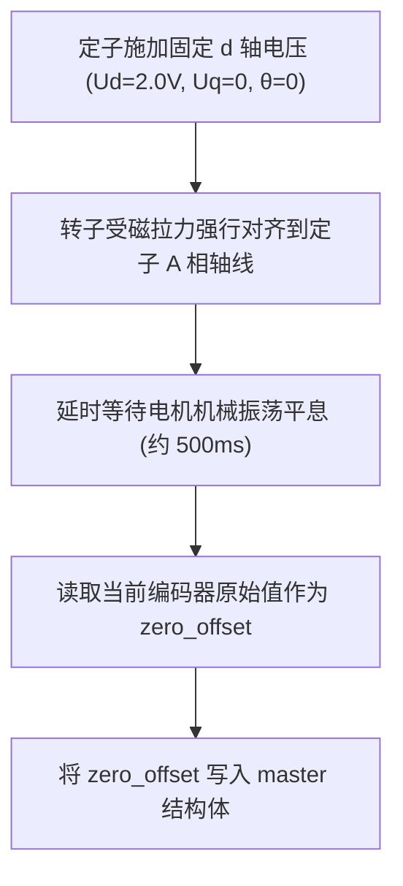

# SguanFOC v4.0.0 初学者手把手实操与源码调试指南 (Step-by-Step Practical Tutorial)

> 本指南配合 [`foc_code_analysis.md`](foc_code_analysis.md) 与 [`source_code_function_guide.md`](source_code_function_guide.md) 使用。  
> 如果说前两篇是*“数学原理与代码全景”*，那么本篇就是**“手把手带你理解嵌入式底层、配置定时器与 ADC、做实验调参、避开硬件炸管天坑的实操手册”**。  
> **面向群体**：嵌入式入门人员、自动化/电控初学者、C 语言基础一般、从未亲自动手调试过电机闭环的新手。  
> 哪怕你此前从未写过高级控制算法，只要按本指南逐步操作，也能避开各种硬件陷阱，彻底让你的电机平稳、丝滑、静音运转！

---

## 目录

- [零、前置特训：嵌入式电机控制必备 C 语言与硬件心法 (零基础必读)](#零前置特训嵌入式电机控制必备-c-语言与硬件心法-零基础必读)
  - [1. 为什么电机控制的 PWM 必须使用“中央对齐计数模式”？](#1-为什么电机控制的-pwm-必须使用中央对齐计数模式)
  - [2. 互补 PWM、死区时间 (Dead-time) 与防止 H 桥直通炸管](#2-互补-pwm死区时间-dead-time-与防止-h-桥直通炸管)
  - [3. ADC 注入通道 (Injected) 与定时器更新事件触发时序天坑](#3-adc-注入通道-injected-与定时器更新事件触发时序天坑)
  - [4. 低侧采样 (Low-side Shunt) 必须在什么时候采样电流？](#4-低侧采样-low-side-shunt-必须在什么时候采样电流)
  - [5. 结构体不透明指针 (Opaque Pointer) 的设计思想](#5-结构体不透明指针-opaque-pointer-的设计思想)
  - [6. Q 格式定点数直观图解：单片机怎么用整数冒充小数？](#6-q-格式定点数直观图解单片机怎么用整数冒充小数)
- [实验一：硬件抽象层 (UserData_Driver) 适配与开环开机测试](#实验一硬件抽象层-userdata_driver-适配与开环开机测试)
- [实验二：编码器与相序极性标定 (寻找电角度零位 Offset)](#实验二编码器与相序极性标定-寻找电角度零位-offset)
- [实验三：电流单闭环调试与 JustFloat 示波器波形观测](#实验三电流单闭环调试与-justfloat-示波器波形观测)
- [实验四：速度-电流双闭环串级控制与抗积分饱和整定](#实验四速度-电流双闭环串级控制与抗积分饱和整定)
- [实验五：利用陷波滤波器 (Nf) 消除机械共振尖叫](#实验五利用陷波滤波器-nf-消除机械共振尖叫)
- [实验六：状态机故障注入实操 (过压、过流延时与堵转保护)](#实验六状态机故障注入实操-过压过流延时与堵转保护)
- [实验七：动手修改固件——添加自定义串口指令与挂载 Patch 补丁](#实验七动手修改固件添加自定义串口指令与挂载-patch-补丁)
- [初学者常见疑难解答与开发避坑宝典 (FAQ)](#初学者常见疑难解答与开发避坑宝典-faq)

---

## 零、前置特训：嵌入式电机控制必备 C 语言与硬件心法 (零基础必读)

### 1. 为什么电机控制的 PWM 必须使用“中央对齐计数模式”？

普通 LED 调光或简单舵机使用的是**边沿对齐模式 (Edge-Aligned)**：计数器从 0 递增到 ARR，波形在前半段置高、后半段拉低。
在电机 FOC 控制中，必须开启**中央对齐模式 (Center-Aligned Mode, 向上/向下双向计数)**：

* **开关谐波抵消**：中央对齐 PWM 的波形关于载波波谷和波峰严格对称，产生的相电压纹波成奇对称，能显著消除电机绕组中的偶次谐波，大幅降低高频电磁发热与刺耳噪声。
* **为 ADC 提供极佳采样点**：在计数器达到波峰（或波谷）的瞬间，所有上桥臂（或下桥臂）的开关动作恰好处于对称中心，高频开关电磁干扰 (EMI) 最小。

---

### 2. 互补 PWM、死区时间 (Dead-time) 与防止 H 桥直通炸管

在三相逆变器中，每一相都有一个上桥臂功率管（High-side MOS）和一个下桥臂功率管（Low-side MOS）：

* **死区时间**：由于场效应管关断具有“拖尾时间”，如果上桥开启指令与下桥关断指令同时发生，会在瞬间出现上下管同时导通的物理短路（称为**直通 Shoot-through**），母线电源瞬间短路至地，直接导致 MOS 管炸裂冒烟！
* **硬件死区生成**：在配置微控制器的定时器时（如 STM32 TIM1/TIM8），必须在寄存器中配置死区时间（通常 $50\text{ns} \sim 500\text{ns}$，取决于 MOS 管的栅极驱动电荷与驱动芯片速度）。

---

### 3. ADC 注入通道 (Injected) 与定时器更新事件触发时序天坑

初学者调试 FOC 最常犯的致命错误是：在大循环 `while(1)` 中用软件轮询方式触发 ADC 采样电流。

* **致命原因**：三相逆变桥以 $20\text{kHz}$ 的高频在高速剧烈开关。在 MOS 开关瞬间，采样电阻两端存在极强的开关电压尖峰（$dV/dt$ 噪声）。如果在错误的时间点采样，采到的全是噪声尖峰，电流环必定剧烈震荡发热！
* **正确做法**：使用**定时器硬件事件自动触发 ADC 注入组 (Injected Trigger)**。配置定时器在**中央对齐波谷点 (Update Event)** 自动产生内部触发信号 TRGO，硬件触发 ADC 同步采样，完全无需 CPU 软件干预。

---

### 4. 低侧采样 (Low-side Shunt) 必须在什么时候采样电流？

对于双电阻或三电阻低侧采样硬件（采样电阻串联在下桥臂源极与地之间）：

* 只有当**下桥臂导通（即对应相输出低电平）时**，相电流才会流经采样电阻入地！如果此时上桥导通，下桥截止，采样电阻电流为零！
* 因此，电流采样的最佳时刻**只能是在七段式 SVPWM 的零矢量 $V_0(000)$ 期间**（此时三相下桥臂全部开启）。此时通过定时器硬件触发采样，才能采集到真实的三相相电流！

```
PWM 载波:  /\      /\      /\
          /  \    /  \    /  \
下管导通:  ====\  /====\  /==== (零矢量 V0 区间)
                 ↑
           ADC 硬件采样触发点 (避开所有开关毛刺)
```

---

### 5. 结构体不透明指针 (Opaque Pointer) 的设计思想

在 [`Sguan_Transfer.h`](../SguanFOC库v4.0.0(高度自由模块化foc，终阶)/Sguan_Transfer.h) 中，你经常看到：
```c
typedef struct Transfer1Data Transfer1Data; // 不透明结构体声明

typedef struct Transfer1 {
    Transfer1In in;
    Transfer1Out out;
    Transfer1Params params;
    Transfer1Data *data; // 状态指针
} Transfer1;
```
* **为什么要把 `Transfer1Data` 藏在 `.c` 文件中？**  
  在大型工程与工业库中，如果把内部状态变量（如上一步的历史输入 `i`、历史输出 `o`、离散化中间系数等）暴露在头文件中，用户写代码时可能会误写 `transfer.data->o = 0`，从而破坏滤波器稳定性。  
  通过在 `.h` 中只留不透明指针，而在 `.c` 中才给出完整定义，既保证了对外接口的纯粹（只读写 `in/out/params`），又实现了类似 C++ 的私有成员封装（Encapsulation）。

---

### 6. Q 格式定点数直观图解：单片机怎么用整数冒充小数？

在没有硬件 FPU 的单片机中，浮点数运算极慢。因此工业上采用 Q 格式定点数：

* **Q31 格式**：使用 32 位有符号整数 `int32_t`。最高位（第 31 位）是符号位，后面的 31 位全部表示小数！
* 最大正数：`0x7FFFFFFF`，对应物理浮点数 $\frac{2^{31}-1}{2^{31}} \approx 0.9999999995$；
* 最小负数：`0x80000000`，对应物理浮点数 $-1.0$；
* 小数点位置被“定”在符号位之后。两个 Q31 相乘时，本质是两个整数相乘得到 64 位整数，再右移 31 位即可恢复为 Q31。  

在 [`Sguan_IQmath.c`](../SguanFOC库v4.0.0(高度自由模块化foc，终阶)/Sguan_IQmath.c) 中，所有加减乘除均经过严格的饱和防溢出包装，初学者直接调用即可。

---

## 实验一：硬件抽象层 (UserData_Driver) 适配与开环开机测试

### 1. 实验目的

不依赖编码器和闭环算法，通过最简开环拖动，验证三相逆变硬件输出能力、相序是否正常、以及 ADC 采样是否正确工作。

### 2. 编写底层的硬件抽象函数

打开 [`UserData_Driver.c`](../SguanFOC库v4.0.0(高度自由模块化foc，终阶)/UserData_Driver.c)，根据你的单片机库（HAL库或寄存器）填入对应接口：

```c
// 1. 设置三相 PWM 占空比输出 (以 STM32 TIM1 为例)
void userdata_driver_set_pwm(uint8_t motor, 
    uint16_t du_0, uint16_t du_1, 
    uint16_t dv_0, uint16_t dv_1, 
    uint16_t dw_0, uint16_t dw_1) {
    if (motor == MOTOR_ONE) {
        TIM1->CCR1 = du_0; // U 相比较值
        TIM1->CCR2 = dv_0; // V 相比较值
        TIM1->CCR3 = dw_0; // W 相比较值
    }
}

// 2. 读取 ADC 相电流原始数值
uint16_t userdata_driver_read_iabc(uint8_t motor, uint8_t ch) {
    if (ch == CURRENT_U) return (uint16_t)ADC1->JDR1;
    if (ch == CURRENT_V) return (uint16_t)ADC1->JDR2;
    if (ch == CURRENT_W) return (uint16_t)ADC1->JDR3;
    return 0;
}

// 3. 读取母线电压 (Vbus)
SguanQ userdata_driver_read_vbus(uint8_t motor) {
    // 假设分压比为 1:11，12位 ADC 基准 3.3V
    float v_pin = (float)ADC1->DR * 3.3f / 4096.0f;
    return (SguanQ)(v_pin * 11.0f);
}
```

### 3. 开环强拖测试

在主循环中，人为生成一个随时间匀速旋转的虚拟电角度 $\theta_{fake}$，并赋予固定的测试电压 $U_q = 1.0\text{V}, U_d = 0$：
```c
float theta_fake = 0.0f;
while(1) {
    theta_fake += 0.005f; // 控制转速
    if (theta_fake > 6.283185f) theta_fake -= 6.283185f;
    
    // 手动调用反 Park 变换与 SVPWM
    // 观察电机是否能平稳转动
}
```
* **判断标准**：电机应能够稳定、低速顺畅转动。若电机剧烈发热、抖动且不旋转，请检查相线接触以及母线限流保护。

---

## 实验二：编码器与相序极性标定 (寻找电角度零位 Offset)

### 1. 实验目的

FOC 算法必须知道转子磁极在当前瞬间精确对应于哪个机械位置。通过**直流电压矢量定向法（电压对齐法）**，自动寻找编码器初始零位偏置 `real_offset`。

### 2. 实操步骤


在系统初始化钩子 [`unitlib_main_goinit0_angle_init`](../SguanFOC库v4.0.0(高度自由模块化foc，终阶)/UnitLib_main.c) 中：
```c
void unitlib_main_goinit0_angle_init(SguanFoc *sguan) {
    // 1. 给定固定的 A 相对齐电压
    sguan->foc.ualpha = 2.0f; // 依据母线电压调整，确保转子能吸合
    sguan->foc.ubeta = 0.0f;
    
    // 2. 保持 500ms
    delay_ms(500);
    
    // 3. 读取对齐后的编码器原始读数
    sguan->encoder.real_offset = userdata_driver_read_encoder(sguan->id_flag);
    
    // 4. 校准完成，切入下一阶段
    sguan->run_flag = RUN_SUCCESS;
}
```

---

## 实验三：电流单闭环调试与 JustFloat 示波器波形观测

### 1. 实验目的

打通真正的 FOC 矢量闭环，将期望力矩转化为实际相电流，并通过串口将电流波形推送到上位机实时观测阶跃响应。

### 2. 调参步骤 (PI 控制器)

1. **电流环增益理论初值估算**：
   $$K_p = L_s \cdot \omega_c$$
   $$K_i = \frac{R_s}{L_s}$$
   其中 $L_s$ 为相电感，$R_s$ 为相电阻，$\omega_c$ 为期望电流环带宽（通常取电流采样周期的 $1/10$，如 $2\pi \times 1000\text{ rad/s}$）。

2. **阶跃测试**：通过上位机串口发送 `Iq=1.0?`（给定期望 $1\text{A}$ 电流），在 JustFloat 示波器上观察 $i_q$ 的上升时间与超调量。

3. **波形评估**：  
   * 若超调超过 $15\%$ 甚至产生高频啸叫：减小 $K_p$ 或调小 $K_i$；
   * 若上升时间过缓、动态迟滞：适当增大 $K_p$。

---

## 实验四：速度-电流双闭环串级控制与抗积分饱和整定

### 1. 串级架构工作流

速度环作为外环，输入目标转速与编码器反馈转速之差，输出作为电流环的输入参考量 $I_q^*$。


### 2. 调参心法与避坑要点

* **必须保证“内快外慢”**：电流内环的响应带宽（如 $1\text{kHz}$）必须至少比速度外环（如 $50\text{Hz} \sim 100\text{Hz}$）快 5 到 10 倍，否则内外环会发生相位重叠并导致低频系统发散剧烈震荡！
* **抗积分饱和限幅**：速度环输出的 $I_q^*$ 必须设置硬限幅（如不得超过电机最大安全电流 $5\text{A}$）。

---

## 实验五：利用陷波滤波器 (Nf) 消除机械共振尖叫

在安装有减速齿轮箱或长连杆的机械结构中，系统往往存在某个固有的机械谐振点（例如 $400\text{Hz}$）。当电机转速升高激起该频率时，整个机构会发出刺耳啸叫甚至直接过流停机。

### 1. 实操消除方法

利用 [`Transfer`](../SguanFOC库v4.0.0(高度自由模块化foc，终阶)/Sguan_Transfer.c) 模块获取陷波滤波器实例并配置参数：
```c
// 1. 获取通道 0 陷波器单例
Nf *my_notch = transfer_nf_get(MOTOR_ONE, 0);

// 2. 配置共振陷波频率与阻尼比
my_notch->params.wo = 2.0f * 3.14159265f * 400.0f; // 消除 400Hz 机械共振峰
my_notch->params.zeta = 0.15f;                     // 陷波深度
my_notch->params.t = 0.00005f;                     // 控制周期 50μs

// 3. 初始化并串联在速度环输出与电流环输入之间
transfer_nf_init(my_notch);
```
在每次速度环循环中：
```c
my_notch->in.input = speed_pid_output;
transfer_nf_loop(my_notch);
target_iq = my_notch->out.output; // 滤波后的平滑电流指令
```
* **效果体验**：共振频点能量被精确吸收消除，刺耳机械尖叫瞬间消失，传动机构平稳运行！

---

## 实验六：状态机故障注入实操 (过压、过流延时与堵转保护)

[`Sguan_MotorStatus.c`](../SguanFOC库v4.0.0(高度自由模块化foc，终阶)/Sguan_MotorStatus.c) 内置了完备的工业保护网。初学者可通过模拟异常数据测试其防护能力：

### 1. 瞬时过流 vs 持续延时过流保护测试

在 [`UnitLib_main.c`](../SguanFOC库v4.0.0(高度自由模块化foc，终阶)/UnitLib_main.c) 的低频循环中，故意将电流参数修改：
```c
sguan->motorstatus.data.ibus_instant_max = 10.0f; // 瞬时硬切断 10A
sguan->motorstatus.data.ibus_stable_max = 3.0f;   // 持续运行限流 3A
sguan->motorstatus.data.ibus_tick_delay = 500;    // 允许短时过载 500ms
```
1. **测试 A**：手动快速卡死电机转轴，使母线电流达到 $4\text{A}$（大于稳定值但小于极限值）。观察系统是否在精确坚持 500ms 后平稳切断 PWM 并置错误码 `0x03`。
2. **测试 B**：短路两相引脚瞬间触发超过 $10\text{A}$，观察系统是否在微秒级瞬间保护切断，没有烧毁任何元件。

---

## 实验七：动手修改固件——添加自定义串口指令与挂载 Patch 补丁

### 1. 添加一条名为 `Power` 的自定义指令

打开 [`UnitLib_UserControl.h`](../SguanFOC库v4.0.0(高度自由模块化foc，终阶)/UnitLib_UserControl.h)：
```c
// 1. 声明回调函数
void unitlib_usercontrol_power(float value);

// 2. 将新指令加入字典 cmd_dict
static CmdMap cmd_dict[] = {
    {"MOTOR",       0, unitlib_usercontrol_motor},
    {"Speed",       0, unitlib_usercontrol_speed},
    {"Position",    0, unitlib_usercontrol_position},
    {"Power",       0, unitlib_usercontrol_power}, // 新增指令
    // ...
};
```
在 [`UnitLib_UserControl.c`](../SguanFOC库v4.0.0(高度自由模块化foc，终阶)/UnitLib_UserControl.c) 中实现逻辑：
```c
void unitlib_usercontrol_power(float value) {
    if (value > 0.5f) {
        // 开机启动电机
        sguanfoc[0].run_flag = RUN_READY;
    } else {
        // 安全停机
        sguanfoc[0].run_flag = RUN_STANDBY;
    }
}
```
通过串口助手发送 `Power=1?`，系统将自动利用 DJB2 哈希在几个机器周期内精确命中并执行开机！

---

## 初学者常见疑难解答与开发避坑宝典 (FAQ)

### Q1: 上电后电机不转，只是轻微抖动并发出低沉的“嗡嗡”声，为什么？

* **排查 1**：电角度零位 Offset 标定错误。重新做实验二的直流电压对齐标定。
* **排查 2**：编码器方向与电机旋转方向相反（反接）。若电机正转而编码器角度递减，闭环会形成**正反馈飞车**。在配置中翻转 `encoder_dir = -1`。
* **排查 3**：极对数 `poles` 设置错误。例如 7 对极电机误设成了 14，导致电角度计算频率快了一倍。

### Q2: 电机高速运转时发出刺耳的高频“嗞嗞”电磁啸叫？

* **排查 1**：PWM 载波频率过低（如设在 $8\text{kHz}$，位于人耳最敏感的听觉频段）。将载波频率提升至 $16\text{kHz} \sim 25\text{kHz}$，立刻实现完全人耳静音。
* **排查 2**：电流环比例增益 $K_p$ 过大，高频噪声被过度放大注入到了 PWM 占空比中。适当调小 $K_p$ 或加大微分低通滤波时间常数。

### Q3: 为什么开环运行正常，一切到闭环就瞬间触发过流保护？

* **排查 1**：ADC 采样偏置零点 (Offset) 没校准。开机在电机静止未发波时，运放输出的真实电压应为 1.65V（对应 12 位 ADC 计数值约 2048）。若开机未采集该偏置并减去它，控制器会误以为有巨大直流电流流过，立刻触发过流保护。
* **排查 2**：三相相电流采样顺序与电机三相接线不匹配（如 A 相采到了 B 相电流）。对调相线或在代码中交换电流通道编号。
