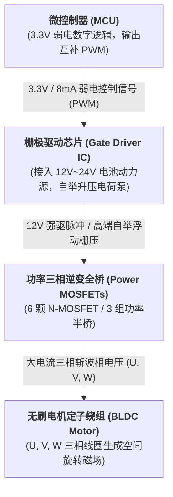
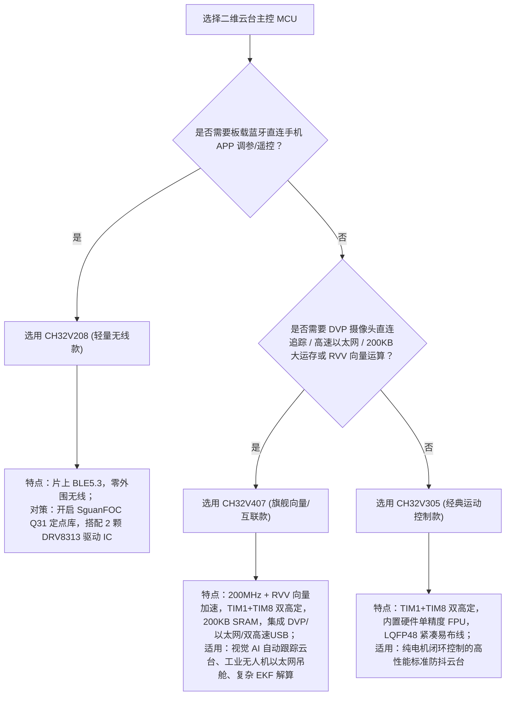
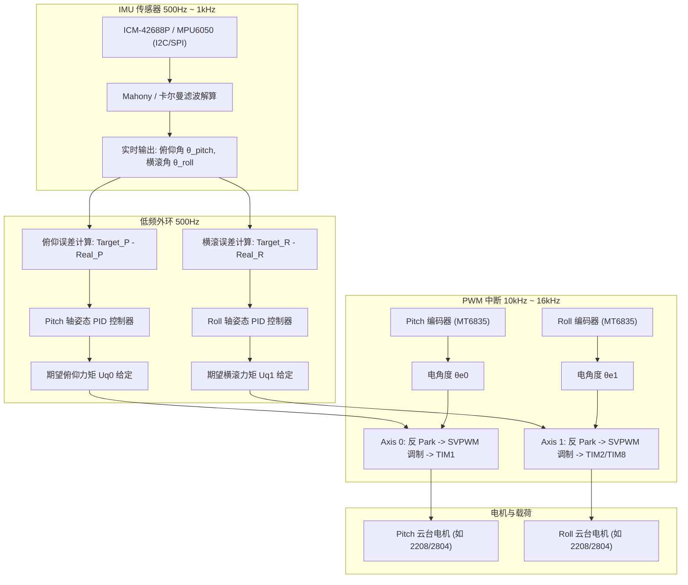
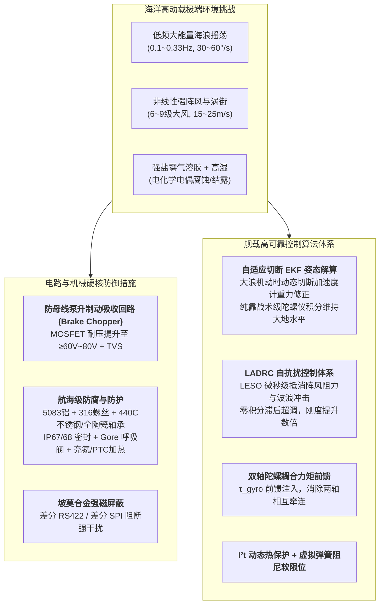

# SguanFOC v4.0.0 单 MCU 双电机二维云台开发方案全景指南

> **文档定位**：本文档针对使用 **SguanFOC 库 v4.0.0 (高度自由模块化，终阶)**，基于单颗微控制器 (MCU) 构建高性能二维无刷云台（Pitch 俯仰轴 + Roll 横滚轴 / Yaw 偏航轴）提供全套软硬件落地设计方案。  
> 深入剖析 **CH32V208**、**CH32V305** 与 **CH32V407** 的核心特性，澄清“高级定时器与驱动芯片”的硬件认知误区，并提供开箱即用的工程配置与避坑要点。

---

## 一、核心硬件概念澄清：为什么有高级定时器依然必须外挂驱动芯片？

很多刚接触嵌入式电机控制的初学者常常产生一个误解：
> **“MCU 内部都有 2 个高级定时器可以输出互补死区 PWM 了，那是不是就可以直接连电机，无需外挂驱动芯片了？”**

**明确结论：绝对不行！无论 MCU 有多少个高级定时器，都必须外挂驱动芯片（或功率级逆变桥）。**

### 1.1 核心原因：逻辑控制与大功率电平的本质鸿沟

| 对比维度 | MCU GPIO 引脚 (TIMx PWM 输出) | 无刷云台电机绕组需求 |
| :--- | :--- | :--- |
| **电压等级** | **3.3V**（数字逻辑高电平） | **12V ~ 24V**（锂电池供电电压） |
| **驱动电流** | 仅 **8mA ~ 25mA**（超过将烧毁芯片引脚） | **0.3A ~ 3A+**（甚至启动冲击达 5A） |
| **功率容量** | 毫瓦级 ($P < 0.08\text{W}$) | 瓦级至数十瓦 ($P = 5\text{W} \sim 50\text{W}$) |
| **高端管驱动** | 无法提供高于母线电压的自举升压 | 上桥臂 N-MOS 导通需栅极电压达到 **$V_{bus} + 10\text{V}$** |



### 1.2 高级定时器的真正职责是什么？

高级定时器（如 TIM1、TIM8）的价值在于**产生精确的微秒级逻辑时序**：

1. **硬件死区发生器 (Dead-time)**：在控制上下两颗 MOSFET 切换时，强制插入数百纳秒的关断等待期，**防止上下管同时导通引发直通短路炸机**。
2. **中心对齐与互补输出 (Complementary PWM)**：硬件自动反相输出 CHx 与 CHxN。
3. **紧急刹车输入 (BKIN)**：外部发生硬件过流时，硬件在纳秒级直接切断输出，无需等待 CPU 软件中断响应。

### 1.3 驱动芯片的分类与选型区别

| 芯片类型 | 代表型号 | 内部集成度 | 适用场景 | 对 MCU 定时器的要求 |
| :--- | :--- | :--- | :--- | :--- |
| **三相一体化功率集成 IC** | **DRV8313** / **MP6536** / **L6234** | **集成预驱 + 6颗功率 MOSFET + 硬件死区控制** | 云台小电机、微型舵机、相机防抖 | **极低**：只需 3 路普通单端 PWM 输入，芯片内部自动产生死区和互补 |
| **三相栅极驱动器 (预驱 IC)** | **FD6288** / **EG2133** / **MP6540** | 仅含自举升压与电平转换，需外挂 6 颗独立 N-MOS | 工业大扭矩电机、机械臂关节、无人机电调 | **高**：需要 6 路互补 PWM，严格依赖 MCU 高级定时器产生死区 |

> [!IMPORTANT]
> **结论**：
>
> * **MCU 的高级定时器解决的是“逻辑控制和防短路安全时序”；**  
> * **驱动芯片解决的是“高压能量转换、强电流供给与 MOSFET 导通电平位移”。两者各司其职，缺一不可！**

---

## 二、MCU 选型全景横评：CH32V208 vs CH32V305 vs CH32V407

在单 MCU 驱动双轴云台的方案设计中，微控制器芯片选型直接决定了外围驱动拓扑、闭环算法运算上限、通信调参方式以及整机系统架构。WCH（沁恒）旗下的 **CH32V208**（无线轻量款）、**CH32V305**（经典高算力双高定款）与新一代旗舰 **CH32V407**（200MHz RVV 向量计算/工业互联款）各有侧重。

### 2.1 详细规格参数对照表

| 硬件规格 | CH32V208 (轻量无线款) | CH32V305 (经典双高定款) | CH32V407 (旗舰向量/互联款) | 对双轴云台的影响与分析 |
| :--- | :--- | :--- | :--- | :--- |
| **内核架构** | 32 位 RISC-V 青稞 **V4C** | 32 位 RISC-V 青稞 **V4F** | 32 位 RISC-V 青稞 **V3V / V4V (支持 RVV 向量扩展)** | V407 搭载 RISC-V 向量扩展指令集 (RVV)，单指令可并行处理多维矢量变换与滤波，算力处于天花板级别 |
| **最高主频** | 144 MHz | 144 MHz | **200 MHz** (零等待运行) | 200MHz 带来更充裕的中断执行窗口，双轴 20kHz~30kHz 极速发波同时可留出巨大算力运行 1kHz 姿态解算与高阶滤波 |
| **硬件 FPU (浮点)** | ❌ **无硬件 FPU** | ✅ **内置硬件单精度 FPU (RV32IMAFC)** | ✅ **内置硬件 FPU + RVV 向量引擎 (Zve32f/Zve64x)** | **重大差异**：V305/V407 直接执行原生 float，V407 进一步支持向量加速；V208 需开启 SguanFOC 的 `CONFIG_IQMATH` Q31 定点数学 |
| **高级定时器数量** | **1 个** (仅 TIM1) | **2 个** (**TIM1 + TIM8**) | **2 个** (**TIM1 + TIM8**) | **重大差异**：V305/V407 可同时输出两套带硬件死区的 6 路互补 PWM（共 12 路）；V208 仅一套，第 2 轴必须借用通用定时器 |
| **通用/基本定时器** | 4 个 (TIM2~TIM5) | 4 个 (TIM2~TIM5) | 4 个通用 (TIM2~TIM5) + 2 个基本 (TIM6/TIM7) 等多组 | 均可用于单端 PWM、测速、编码器正交解码与基准时钟，V407 资源最充沛 |
| **ADC 模拟资源** | 2 × 12 位 ADC (16 通道，支持注入) | 2 × 12 位 ADC (16 通道，支持双重/注入) | 2 × 12 位高速 ADC (多通道，支持双重/注入) + 2 × DAC + 运放 OPA | 均支持相电流与母线电压采样；V407 内部集成 OPA 可做微弱电流差分采样，无需外部运放 |
| **SRAM / Flash** | 64KB SRAM / 128KB Flash | 32KB SRAM / 128KB Flash | **200KB SRAM / 512KB Flash** | **存储优势巨大**：V407 拥有 200KB 超大 SRAM，可开辟大容量离线运动规划缓冲区、整机状态黑匣子，甚至嵌入轻量端侧视觉模型 |
| **通信与特色接口** | ✅ **片上集成 2.4G RF + BLE 5.3 蓝牙** | 双路 USB 2.0 高速 PHY (480Mbps) + CAN 2.0B | ✅ **10/100M 以太网 MAC+PHY** + **双高速 USB PHY** + **DVP 摄像头接口** + LTDC + CAN 2.0B | **分水岭特征**：V208 无线手持零外围；V305 紧凑易布线；V407 可打造“**视觉直连跟踪云台**”（DVP 接入传感器）或无人机高速图传/以太网工业吊舱 |
| **封装体积** | QFN28 / QFN64 / LQFP64 | LQFP48 / LQFP64M | QFN68 / LQFP64 / LQFP100 | V208 的 QFN28 与 V305 的 LQFP48 体积极小；V407 适合功能聚合型高阶主板 |

### 2.2 三大 MCU 在二维云台中的定位画像

#### 1. CH32V208：无线轻量手持云台首选

* **核心优势**：片上自带 BLE 5.3 蓝牙与 2.4G 射频，无需任何外部通信模组即可直连手机 APP 调参或无线遥控手柄；支持 QFN28 极小封装，占板面积微小。
* **妥协与对策**：仅 1 个高级定时器，第 2 轴无法输出硬件死区互补波，因此**强烈建议搭配 2 颗集成式三相驱动芯片（如 DRV8313）**；无硬件 FPU，需在 SguanFOC 中启用 `CONFIG_IQMATH 1`（Q31 定点运算）。

#### 2. CH32V305：经典纯运动控制云台的黄金标杆

* **核心优势**：具备完整的 **TIM1 + TIM8 两个高级定时器**，能独立输出两组 6 路带死区的互补 PWM；拥有硬件单精度 FPU，直接使用原生 `float` 运算；LQFP48 封装紧凑易布线。
* **适用场景**：标准的相机防抖云台、微型双轴机械臂台面，既可搭配集成驱动芯片（DRV8313），也可搭配分立大功率 MOS 预驱（FD6288/EG2133）。

#### 3. CH32V407：新一代旗舰算力 / 视觉追踪与工业互联重载云台

* **核心优势**：

  1. **200MHz + RVV 向量运算引擎**：青稞 V3V 内核支持 RISC-V Vector 向量扩展指令（RVV），多维矢量运算、Clarke/Park 变换与高阶扩展卡尔曼滤波 (EKF) 可并行执行，算力充沛到极致；
  2. **200KB SRAM + 512KB Flash 超大存储**：轻松容纳复杂轨迹规划算法、高速数据记录黑匣子、甚至 FreeRTOS / RT-Thread 完整协议栈；
  3. **丰富的高速工业级接口**：内置 **DVP 摄像头数字接口**（可单芯片直连图像传感器实现目标自检测跟踪）、**10/100M 以太网 MAC+PHY**、**双高速 USB 2.0 PHY**、CAN 2.0B，打造一体化“**视觉 AI 追踪云台**”或高带宽无人机工业级吊舱。
* **适用场景**：需要单 MCU 同时负责“图像采集/目标追踪 + 双轴 FOC 伺服”、无人机以太网吊舱、以及需跑复杂运动学解算与大电流分立功率级的重载工业云台。

### 2.3 驱动芯片与三款 MCU 的拓扑兼容性矩阵

| 驱动芯片方案 | CH32V208 | CH32V305 | CH32V407 | 选型建议 |
| :--- | :---: | :---: | :---: | :--- |
| **2 颗 DRV8313 / MP6536**<br>(三相集成芯片，3路单端PWM输入) | 完美契合<br>(TIM1 + TIM2) | 完美契合<br>(TIM1 + TIM2/TIM8) | 完美契合<br>(TIM1 + TIM2/TIM8) | 手持轻型云台首选，引脚少、走线简单、不易炸机 |
| **2 颗 FD6288 / EG2133 + 12 颗独立 MOS**<br>(分立预驱，需要两套 6 路互补死区 PWM) | ❌ **不推荐/受限**<br>(仅1个高定，第2轴无硬件死区) | 完美契合<br>(TIM1 + TIM8 双高定) | 完美契合<br>(TIM1 + TIM8 双高定，200MHz微秒级精准死区) | 大扭矩/大功率重载云台必选方案 |

### 2.4 选型决策树



---

## 三、二维云台全景控制架构设计



---

## 四、硬件推荐拓扑与引脚连接方案

### 4.1 方案 A（极简黄金组合：CH32V208 / V305 / V407 + 2 颗 DRV8313）

针对绝大多数手持稳定器、云台防抖相机，最稳定、最容易布线且不易损坏的硬件架构：

* **主控**：CH32V208 (轻量蓝牙)、CH32V305 (经典双高定) 或 CH32V407 (旗舰向量/高速互联)
* **驱动芯片**：2 颗 TI **DRV8313**（每颗内部集成 3 个半桥，自带内部死区和过流自愈，3 根 PWM 即可控制）
* **角度传感器**：2 颗 **MT6835** 磁编码器（16位高精度绝对值，SPI 挂在同组总线，独立 CSN）
* **姿态传感器**：1 颗 **ICM-42688P**（6 轴超低噪声 IMU，挂在 I2C1）

#### 引脚分配表：

| 功能模块 | 引脚分配 | 说明 |
| :--- | :--- | :--- |
| **Pitch 电机 PWM** | `PA8 (TIM1_CH1)`, `PA9 (TIM1_CH2)`, `PA10 (TIM1_CH3)` | 连接到 Driver0 (DRV8313) 的 IN1, IN2, IN3 |
| **Pitch 电机使能** | `PB12 (GPIO_Output)` | 连接到 Driver0 的 nSLEEP / EN |
| **Roll 电机 PWM** | `PA0 (TIM2_CH1)`, `PA1 (TIM2_CH2)`, `PA2 (TIM2_CH3)` *(或 TIM8)* | 连接到 Driver1 (DRV8313) 的 IN1, IN2, IN3 |
| **Roll 电机使能** | `PB13 (GPIO_Output)` | 连接到 Driver1 的 nSLEEP / EN |
| **双编码器 SPI 总线** | `PA5 (SPI1_SCK)`, `PA6 (SPI1_MISO)`, `PA7 (SPI1_MOSI)` | 两个 MT6835 并联共用时钟与数据线 |
| **Pitch 编码器片选** | `PA4 (CS0)` | 低电平选通 Pitch 轴角度读取 |
| **Roll 编码器片选** | `PB0 (CS1)` | 低电平选通 Roll 轴角度读取 |
| **IMU 姿态传感器** | `PB6 (I2C1_SCL)`, `PB7 (I2C1_SDA)` | 读取 6 轴陀螺仪加速度角速度 |
| **串口调试 / 遥测** | `PA2 (USART2_TX)`, `PA3 (USART2_RX)` | 接入 VOFA+ 示波器或上位机调参 |

---

## 五、SguanFOC v4.0.0 库双电机配置与落地代码

### 步骤 1：修改 `Sguan_Config.h`

打开 [`Sguan_Config.h`](file:///e:/github.Prj/FOC/SguanFOC_Library/SguanFOC库v4.0.0(高度自由模块化foc，终阶)/Sguan_Config.h)：
```c
// 1. 设置电机数量为 2
#define CONFIG_MOTOR           2   // 轴 0: Pitch，轴 1: Roll

// 2. 根据 MCU 选型配置数学运算模式
#if defined(CH32V208)
    #define CONFIG_IQMATH      1   // V208 无硬件 FPU，强制开启 Q31 定点运算，大幅提升效率
#elif defined(CH32V305) || defined(CH32V407)
    #define CONFIG_IQMATH      0   // V305 / V407 具备硬件 FPU，直接使用原生 float (V407 亦可调用 RVV 向量加速)
#endif

// 3. 配置控制器池规模
#define CONFIG_PID             4   // 足够容纳双轴多环 PID
```

### 步骤 2：在 `UserData_Driver.c` 中分发双轴硬件操作

打开 [`UserData_Driver.c`](file:///e:/github.Prj/FOC/SguanFOC_Library/SguanFOC库v4.0.0(高度自由模块化foc，终阶)/UserData_Driver.c)：

```c
// 1. 双轴 PWM 占空比寄存器分发写入
void userdata_driver_set_pwm(uint8_t motor, float a, float b, float c) {
    if (motor == 0) {
        // Axis 0 (Pitch 轴): 写入 TIM1
        TIM1->CH1CVR = (uint32_t)(a * TIM1->ATRLR);
        TIM1->CH2CVR = (uint32_t)(b * TIM1->ATRLR);
        TIM1->CH3CVR = (uint32_t)(c * TIM1->ATRLR);
    } else if (motor == 1) {
        // Axis 1 (Roll 轴): 写入 TIM2 (或 V305 / V407 的 TIM8)
        #if defined(USE_CH32V305_TIM8) || defined(USE_CH32V407_TIM8)
        TIM8->CH1CVR = (uint32_t)(a * TIM8->ATRLR);
        TIM8->CH2CVR = (uint32_t)(b * TIM8->ATRLR);
        TIM8->CH3CVR = (uint32_t)(c * TIM8->ATRLR);
        #else
        TIM2->CH1CVR = (uint32_t)(a * TIM2->ATRLR);
        TIM2->CH2CVR = (uint32_t)(b * TIM2->ATRLR);
        TIM2->CH3CVR = (uint32_t)(c * TIM2->ATRLR);
        #endif
    }
}

// 2. 双轴 SPI 磁编码器片选轮询读取
SguanQ userdata_driver_read_encoder(uint8_t motor) {
    uint16_t raw_data = 0;
    
    if (motor == 0) {
        // 选中 Pitch 编码器 (CS0)
        GPIO_ResetBits(GPIOA, GPIO_Pin_4);
        raw_data = SPI_ReadWrite16(SPI1, 0xFFFF);
        GPIO_SetBits(GPIOA, GPIO_Pin_4);
    } else {
        // 选中 Roll 编码器 (CS1)
        GPIO_ResetBits(GPIOB, GPIO_Pin_0);
        raw_data = SPI_ReadWrite16(SPI1, 0xFFFF);
        GPIO_SetBits(GPIOB, GPIO_Pin_0);
    }
    
    // 扣除高位标志，提取 14 位有效角度并归一化为 [0, 2*PI)
    float rad = (float)(raw_data & 0x3FFF) * (6.283185307f / 16384.0f);
    
    #if CONFIG_IQMATH
    return iqmath_from_float(rad, 6.283185307f);
    #else
    return rad;
    #endif
}
```

### 步骤 3：双频控制循环协同主框架

在工程主代码 `main.c` 中：

```c
// 1. 高频 PWM 中断服务函数 (10kHz ~ 16kHz)
void TIM1_UP_IRQHandler(void) __attribute__((interrupt("WCH-Interrupt-fast")));
void TIM1_UP_IRQHandler(void) {
    if (TIM_GetITStatus(TIM1, TIM_IT_Update)) {
        TIM_ClearITPendingBit(TIM1, TIM_IT_Update);
        
        // 依次执行轴 0 与轴 1 的高频电流/电压矢量解算
        high_loop_0(); // Pitch 轴快速发波
        high_loop_1(); // Roll 轴快速发波
    }
}

// 2. 低频主线程大循环 (姿态解算与外环控制)
int main(void) {
    Hardware_Init();     // 外设定时器、SPI、I2C 初始化
    SguanFOC_Init();      // SguanFOC 核心库双轴初始化
    
    // 启动前执行电角度初始对齐标定
    unitlib_main_goinit0_angle_init(&sguanfoc_inst[0]);
    unitlib_main_goinit0_angle_init(&sguanfoc_inst[1]);

    while (1) {
        // 500Hz 周期性读取 IMU 姿态
        if (systick_flag_500hz) {
            systick_flag_500hz = 0;
            
            // 姿态解算
            IMU_UpdateAttitude(&current_pitch, &current_roll);
            
            // 姿态外环 PID 计算目标力矩 Uq
            float uq_pitch = PID_Calculate(&pid_pitch, target_pitch - current_pitch);
            float uq_roll  = PID_Calculate(&pid_roll,  target_roll  - current_roll);
            
            // 注入至 SguanFOC 核心
            unitlib_usercontrol_uq_axis(0, uq_pitch);
            unitlib_usercontrol_uq_axis(1, uq_roll);
        }
        
        // 轮询双轴状态机与保护机制
        main_loop_0();
        main_loop_1();
    }
}
```

---

## 六、调机实战与避坑指南 (SOP)

### 避坑点 1：云台电机相序与编码器正反向一致性

* **现象**：开启闭环瞬间，电机剧烈飞车狂转或产生刺耳尖叫。
* **排查**：电机的电气正向必须与磁编码器的角度递增方向一致。若不一致，互换电机任意两根相线（如 U 与 V），或者在代码中取 `angle = 2*PI - raw_angle`。

### 避坑点 2：电角度零位偏移标定与 Flash 固化

* **要点**：FOC 控制必须准确知道转子永磁体磁极与编码器零位的相位偏差 `zero_electric_angle`。
* **流程**：装机完成后，调用一次零位自对齐函数，记录控制台打印出的零偏值，直接固化写入芯片内部 Flash，避免每次上电电机晃动寻零损坏云台挂载的相机镜头。

### 避坑点 3：机械高频啸叫消除 (充分利用 SguanFOC 陷波器)

* **要点**：云台机械臂通常具有薄弱结构，速度环增益拔高时易激发结构共振（约 600Hz~1200Hz 啸叫发烫）。
* **对策**：无需无休止调低 PID，调用 SguanFOC 库内建的 [`transfer_nf_loop()`](file:///e:/github.Prj/FOC/SguanFOC_Library/commit/html_docs/code_walkthrough.html#sguan_transfer_c) 陷波滤波器，将中心频率设置为啸叫点频率，共振瞬间消除，刚性显著提升！

---

---

## 七、恶劣海况与舰载高动载工况：双轴云台软硬件全景避坑实战

在**高海况 (4~6 级恶劣海况)**或无人快艇 (USV)、巡逻舰艇光电吊舱应用中，双轴云台所处的力学动态冲击与电磁/腐蚀环境极为恶劣。普通陆用或手持稳定器方案在此环境下往往在一周内就会出现“大浪打偏、视场假倾斜、MOS 击穿、轴承锈死、机体电偶腐蚀溃烂”。



### 7.1 硬件电路与驱动拓扑避坑清单

1. **驱动芯片与 MOSFET 耐压储备：警惕“母线泵升电压 (Bus Pumping)”**  
   * **致命陷阱**：在海浪剧烈冲击外拖镜头时，电机频繁处于**反向发电制动（四象限运行）**状态。巨大的动能转化为电能倒灌进供电母线，使母线电压瞬间从 24V 飙升至 45V 甚至更高。若采用耐压仅 36V 的常规集成芯片（如普通 DRV8313），上电拍浪几次即被高压瞬间击穿烧毁。
   * **防范方案**：

     * **MOSFET 耐压选型**：必须选用耐压 **$\ge 60\text{V} \sim 80\text{V}$** 的功率管（如采用 FD6288 预驱 + 60V 独立 N-MOS，或使用工业级 MP6540H）；
     * **硬件防泵升放电回路 (Brake Chopper)**：在母线端必须布局大容量低 ESR 固态电解电容阵列 + 高压大功率 TVS 管，并配置由一颗大功率 N-MOS 与铝壳制动电阻组成的**硬件能量泄放回路**，当母线电压超过保护阈值时自动斩波放电，保护驱动级安全。

2. **磁编码器强电磁屏蔽与差分抗扰**  
   * **致命陷阱**：钢铁船体结构、船用柴油发电机、大功率高频通信电台与雷达发射机会发射极强的空间电磁脉冲与杂散磁场，使基于霍尔原理的绝对值磁编码器感应到数度的伪角度畸变。
   * **防范方案**：

     * 磁编码器芯片背部与侧方必须安装 **坡莫合金 (Mu-metal) 或软铁高导磁屏蔽罩**；
     * 编码器与主控 MCU 之间的通信连接**严禁使用单端 I2C 或普通单端长排线**，必须选用 **RS422 硬件差分电平** 或 **差分 SPI / BiSS-C** 总线传输。

3. **机械结构防腐与“电偶腐蚀”防范**  
   * **致命陷阱**：**严禁将普通镀锌碳钢螺栓拧入铝合金悬臂中！** 在高盐雾电解质环境中，铝与碳钢接触电位差大，会形成微原电池引发剧烈的**电偶腐蚀 (Galvanic Corrosion)**，螺纹一周内就会锈烂酥松。
   * **防范方案**：

     * 结构悬臂必须选用 **航海级 5083 或 6061-T6 铝合金**，表面做 **厚度 $\ge 30\mu\text{m}$ 的硬质阳极氧化 + 盐雾封闭处理**，或耐蚀碳纤维复合材料；
     * 所有连接紧固螺栓统一指定 **316 / 316L 航海级不锈钢螺栓**，配合中强度螺纹锁固胶（Loctite 243）防止 20G 跳浪冲击震脱；
     * 轴承必须选用 **440C 不锈钢深沟球轴承** 或 **氧化锆 ($ZrO_2$) 全陶瓷轴承**，配置 **双面接触式丁腈橡胶骨架密封圈 (2RS)**，并封填耐海水冲刷的 **全氟聚醚 (PFPE) 氟素长效润滑脂**。

4. **整机防水、防结露与微气压平衡**  
   * 整机外壳密封必须达到 **IP67 / IP68** 级别；
   * 机壳上必须安装 **Gore 防水透气阀 (呼吸阀)**，动态平衡昼夜温差引起的内外压差，杜绝负压吸入湿气；
   * 相机镜头密封腔体内出厂充干燥高纯氮气，或在透镜边缘内嵌 PTC 微型恒温加热片，自动除雾。

---

### 7.2 软件控制算法关键细节与避坑要点

1. **姿态解算第一大坑：“重力对准陷阱”与动态自适应 EKF 切换**  
   * > [!CAUTION]
     > **在恶劣海况与机动舰船上，绝不可直接用加速度计实时校正倾角！**
   * **物理机理**：在陆地静止时加速度计仅受地心引力 $1.0g$，常用来修正陀螺仪的积分零偏；但在恶劣海况下，船只受横风拍浪碰撞、高速转弯时，**向心加速度与侧向切向冲击加速度高达数个 G**。此时加速度计测得的合加速度方向严重偏离地心垂线！
   * **致命后果**：若姿态融合算法盲目信任加速度计，云台会误把海浪向心加速度当作重力方向，导致画面剧烈倒向波浪一侧，产生严重的“假倾斜翻滚”。
   * **落地对策：动态自适应 $R$ 矩阵切换**：  
     实时监测加速度计测量向量模长 $\|\mathbf{a}_{meas}\|$：  

     * 当 $\left| \|\mathbf{a}_{meas}\| - 1.0g \right| > 0.05g$ 时，判定载体正处于拍浪机动与波浪冲击状态，瞬间将扩展卡尔曼滤波 (EKF) 中的加速度计测量噪声协方差 $R_{acc}$ 放大 $10^6$ 倍（或直接临时切断加速度测量更新），**完全依靠低噪声宽温区战术级陀螺仪高频纯积分维持绝对大地姿态**；
     * 仅在海浪平稳段（$\|\mathbf{a}_{meas}\| \approx 1.0g$ 持续数百毫秒）才开启微弱的倾角收敛修正。

2. **地磁计 (Compass) 彻底禁用**  
   * 钢铁船体、大功率柴油机、船载雷达与强电缆产生极强的动态磁畸变，地磁计无法作为有效航向参考。绝对航向必须由**母船系统通过 CAN/串口广播的双天线 GNSS-RTK 差分定向航向角**提供，或由云台内置陀螺仪短时纯积分维持。

3. **算法全面升级为 LADRC 替代传统 PID**  
   * 海浪能量主要集中在 $0.1\sim 0.33\text{Hz}$ 的低频大波长涌浪，并伴随剧烈的突发强阵风。传统 PID 的积分项在大浪下严重饱和滞后（Windup），在波浪越过顶点回摆时释放巨大能量引发“鞭尾甩动”超调；若减小积分项，强风阻下又会产生视场下垂（Droop）。
   * 速度环与位置环全面部署 **LADRC (线性自抗扰)**：二阶/三阶线性扩张状态观测器 (LESO) 将海浪力矩、风阻与未建模摩擦统一实时估计为“总扰动 $f(t)$”，并在控制量中前馈反向抵消，**实现零积分超调、零下垂与超强动态抗浪刚度**。

4. **双轴陀螺力矩交叉解耦前馈**  
   * 实时采集机架横滚角速度 $\omega_{roll}$ 与俯仰角速度 $\omega_{pitch}$，计算交叉陀螺力矩：
     $$\boldsymbol{\tau}_{gyro\_pitch} = J_{roll} \cdot \omega_{roll} \cdot \omega_{base\_yaw}, \quad \boldsymbol{\tau}_{gyro\_roll} = J_{pitch} \cdot \omega_{pitch} \cdot \omega_{base\_yaw}$$
     
   * 将该解耦力矩作为前馈直接注入 SguanFOC 电流环，在物理层面上切断双轴机械动力学相互牵连。

5. **电磁热模型保护 ($I^2t$) 与虚拟软限位**  
   * 电机长时间对抗强风大浪时，相电流长期工作在额定上限。软件必须内置 **$I^2t$ 连续发热模型**，防止绕组高温烧毁或永磁体退磁；
   * 在角位移逼近极限行程前 $5^\circ$，激活 **虚拟非线性弹簧-阻尼算法 (Virtual Spring-Damper)** 施加平滑缓冲力矩，杜绝大浪冲击下悬臂硬撞机械限位导致机构形变或码盘碎裂。

---

## 八、总结

1. **CH32V407 是旗舰级全能平台**：具备 **200MHz 极致主频、青稞 RISC-V RVV 向量扩展、TIM1 + TIM8 双高级定时器、200KB SRAM 与片上 DVP/以太网/双高速 USB**，可实现“单 MCU 同时搞定视觉目标跟踪 + 双轴高频 FOC”，是端侧 AI 视觉追踪与工业级吊舱的首选。
2. **CH32V305 是纯电机闭环的性价比标杆**：具备 **TIM1 + TIM8 双高级定时器与硬件单精度 FPU**，封装紧凑（LQFP48），非常适合纯浮点运算与分立 MOS 预驱搭建的经典相机防抖云台。
3. **CH32V208 是无线手持一体化利器**：虽仅 1 个高级定时器且无硬件 FPU，但凭借 **片上集成 BLE 5.3 蓝牙与 QFN28 极小封装**，配合 SguanFOC 的 Q31 定点库与 2 颗 DRV8313 驱动 IC，省去外部蓝牙模块与走线，是超紧凑无线手持稳定器的最优解。
4. **核心防翻车准则**：“高级定时器”输出的仅是微安级的 3.3V 逻辑电平，无论选用何种 MCU，均必须合理搭配功率驱动芯片（三相一体化 IC 或栅极预驱半桥）！

