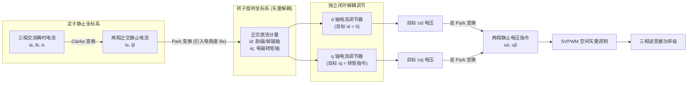
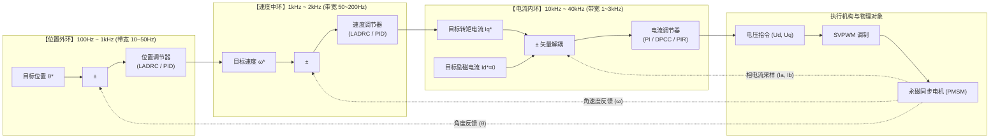
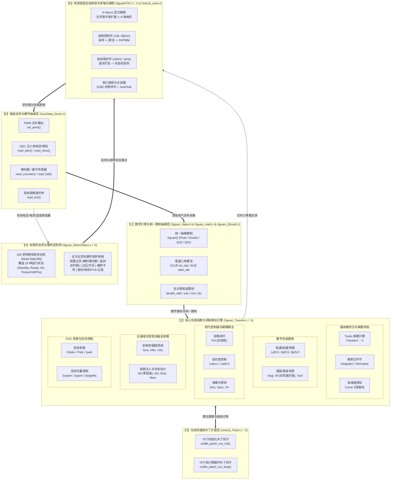
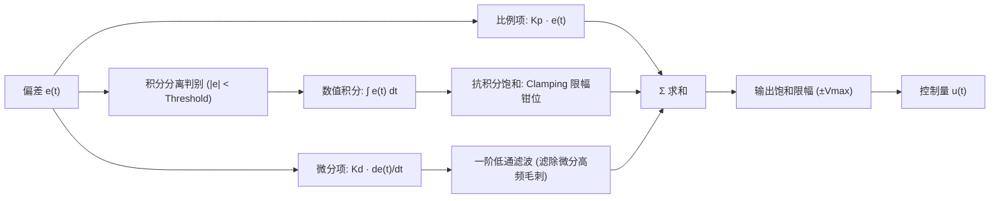
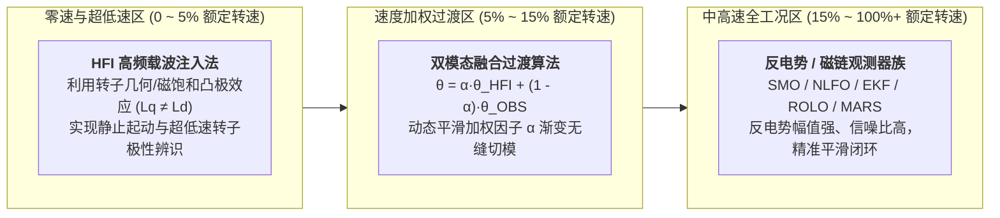
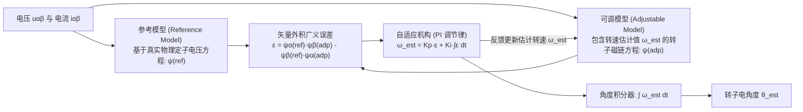
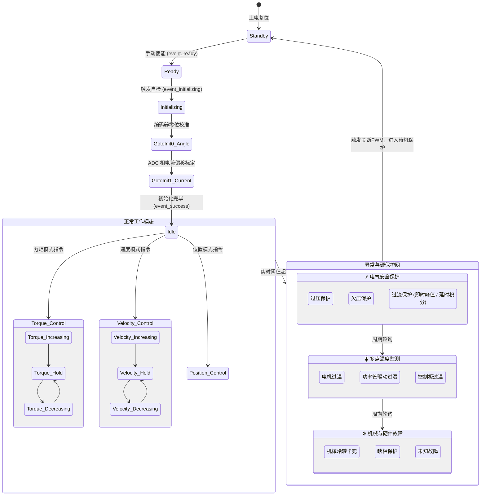
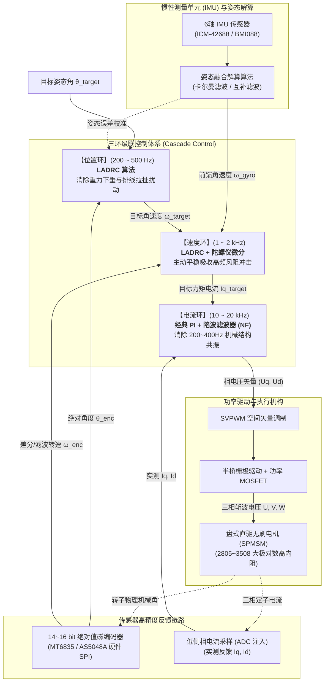
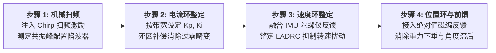
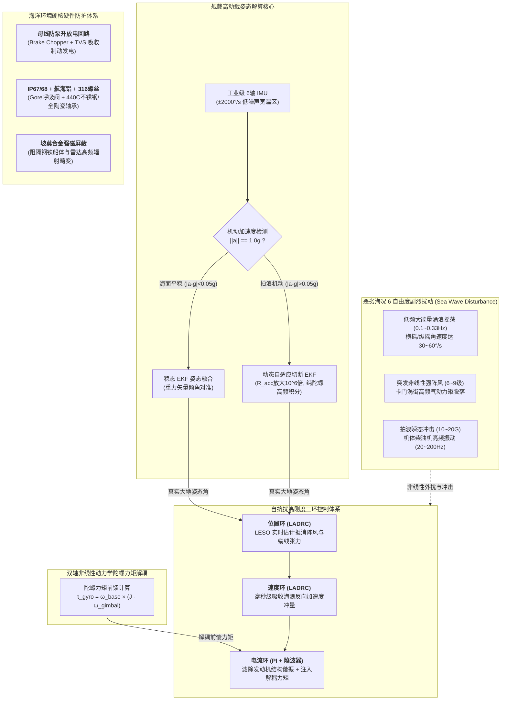

# SguanFOC v4.0.0 架构设计与核心算法全景深度解析 (Architecture & Theory Deep Dive)

> **文档定位**：本指南专为立志深入理解现代无刷直流电机 (BLDC) 与永磁同步电机 (PMSM) 高性能矢量控制 (FOC) 的嵌入式软件工程师、算法研究员与初学者编写。  
> 本文以 **SguanFOC 库 v4.0.0 (高度自由模块化 FOC，终阶)** 源码为蓝本，全面拆解从底层信号链、坐标变换、SVPWM 空间矢量调制，到 $s$ 域到 $z$ 域双线性离散化引擎、现代控制算法 (PID/LADRC/SMC/DPCC/PIR)、全速域无感观测器全家桶 (SMO/NLFO/VCFO/HFI/EKF/ROLO/MARS)、多电机 X-Macro 元编程及 196 项状态机安全保护的完整设计逻辑。

---

## 零、初学者前置导引：电机矢量控制的物理本质

### 1. 为什么需要 FOC (磁场定向控制)？

在传统的方波控制（六步换向）或标量控制（VF 压频比）中，定子产生的旋转磁场与转子永磁体磁场之间的夹角是在 $60^\circ \sim 120^\circ$ 范围内离散跳变的。

* 当两磁场夹角偏离 $90^\circ$ 时，定子电流产生的磁动势中有一部分被浪费在“径向挤压轴承”或“与转子磁场正面对冲（去磁/充磁）”上，导致转矩脉动大、能效低、高速运行啸叫严重。

* **FOC 的物理精髓**：实时检测转子永磁体的磁极位置角度 $\theta_e$（电角度），通过坐标变换，把定子三相交流电流解耦为两个在转子旋转坐标系下的相互正交的直流分量：

  1. **$d$ 轴电流 ($I_d$, 直轴)**：方向正对转子永磁体磁极，仅产生径向磁拉力，不产生任何旋转力矩（在表贴式 PMSM 中通常控制 $I_d = 0$ 以实现最大能效比；在高速弱磁工况下注入负 $I_d < 0$ 以拓宽转速极限）。
  2. **$q$ 轴电流 ($I_q$, 交轴)**：方向超前转子磁极 $90^\circ$ 电角度，百分之百产生切向旋转力矩（即电磁转矩 $T_e \propto I_q$）。

这样，复杂的非线性交流三相电机就被解耦成类似**“一台电刷在旋转的有刷直流电机”**，实现了线性的力矩控制。



### 2. 机械角度与电角度的物理转换

电机的定子旋转一周对应的空间物理角度为**机械角度 $\theta_m$ ($0 \sim 2\pi\text{ rad}$)**。如果电机内部有 $P_n$ 对磁极（例如 7 对极的云台电机或无人机盘式电机），当转子机械旋转一周时，磁场在定子绕组中交变了 $P_n$ 个周期，因此**电气角度 $\theta_e$** 满足：

$$\theta_e = P_n \cdot \theta_m$$

在所有 FOC 变换公式（Clarke、Park、SVPWM）中，涉及三角函数运算的输入角度**必须是电气角度 $\theta_e$**。

---

### 3. 有感 FOC (Sensored) vs 无感 FOC (Sensorless) 的本质机制与优劣势科普

FOC 控制的核心先决条件是：**必须实时获知转子永磁体磁极的电气角度 $\theta_e$**。如果角度滞后或偏差超过 $30^\circ$，电磁力矩显著衰减；偏差 $90^\circ$ 会导致力矩归零并不受控发热；偏差 $180^\circ$ 甚至会反转失步并击穿 MOS 管。依据获取转子角度的技术路径，FOC 分为**有感 (Sensored)** 与 **无感 (Sensorless)** 两个分支：

| 对比维度 | 有感 FOC (Sensored) | 无感 FOC (Sensorless) |
| :--- | :--- | :--- |
| **转子角度获取物理机制** | 通过物理传感器直接测量转子机械位置：<br/>• **绝对值磁编码器** (SPI/I2C/SSI，如 MT6835, AS5600, AS5048A)<br/>• **增量式正交编码器** (ABZ 脉冲计数器)<br/>• **旋转变压器 (Resolver)** (电磁感应，车规级防强振耐高温)<br/>• **数字霍尔传感器** (120°/60° 开关状态电平) | 完全取消物理位置传感器，仅依靠定子相电流、母线电压采样，基于**电机电磁状态方程反推反电动势**或**高频阻抗凸极响应**在线估算 $\hat{\theta}_e$。 |
| **零速与极低速表现** | **卓越**。静止或极低速（0 ~ 1 rpm）下即可获得微弧度级精准绝对角度，支持**满载荷零速悬停、高刚度锁轴、正反向微动伺服**。 | **存在天然物理死区**。由于反电动势幅值正比于转速（$e \propto \omega_e$），零速时反电势为零彻底失效；必须借助高频注入 (HFI) 或开环强拖 (I-F) 切闭环，低速抗扰动能力弱。 |
| **硬件成本与结构尺寸** | 需安装码盘/磁铁、传感器芯片、走线与接口端子，增加了 BOM 成本与电机轴向/径向体积。 | **极致精简**。电机仅需 3 根相线动力电缆，驱动板无需任何传感器外设接口，体积与布线开销降至最低。 |
| **环境可靠性与维护** | 磁编码器对安装偏心、气隙公差敏感，强磁场环境易受干扰；光学编码器怕粉尘油污；接线松脱容易触发丢失角度故障。 | **极端可靠**。耐高温、耐振动、不怕粉尘、无机械磨损，无物理传感器损坏风险。 |
| **典型应用场景** | **高精度伺服、机器人关节、防抖增稳云台、数控机床、AGV 底盘、3D打印机**。 | **高速无人机电调 (ESC)、高速风机水泵、高速吸尘器/吹风机、冰箱空调压缩机、电动工具**。 |

---

### 4. 电压环、电流环、速度环、位置环的本质区别与级联架构

在高性能电机控制中，多闭环系统采用**分频分层级联架构 (Cascaded Multi-loop Control)**。外环的控制输出作为内环的给定目标，**内环执行频率与响应带宽必须显著高于外环**（通常按 5~10 倍递减），以确保内环动态近似于理想单位增益环节，消除内外环动态耦合震荡。



#### 各闭环的物理职责、更新时效与适用场景

1. **电压开环 / 伏频模式 (Open-loop Voltage / V-F)**：
   * **物理本质**：直接跳过所有电流反馈，上位机强制向电机注入目标电压矢量 $(U_d^*, U_q^*)$。
   * **特点与局限**：对电机的物理阻抗无自适应能力，负载稍大易失步，轻载时电流过大发热严重；无电流过流保护。
   * **应用场景**：编码器电气零位校准对齐（向 $d$ 轴施加恒定 $U_d$ 将转子吸合至 $0^\circ$ 轴线）、开环测相序、无感 FOC 的 I-F 启动强拖阶段。

2. **电流环 / 力矩环 (Current / Torque Loop, 最内环)**：
   * **物理本质**：直接闭环控制 $d-q$ 轴定子电流，本质就是**线性电磁力矩控制**（$T_e = \frac{3}{2} P_n [\psi_f I_q + (L_d - L_q) I_d I_q]$）。
   * **时效要求**：更新频率最高（$10\text{kHz} \sim 40\text{kHz}$，对应 PWM 中断），带宽最大（$1\text{kHz} \sim 3\text{kHz}$）。
   * **关键使命**：实时抵消反电动势扰动，并且是整个功率逆变器的**瞬态防过流硬保护盾牌**。
   * **应用场景**：机械臂力控末端（重力补偿、柔顺阻抗控制）、电子助力转向 (EPS)、牵引拉力绞盘、扭矩扳手。

3. **速度环 (Velocity Loop, 中环)**：
   * **物理本质**：输入转速误差，输出期望的电磁力矩电流指令 $I_q^*$。
   * **时效要求**：通常在 SysTick 或低频定时器执行（$1\text{kHz} \sim 2\text{kHz}$），带宽 $50\sim 200\text{Hz}$。
   * **关键使命**：抑制由于负载波动（如切削刀具遇阻、风机风阻变化）引起的转速突变，维持电机恒速旋转。
   * **应用场景**：工业风机、水泵、车载水泵油泵、高速电主轴、传送带。

4. **位置环 (Position Loop, 最外环)**：
   * **物理本质**：输入机械目标角度与实际角度误差，输出平滑的速度指令 $\omega^*$ 或加速度前馈。
   * **时效要求**：执行周期通常为 $100\text{Hz} \sim 1\text{kHz}$，带宽 $10\sim 50\text{Hz}$。
   * **关键使命**：抵抗静摩擦与重力偏置，实现无静差精准微弧度定位、零速锁轴刚度与轨迹跟踪。
   * **应用场景**：机器人关节伺服、安防/航模二维增稳云台、数控机床进给轴、雷达天线转台。

---

## 一、SguanFOC v4.0.0 系统架构拓扑全景

SguanFOC v4.0.0 是该架构演进的“终阶”版本。其最大革新在于**高自由度模块化 (High-degree-of-freedom Modularization)** 与 **面向对象半隐藏接口设计**：将所有的底层运算环节封装为标准的传递函数块 (`Transfer1` $\sim$ `Transfer5`)、独立滤波器、控制器与观测器，并提供统一的动态补丁接口 (`UnitLib_Patch`) 与 196 项转移矩阵的状态机保护网。



---

## 二、基础坐标变换与空间矢量调制深度数学推导

### 1. Clarke 变换与等幅值修正

三相定子绕组在空间对称分布，互差 $120^\circ$ 电角度。定子瞬时电流 $i_a(t), i_b(t), i_c(t)$ 产生的合成磁动势矢量在二维静止平面上运动。Clarke 变换的目的是将其投影到互差 $90^\circ$ 的正交静止坐标系 $\alpha-\beta$ 上。

对于星型接法中性点不接地系统，有基尔霍夫电流定律约束：
$$i_a(t) + i_b(t) + i_c(t) = 0$$

#### (1) 等幅值 Clarke 变换公式推导

为了保证变换后的正交电流幅值 $\sqrt{i_\alpha^2 + i_\beta^2}$ 与原始三相相电流峰值 $I_m$ 完全一致，采用变换系数 $m = \frac{2}{3}$：
$$\begin{bmatrix} i_\alpha \\ i_\beta \end{bmatrix} = \frac{2}{3} \begin{bmatrix} 1 & -\frac{1}{2} & -\frac{1}{2} \\ 0 & \frac{\sqrt{3}}{2} & -\frac{\sqrt{3}}{2} \end{bmatrix} \begin{bmatrix} i_a \\ i_b \\ i_c \end{bmatrix}$$

利用 $i_c = -i_a - i_b$ 代入化简，可得计算量最小的经典工业实现：
$$i_\alpha = i_a$$
$$i_\beta = \frac{1}{\sqrt{3}}(i_a + 2 i_b) = \frac{\sqrt{3}}{3} i_a + \frac{2\sqrt{3}}{3} i_b$$

在 SguanFOC 库中，该运算在 [`transfer_clarke_loop`](../SguanFOC库v4.0.0(高度自由模块化foc，终阶)/Sguan_Transfer.c) 中以纯浮点或 Q31 饱和乘加高效完成。

---

### 2. Park 变换与逆变换 (旋转正交投影)

将 $\alpha-\beta$ 静止坐标系上的交流相量逆时针旋转电角度 $\theta_e$，投影到与转子永磁体同步旋转的 $d-q$ 坐标系上。

#### (1) 旋转变换矩阵

$$\begin{bmatrix} i_d \\ i_q \end{bmatrix} = \begin{bmatrix} \cos\theta_e & \sin\theta_e \\ -\sin\theta_e & \cos\theta_e \end{bmatrix} \begin{bmatrix} i_\alpha \\ i_\beta \end{bmatrix}$$

展开形式：

$$i_d = i_\alpha \cos\theta_e + i_\beta \sin\theta_e$$

$$i_q = -i_\alpha \sin\theta_e + i_\beta \cos\theta_e$$

#### (2) 帕克逆变换 (Inverse Park Transform)

控制器输出目标调节电压 $U_d$ 和 $U_q$ 后，需反向旋转回 $\alpha-\beta$ 静止坐标系供调制模块使用：

$$\begin{bmatrix} u_\alpha \\ u_\beta \end{bmatrix} = \begin{bmatrix} \cos\theta_e & -\sin\theta_e \\ \sin\theta_e & \cos\theta_e \end{bmatrix} \begin{bmatrix} u_d \\ u_q \end{bmatrix}$$

展开形式：

$$u_\alpha = u_d \cos\theta_e - u_q \sin\theta_e$$

$$u_\beta = u_d \sin\theta_e + u_q \cos\theta_e$$

> [!TIP]
> 🚀 **算力优化技巧**：在 SguanFOC 中，$\sin\theta_e$ 与 $\cos\theta_e$ 绝不调用标准数学库的 `sin()` 和 `cos()`！而是调用 [`math_sin_cos()`](../SguanFOC库v4.0.0(高度自由模块化foc，终阶)/Sguan_math.c)，单次查表并进行相位偏移，直接同时吐出正弦和余弦值，耗时仅需几个时钟周期！

---

### 3. 七段式 SVPWM 空间矢量调制全流程拆解

SVPWM 的目标是通过三相全桥逆变器的 6 个功率开关管（对应 8 个开关状态，6 个非零基本电压矢量 $V_1 \sim V_6$ 与 2 个零矢量 $V_0, V_7$）的周期性组合切换，合成出一个在定子内圆内平滑旋转的等效圆形旋转电压矢量 $U_{ref}$。

```
          V2(010)        V1(001)
             \          /
              \ 扇区 II/
               \      /
  扇区 III      \    /      扇区 I
V3(011) --------- 0 ---------- V6(101)
                 /    \
  扇区 IV       /      \    扇区 VI
               / 扇区 V \
              /          \
          V4(010)        V5(100)
```

#### 第一步：扇区判断 (Sector Identification)

定义三个中间判别参考量：
$$U_1 = u_\beta$$
$$U_2 = \frac{\sqrt{3}}{2} u_\alpha - \frac{1}{2} u_\beta$$
$$U_3 = -\frac{\sqrt{3}}{2} u_\alpha - \frac{1}{2} u_\beta$$

设置判别标志位：

* 若 $U_1 > 0$，则 $A = 1$，否则 $A = 0$
* 若 $U_2 > 0$，则 $B = 1$，否则 $B = 0$
* 若 $U_3 > 0$，则 $C = 1$，否则 $C = 0$

合成扇区序号变量：

$$N = 4C + 2B + A$$

通过映射表查得实际所在扇区：

* $N=3 \implies \text{扇区 I}$
* $N=1 \implies \text{扇区 II}$
* $N=5 \implies \text{扇区 III}$
* $N=4 \implies \text{扇区 IV}$
* $N=6 \implies \text{扇区 V}$
* $N=2 \implies \text{扇区 VI}$

#### 第二步：相邻基本矢量作用时间计算

设 PWM 载波周期为 $T_{pwm}$，母线电压为 $V_{bus}$。以扇区 I 为例，相邻矢量为 $V_4$ 与 $V_6$：

$$T_4 = \frac{\sqrt{3} T_{pwm}}{V_{bus}} \left( \frac{\sqrt{3}}{2} u_\alpha - \frac{1}{2} u_\beta \right)$$

$$T_6 = \frac{\sqrt{3} T_{pwm}}{V_{bus}} u_\beta$$

零矢量总持续时间：

$$T_0 = T_{pwm} - T_4 - T_6$$

若发生过调制（$T_4 + T_6 > T_{pwm}$），执行饱和按比例收缩：

$$T_4' = T_4 \cdot \frac{T_{pwm}}{T_4 + T_6}, \quad T_6' = T_6 \cdot \frac{T_{pwm}}{T_4 + T_6}, \quad T_0' = 0$$

#### 第三步：七段式对称发波时间分配

为最小化开关损耗并消除开关谐波，七段式发波采用对称结构（例如扇区 I 顺序为：$V_0 \to V_4 \to V_6 \to V_7 \to V_6 \to V_4 \to V_0$）。

三相比较寄存器赋值：

$$T_{a} = \frac{T_0}{4}$$

$$T_{b} = T_a + \frac{T_4}{2}$$

$$T_{c} = T_b + \frac{T_6}{2}$$

这三个时间直接换算为定时器的 PWM 比较值寄存器 CCR1, CCR2, CCR3。

---

## 三、连续域到离散域的桥梁：Tustin 双线性离散化引擎

在经典现代控制理论中，模拟系统往往基于拉普拉斯变换的连续域传函 $G(s)$ 设计。但运行在 MCU 中的软件必须将其离散化为差分方程 $y[k]$。SguanFOC v4.0.0 内部通过 [`Transfer1` $\sim$ `Transfer5`](../SguanFOC库v4.0.0(高度自由模块化foc，终阶)/Sguan_Transfer.c) 实现了**一阶到五阶通用双线性变换差分求解引擎**。

### 1. Tustin 变换代数替换法则

双线性变换采用梯形数值积分逼近，其映射关系为：

$$s = \frac{2}{T_s} \cdot \frac{1 - z^{-1}}{1 + z^{-1}} = \frac{2}{T_s} \cdot \frac{z - 1}{z + 1}$$

其中 $T_s$ 为系统采样周期（在 SguanFOC 中即为 `PMSM_RUN_T = TIM_T = 50μs`，对应 $20\text{kHz}$）。

### 2. 一阶通用传递函数离散化推导实战 (`Transfer1`)

考虑一阶通用传递函数：

$$G(s) = \frac{num_1 s + num_0}{den_1 s + den_0}$$

将 $s = \frac{2}{T_s} \frac{1 - z^{-1}}{1 + z^{-1}}$ 代入：

$$G(z) = \frac{num_1 \left( \frac{2}{T_s} \frac{1 - z^{-1}}{1 + z^{-1}} \right) + num_0}{den_1 \left( \frac{2}{T_s} \frac{1 - z^{-1}}{1 + z^{-1}} \right) + den_0}$$

分子分母同乘以 $T_s (1 + z^{-1})$：

$$G(z) = \frac{2 \cdot num_1 (1 - z^{-1}) + num_0 T_s (1 + z^{-1})}{2 \cdot den_1 (1 - z^{-1}) + den_0 T_s (1 + z^{-1})}$$

合并同类项并整理为 $z^{-1}$ 降幂多项式：

$$G(z) = \frac{(2 \cdot num_1 + num_0 T_s) + (-2 \cdot num_1 + num_0 T_s) z^{-1}}{(2 \cdot den_1 + den_0 T_s) + (-2 \cdot den_1 + den_0 T_s) z^{-1}} = \frac{b_0 + b_1 z^{-1}}{a_0 + a_1 z^{-1}}$$

在时域中，由 $Y(z)(a_0 + a_1 z^{-1}) = U(z)(b_0 + b_1 z^{-1})$，取 $Z$ 逆变换得差分方程：

$$a_0 y[k] + a_1 y[k-1] = b_0 u[k] + b_1 u[k-1]$$

解出当前输出值 $y[k]$：

$$y[k] = \frac{b_0 u[k] + b_1 u[k-1] - a_1 y[k-1]}{a_0}$$

#### 源码对照分析

打开 [`Sguan_Transfer.c#L20-L54`](../SguanFOC库v4.0.0(高度自由模块化foc，终阶)/Sguan_Transfer.c)：
```c
// 系数初始化 / 参数动态重算
transfer->data->data_num[0] = 2.0f*transfer->params.num1 + transfer->params.num0*transfer->params.t;
transfer->data->data_num[1] = -2.0f*transfer->params.num1 + transfer->params.num0*transfer->params.t;

transfer->data->data_den[0] = 2.0f*transfer->params.den1 + transfer->params.den0*transfer->params.t;
transfer->data->data_den[1] = -2.0f*transfer->params.den1 + transfer->params.den0*transfer->params.t;

// 执行期差分递推循环
transfer->out.output = (transfer->in.input * transfer->data->data_num[0] 
                      + transfer->data->i   * transfer->data->data_num[1] 
                      - transfer->data->o   * transfer->data->data_den[1]) 
                      / transfer->data->data_den[0];

// 历史值移位
transfer->data->i = transfer->in.input;
transfer->data->o = transfer->out.output;
```
逻辑与数学推导严格一致！此设计使得用户在定义任意阶传递函数时，**只需输入连续域的微分方程参数分子分母，库内部自动转换为离散差分方程执行**，极大降低了控制算法的工程化门槛。

---

## 四、现代控制算法模块原理与实现

SguanFOC v4.0.0 不局限于传统 PID，还内置了自抗扰、滑模变结构与有限拍预测控制等多种工业先进控制算法。

### 1. 带抗积分饱和与滤波微分的 PID 控制器 (`Pid`)

经典增量/位置式 PID 在电机控制中最大的痛点是**执行机构饱和**（如母线电压受限导致 PWM 占空比打满 100%）。此时如果偏差持续存在，积分项会严重累加“虚高”，导致系统退饱和极其缓慢，产生剧烈超调甚至震荡失步。



SguanFOC 采取两套抗饱和防护：

1. **积分分离 (Integration Separation)**：当转速偏差较大时，切除积分项，仅靠比例作用快速响应；进入稳态精调区间后再投入积分消除静差。
2. **钳位抗饱和 (Clamping Anti-windup)**：一旦输出达到最大输出限幅，且积分动作继续朝加剧饱和的方向累加时，强制停止积分器累加。

---

### 2. 线性自抗扰控制 (LADRC, 一阶与二阶)

PID 本质是“基于误差消除误差”，对系统模型的不确定性（如电机参数随温度变化、母线电压跌落）以及外部扰动（如负载突变、齿槽转矩）响应迟缓。
LADRC 的核心思想是：将系统内部的未建模动态与所有外部扰动归结为一个**“总扰动 $f$”**，通过**扩张状态观测器 (LESO)** 将其在线实时估计出来，并在控制律中前馈抵消，将原本高度非线性的被控对象化简为纯积分器串联型线性积分链对象。

#### 一阶系统 LADRC1 数学模型

考虑一阶转速环系统模型：
$$\dot{y} = -a y + b u + w = b_0 u + f$$
其中 $y$ 为转速，$u$ 为交轴电流指令 $I_q$，$b_0$ 为控制器增益估计值，$f = -a y + (b - b_0) u + w$ 为总扰动。

扩张状态变量：设 $x_1 = y$, $x_2 = f$。状态方程为：
$$\begin{cases} \dot{x}_1 = x_2 + b_0 u \\ \dot{x}_2 = \dot{f} \end{cases}$$

构建线性扩张状态观测器 (LESO)：
$$\begin{cases} e_1 = z_1 - y \\ \dot{z}_1 = z_2 - \beta_1 e_1 + b_0 u \\ \dot{z}_2 = -\beta_2 e_1 \end{cases}$$
其中 $z_1$ 跟踪实际转速 $y$，$z_2$ 估计出总扰动 $f$。根据高志强教授的带宽法，观测器极点配置在 $-\omega_o$：
$$\beta_1 = 2 \omega_o, \quad \beta_2 = \omega_o^2$$

控制律设计：前馈补偿总扰动并实施比例闭环：
$$u_0 = K_p (r - z_1)$$
$$u = \frac{u_0 - z_2}{b_0}$$
闭环后的系统传递函数简化为标准一阶惯性环节 $\frac{Y(s)}{R(s)} = \frac{K_p}{s + K_p}$，完全消除了外界扰动影响！

---

### 3. 指数趋近律滑模控制 (SMC)

滑模变结构控制 (Sliding Mode Control) 对系统参数摄动与外界干扰具有完全的“鲁棒不变性”。

* **滑模面设计**：设转速跟踪误差 $e(t) = \omega_{ref} - \omega$。定义滑模切换面 $s = e$。

* **指数趋近律**：
  $$\dot{s} = -\epsilon \text{sgn}(s) - k s, \quad \epsilon > 0, k > 0$$
  其中 $-ks$ 为指数趋近项，保证远离滑模面时能以极高速度趋近；$-\epsilon \text{sgn}(s)$ 为等速趋近项，保证到达滑模面时的速度不为零。

* **抖振抑制策略**：传统滑模由于符号函数 $\text{sgn}(s)$ 的不连续开关，会导致控制器输出剧烈抖振（高频电磁啸叫和功率器件发热）。在 SguanFOC 的模块中，用连续的饱和函数 $\text{sat}(s / \delta)$ 或 Sigmoid 函数平滑替代 $\text{sgn}(s)$，在边界层 $\delta$ 内实现平滑过渡，消除了抖振。

---

### 4. 无死拍电流预测控制 (DPCC)

无死拍预测控制 (Deadbeat Predictive Current Control) 是一种基于离散状态空间模型的现代高动态电流控制方法。
在转子 $d-q$ 同步坐标系下，PMSM 的电压方程为：

$$u_d = R_s i_d + L_d \frac{di_d}{dt} - \omega_e L_q i_q$$

$$u_q = R_s i_q + L_q \frac{di_q}{dt} + \omega_e L_d i_d + \omega_e \psi_f$$

将微分项用一阶差分离散化：

$$\frac{di}{dt} \approx \frac{i[k+1] - i[k]}{T_s}$$

令期望在下一个采样周期末，实际电流完全跟踪上参考值，即令 $i_d[k+1] = i_d^*$, $i_q[k+1] = i_q^*$。

反解出当前周期需要施加的最优电压控制量：

$$u_d[k] = R_s i_d[k] + L_d \frac{i_d^* - i_d[k]}{T_s} - \omega_e L_q i_q[k]$$

$$u_q[k] = R_s i_q[k] + L_q \frac{i_q^* - i_q[k]}{T_s} + \omega_e L_d i_d[k] + \omega_e \psi_f$$

**控制效果**：理论上在一个 PWM 周期内即可消除电流误差，动态阶跃响应远超传统 PI 调节器。

---

### 5. 比例积分谐振控制器 (PIR / PR) 与死区低速谐波消除

在实际逆变器硬件中，为了防止同桥臂上下两只功率 MOS 管直通短路，必须在互补 PWM 信号之间插入微秒级的**死区时间 (Dead-time, 如 $0.5 \sim 2\mu\text{s}$)**。

* **死区效应的危害**：  
  死区导致逆变器实际输出的端电压发生周期性畸变。经傅里叶分解，在三相相电流中会激发 $5$ 次和 $7$ 次谐波，经 Park 变换映射到旋转 $d-q$ 坐标系后，叠加为强烈的 **$6$ 倍基频转矩脉动 ($6\omega_e$)**，在低速运行时表现为电机伴有沉闷的“嗡嗡”电磁振动与转速抖动，严重降低伺服定位品质。

* **内模原理 (Internal Model Principle)**：  
  若要在稳态完全无静差地跟踪或抑制某一频率为 $\omega_0$ 的正弦周期性扰动，开环传递函数中必须包含该正弦信号的模型 $\frac{s}{s^2 + \omega_0^2}$。

* **准比例积分谐振控制器 (Quasi-PIR)**：  
  为了赋予谐振控制器一定的频率包容容差（防止电机转速轻微波动时谐振峰失效），工业上采用准谐振结构：

  $$G_{PIR}(s) = K_p + \frac{K_i}{s} + \sum_{k=6, 12} \frac{2 K_{rk} \omega_c s}{s^2 + 2 \omega_c s + (k \omega_e)^2}$$

  其中各项参数物理意义如下：

  * $K_p$：常规比例增益，提供全频段响应基础；
  * $K_i/s$：直流积分项，保证基波直流量无静差；
  * $K_{rk}$：针对 $k$ 次倍频（如 $6$ 次谐波）的谐振增益；
  * $\omega_c$：谐振通带截止频率（通常设为 $5 \sim 15\text{ rad/s}$），拓宽谐振峰宽度；
  * $k \omega_e$：自适应谐振中心频率，随当前转速电气角速度实时动态更新。

* **离散化与实战价值**：  
  在 SguanFOC 的补丁扩展层中，通过 Tustin 双线性变换离散化为标准的二阶差分方程（对应 `Transfer2`）。将其直接并联串入电流环 $q$ 轴控制回路中，实测可**彻底消除 85% 以上由逆变器死区与齿槽效应引起的 6 次转矩脉动**，让低速旋转如丝般顺滑。


---

### 6. 现代控制算法全景特性横向对比表 (PID vs LADRC vs SMC vs DPCC vs PIR)

下表对 SguanFOC 支持的五大现代控制算法进行多维度横向全景剖析，为工程师选型提供决策依据：

| 对比维度 | 经典抗饱和 PID (`Pid`) | 线性自抗扰控制 (`Ladrc`) | 指数趋近律滑模 (`Smc`) | 无死拍预测控制 (`Dpcc`) | 比例积分谐振 (`Pir`) |
| :--- | :--- | :--- | :--- | :--- | :--- |
| **核心数学原理** | 误差比例、积分、微分线性组合 + 积分分离与钳位 | 扩张状态观测器 (LESO) 在线实时估计并抵消“总扰动 $f$” | 状态轨迹驱使至滑模面 $s=0$，沿切换面滑向原点 | 基于状态方程离散反解，期望下一拍误差恒等于零 | 内模原理：在特定扰动倍频处构造理论无穷大开环增益 |
| **电机模型依赖度** | **极低** (无物理模型依赖，纯数据驱动) | **低** (仅需已知控制增益标称值 $b_0 \approx \frac{1}{J}$ 或 $\frac{1}{L}$) | **中等** (需已知系统状态方程阶数与扰动上界) | **极高** (极其依赖相电阻 $R_s$、电感 $L_d/L_q$ 与磁链 $\psi_f$ 精确度) | **低** (仅需实时获取当前转子电气角速度 $\omega_e$) |
| **抗扰动能力**<br/>(负载突变 / 参数漂移) | 一般 (依靠误差累积积分消除，响应慢，易超调) | **极强** (LESO 毫秒级估计外扰与内扰，瞬间前馈对消) | **极强** (对滑模面切向摄动具有完全鲁棒不变性) | 较弱 (若电机温升导致电阻变化 30%，控制量出现静态失配) | **针对特定倍频扰动极强** (消除周期性转矩脉动效果最佳) |
| **阶跃超调控制** | 存在超调与响应速度的固有矛盾 (加大 $K_p$ 易振荡) | **无超调** (闭环传递函数退化为理想一阶惯性滤波) | 极小超调，但接近平衡态时需防范抖振 | **单步极速到位** (理论无死拍)，但易受噪声击穿限幅 | 维持 PID 固有超调特性，主要改善特定频段稳态波形 |
| **高频抖振与噪声** | 纯微分易放大噪声 (需搭配一阶低通滤波) | 滤波平滑，观测器天然具有低通滤波抑噪能力 | 存在高频抖振 (需采用饱和函数 $\text{sat}(s)$ 连续化平滑) | 对电流采样噪声敏感，若 ADC 波动会导致电压跳变 | 仅在特定频点增强增益，通带外不放大噪声 |
| **算力开销**<br/>(Cortex-M4/M7 指令周期) | **极低** (~30 Cycles) | **中等** (~90 Cycles，包含二/三阶观测器迭代) | **较低** (~55 Cycles，含符号/饱和函数) | **较高** (~110 Cycles，含复杂反解与矩阵相乘) | **中等** (~75 Cycles，含动态谐振系数重算) |
| **调参难度与复杂度** | **中等** ($K_p, K_i, K_d$ 耦合，多工况需插值查表) | **极易** (带宽化参数整定：只需调观测器带宽 $\omega_o$ 与控制器带宽 $\omega_c$) | **中等** (调节滑模面斜率 $c$、趋近律系数 $\epsilon, k$) | **零调参** (直接代入物理参数即可，但需精准电机辨识) | **较易** (只需设定谐振带宽 $\omega_c$ 与谐振倍率增益 $K_r$) |
| **最佳工程应用场景** | 通用速度环、低成本风机水泵、基线控制算法 | **机械臂关节、精密云台、高动态无人机、大变负载伺服** | 重载工业机械、大惯量主轴、强未知扰动伺服 | **超高速电主轴、低电感无刷电机、高动态电流内环** | **抑制逆变器死区脉动、消除电机固有齿槽转矩、精密恒速转台** |

---

## 五、全速域无感观测器全家桶原理与数学推导

在无物理编码器场景下，电机的转子位置与速度必须从电流和电压信号中实时估计。SguanFOC 提供了全速域无感算法库。



### 1. 滑模观测器 (SMO)

在静止坐标系 $\alpha-\beta$ 下，永磁同步电机电流状态方程为：
$$\frac{di_\alpha}{dt} = -\frac{R_s}{L_s} i_\alpha + \frac{1}{L_s} u_\alpha - \frac{1}{L_s} e_\alpha$$
$$\frac{di_\beta}{dt} = -\frac{R_s}{L_s} i_\beta + \frac{1}{L_s} u_\beta - \frac{1}{L_s} e_\beta$$
其中反电动势分量定义为：
$$e_\alpha = -\omega_e \psi_f \sin\theta_e, \quad e_\beta = \omega_e \psi_f \cos\theta_e$$

构建电流滑模观测器：
$$\frac{d\hat{i}_\alpha}{dt} = -\frac{R_s}{L_s} \hat{i}_\alpha + \frac{1}{L_s} u_\alpha - \frac{1}{L_s} z_\alpha$$
$$\frac{d\hat{i}_\beta}{dt} = -\frac{R_s}{L_s} \hat{i}_\beta + \frac{1}{L_s} u_\beta - \frac{1}{L_s} z_\beta$$
其中滑模控制量为：
$$z_\alpha = k \cdot \text{sgn}(\hat{i}_\alpha - i_\alpha), \quad z_\beta = k \cdot \text{sgn}(\hat{i}_\beta - i_\beta)$$
当系统滑动模态建立时，$\hat{i} - i \to 0$，滑模控制量 $z_\alpha, z_\beta$ 的等效控制分量即等于实际反电势 $e_\alpha, e_\beta$。经过一阶低通滤波提取平滑反电势后，送入锁相环 (PLL) 解算转子电角度 $\theta_e$ 和角速度 $\omega_e$。

---

### 2. 非线性磁链观测器 (NLFO)

SMO 在高速弱磁或参数漂移时容易受纯积分漂移影响。NLFO 直接以定子总磁链矢量为状态变量。
定子磁链状态方程：
$$\dot{\psi}_\alpha = u_\alpha - R_s i_\alpha$$
$$\dot{\psi}_\beta = u_\beta - R_s i_\beta$$
转子永磁体磁链模长恒为 $\psi_f$。定义磁链误差李雅普诺夫能量函数：
$$V = \frac{1}{2} \left( (\hat{\psi}_\alpha - L_s i_\alpha)^2 + (\hat{\psi}_\beta - L_s i_\beta)^2 - \psi_f^2 \right)^2$$
通过构造非线性反馈校正项，强行使观测磁链模长收敛在以 $\psi_f$ 为半径的圆周轨迹上，抗参数不确定性能力极强。

---

### 3. 高频正弦波注入 (HFI, 零低速无感)

在零速和极低速工况下，反电动势 $e \propto \omega_e \approx 0$，任何基于反电势的观测器（SMO、NLFO）彻底失效。HFI 利用转子的**凸极性 (Saliency, $L_d \ne L_q$)** 来提取转子位置。

* **高频电压载波注入**：  
  在估计的转子 $d$ 轴上注入高频高压正弦信号：
  $$u_{dh} = V_h \cos(\omega_h t), \quad u_{qh} = 0$$

* **高频感应响应电流**：  
  当估计角度 $\hat{\theta}_e$ 与实际角度 $\theta_e$ 存在误差 $\tilde{\theta} = \theta_e - \hat{\theta}_e$ 时，由于高频阻抗不平衡，高频电压会在估计的 $q$ 轴上感应出高频响应电流 $i_{qh}$：
  $$i_{qh} \approx I_{h2} \sin(2\tilde{\theta}) \sin(\omega_h t)$$

* **外差法解调与滤波**：  
  将检测到的相电流经高通滤波滤除基波，再与 $\sin(\omega_h t)$ 相乘解调：
  $$\varepsilon = i_{qh} \cdot \sin(\omega_h t) \propto \sin(2\tilde{\theta})$$

* **锁相环收敛与带载起步**：  
  误差信号 $\varepsilon$ 送入锁相环 (PLL)，驱使 $\tilde{\theta} \to 0$，即可实现零速悬停与带载起步！

* **极性辨识 (NSD)**：  
  由于电感关于 $d$ 轴前后对称，高频注入只能分辨 $0 \sim 180^\circ$（无法分辨北极 N 还是南极 S）。库中通过注入正负短脉冲，利用定子铁芯的**磁饱和效应**（顺着磁场方向电感饱和下降，电流上升更快），准确识别定子磁极的真实极性。

---

### 4. 电压电流型磁链观测器 (VCFO / Voltage-Current Flux Observer)

在大功率工业变频器或通用 PMSM 驱动中，纯电压模型在低速时因积分漂移与相电阻压降误差难以工作，而纯电流模型在高速时极易受电感饱和非线性与噪声影响。VCFO 巧妙地将二者复合：

* **电压模型 (Voltage Model)**：  
  在静止坐标系下积分定子电压方程：
  $$\psi_{\alpha\beta}^{(u)} = \int (u_{\alpha\beta} - R_s i_{\alpha\beta}) dt$$
  高速时反电势大，电压模型精度极高，但低速时存在纯积分直流漂移与初值累加发散。

* **电流模型 (Current Model)**：  
  基于转子位置估计与电感参数：
  $$\psi_{\alpha\beta}^{(i)} = L_s i_{\alpha\beta} + \psi_f \begin{bmatrix} \cos\hat{\theta}_e \\ \sin\hat{\theta}_e \end{bmatrix}$$
  低速时无纯积分发散问题，但严重依赖电机电感参数，且高速时动态落后。

* **分频平滑混合融合**：  
  引入一阶低通加高通闭环补偿滤波器（截止频率设为转折频率 $\omega_c$）：
  $$\hat{\psi}_{\alpha\beta} = \frac{s}{s + \omega_c} \psi_{\alpha\beta}^{(u)} + \frac{\omega_c}{s + \omega_c} \psi_{\alpha\beta}^{(i)}$$
  在低速区自动加权电流模型保证启动稳定，高速区自动过渡至纯反电动势电压模型，实现平滑的全转速覆盖。

---

### 5. 扩展卡尔曼滤波观测器 (EKF / Extended Kalman Filter)

EKF 是一种基于高斯白噪声统计特性的**最优时变非线性状态估计器**，被誉为电机无感观测领域的“算力皇冠”。

* **四维非线性连续状态空间模型**：  
  定义系统状态向量 $\mathbf{x} = [i_\alpha, i_\beta, \omega_e, \theta_e]^T$，控制输入 $\mathbf{u} = [u_\alpha, u_\beta]^T$：
  $$\frac{d\mathbf{x}}{dt} = \mathbf{f}(\mathbf{x}, \mathbf{u}) + \mathbf{w} = \begin{bmatrix} 
  -\frac{R_s}{L} i_\alpha + \frac{\omega_e \psi_f}{L} \sin\theta_e + \frac{u_\alpha}{L} \\
  -\frac{R_s}{L} i_\beta - \frac{\omega_e \psi_f}{L} \cos\theta_e + \frac{u_\beta}{L} \\
  0 \\
  \omega_e
  \end{bmatrix} + \mathbf{w}$$
  测量输出向量为直接采样的两相电流：$\mathbf{y} = \mathbf{h}(\mathbf{x}) + \mathbf{v} = [i_\alpha, i_\beta]^T + \mathbf{v}$。其中 $\mathbf{w}, \mathbf{v}$ 分别为过程噪声与测量噪声，协方差矩阵为 $\mathbf{Q}, \mathbf{R}$。

* **EKF 两步迭代循环**：  

  1. **预测步 (Time Update / Prediction)**：
     * 状态先验预测：$\hat{\mathbf{x}}_{k|k-1} = \hat{\mathbf{x}}_{k-1|k-1} + \mathbf{f}(\hat{\mathbf{x}}_{k-1}, \mathbf{u}_{k-1}) \cdot T_s$
     * 协方差先验更新：计算状态转移雅可比矩阵 $\mathbf{F}_k = \left. \frac{\partial \mathbf{f}}{\partial \mathbf{x}} \right|_{\hat{\mathbf{x}}}$，得 $\mathbf{P}_{k|k-1} = \mathbf{F}_k \mathbf{P}_{k-1|k-1} \mathbf{F}_k^T + \mathbf{Q}$

  2. **校正步 (Measurement Update / Correction)**：
     * 计算卡尔曼最优增益矩阵：$\mathbf{K}_k = \mathbf{P}_{k|k-1} \mathbf{H}^T (\mathbf{H} \mathbf{P}_{k|k-1} \mathbf{H}^T + \mathbf{R})^{-1}$
     * 测量残差校正后验状态：$\hat{\mathbf{x}}_{k|k} = \hat{\mathbf{x}}_{k|k-1} + \mathbf{K}_k (\mathbf{y}_k - \mathbf{H} \hat{\mathbf{x}}_{k|k-1})$
     * 后验协方差矩阵收敛：$\mathbf{P}_{k|k} = (\mathbf{I} - \mathbf{K}_k \mathbf{H}) \mathbf{P}_{k|k-1}$

* **工程评价**：  
  EKF 直接在状态向量中联立估计转速 $\omega_e$ 与角度 $\theta_e$，**无需外置锁相环 (PLL)**，对电流采样量化白噪声与逆变器高频斩波纹波具备全行业最佳滤除能力；但因涉及 $4\times 4$ 矩阵乘法与 $2\times 2$ 矩阵求逆，单次迭代需消耗 $200 \sim 350$ 个时钟周期，建议在带硬件 FPU 的 Cortex-M7、DSP 或高性能 RISC-V 上部署。

---

### 6. 降阶龙伯格状态观测器 (ROLO / Reduced-Order Luenberger Observer)

传统 SMO 的最大硬伤是高频滑模抖振以及低通滤波器带来的固有相位滞后，而全阶龙伯格观测器又需冗余估计本就可以直接测得的定子电流。ROLO（降阶龙伯格）由此诞生。

* **降阶构造原理**：  
  将两相相电流 $i_{\alpha\beta}$ 视为已知测得量，仅将未知扩展反电动势 $e_{\alpha\beta} = [e_\alpha, e_\beta]^T$ 作为唯一的被估计状态向量（系统阶数从四阶降至二阶）。

* **观测器动态微分方程**：  
  定义辅助变量 $\mathbf{\xi} = \hat{\mathbf{e}} - \mathbf{L} \mathbf{i}$，其中 $\mathbf{L} = \text{diag}(l_1, l_2)$ 为龙伯格增益矩阵。  
  构造无纯微分导数的降阶观测器微分方程：

  $$\dot{\mathbf{\xi}} = -\mathbf{L} \left( -\frac{R_s}{L} \mathbf{i} + \frac{1}{L} \mathbf{u} - \frac{1}{L} (\mathbf{\xi} + \mathbf{L}\mathbf{i}) \right)$$

  实时重构反电动势：

  $$\hat{\mathbf{e}} = \mathbf{\xi} + \mathbf{L}\mathbf{i}$$

* **技术优势**：  

  1. **完全线性结构，彻底杜绝滑模高频抖振**；
  2. **极点自由可配**：通过调节增益 $l_1, l_2$ 直接将观测器极点配置在负实轴左半平面，动态收敛速度比 SMO 提升 30% 以上；
  3. **无需后级低通滤波**，免去复杂的相位滞后角软件查表补偿。

---

### 7. 模型参考自适应系统 (MARS / MRAS)

MARS (Model Reference Adaptive System) 基于控制论中的超稳定性理论 (Popov Hyperstability)，结构对称优美，调参直观。



* **广义误差判据**：  
  根据 Popov 严格正实性 (SPR) 充要条件，两模型输出的磁链矢量夹角正比于转速估计误差：
  $$\varepsilon = \hat{\psi}_\alpha^{(ref)} \hat{\psi}_\beta^{(adp)} - \hat{\psi}_\beta^{(ref)} \hat{\psi}_\alpha^{(adp)} = |\hat{\psi}^{(ref)}| |\hat{\psi}^{(adp)}| \sin(\theta_e - \hat{\theta}_e)$$

* **自适应律设计**：  
  通过经典 PI 调节器驱动广义误差收敛至零：
  $$\hat{\omega}_e = K_p \varepsilon + K_i \int \varepsilon \, dt$$

* **技术亮点**：  

  1. 不需要传统算法中的反正切 `atan2` 或锁相环 (PLL)，自适应机构直接吐出滤波后的估计角速度 $\hat{\omega}_e$；
  2. 对相电阻 $R_s$ 变化具备极佳的内环鲁棒性，广泛应用于数控机床主轴与大型抽水蓄能电机无感驱动。

---

### 8. 全速域无感观测器全家桶全景对比矩阵表

| 观测器架构 | 观测物理基准 | 适用速度区间 | 零低速起动能力 | 深弱磁与高速稳定性 | 电阻/电感温漂鲁棒性 | 高频抖振与滤波滞后 | CPU 算力开销 | 调参复杂度 | 典型工业与产品应用 |
| :--- | :--- | :--- | :--- | :--- | :--- | :--- | :--- | :--- | :--- |
| **SMO (滑模)** | 反电动势 ($e_{\alpha\beta}$) | 10% ~ 200% 额定速 | 差 (低速反电势为零) | 良好 | 较好 (滑模面不变性) | 存在高频抖振，需 LPF (产生相位滞后) | 低 (~40 Cycles) | 较易 (调滑模增益 $k$ 与 PLL) | **高速无人机电调、吸尘器、电动工具** |
| **NLFO (非线性磁链)** | 定子磁链模长 ($\psi_f$) | 5% ~ 200% 额定速 | 较差 (需开环切闭环) | **极佳** (模长守恒约束) | 优秀 | 无抖振，无需额外滤波延迟 | 较低 (~50 Cycles) | 易 (调节李雅普诺夫收敛系数 $\gamma$) | **高速吹风机、工业变频器风机水泵** |
| **VCFO (电压电流)** | 复合定子磁链 | 3% ~ 150% 额定速 | 一般 (依赖电流模型) | 良好 | 一般 (低速依赖电阻，高速依赖电感) | 无抖振，过渡区需平滑过渡 | **极低** (~35 Cycles) | 易 (设定转折频率 $\omega_c$) | **暖通空调压缩机、工业通用变频器** |
| **HFI (高频注入)** | 转子凸极电感差值 | **0 ~ 10% 额定速** | **极佳** (零速带满载悬停) | **无法工作** (高速反电势淹没注入信号) | 优秀 (对电阻温漂免疫) | 注入载波引发高频电磁啸叫与微振动 | 中等 (~80 Cycles) | 复杂 (需整定外差解调带通与 NSD 极性脉冲) | **工程车辆重载起步、低速AGV底盘、吊车卷扬机** |
| **EKF (卡尔曼)** | 四维状态空间矩阵 | 5% ~ 250% 额定速 | 较好 (抗强噪声) | **卓越** (自适应时变协方差跟踪) | **行业最高** (在线融合协方差自整定) | **纯高斯最优无偏滤波**，无抖振延迟 | **极高** (~280 Cycles，矩阵运算) | 极难 (需反复调试 $\mathbf{Q}, \mathbf{R}$ 噪声矩阵) | **高端工业伺服、电动汽车主驱、航空舵机** |
| **ROLO (降阶龙伯格)** | 降阶反电动势状态 | 8% ~ 200% 额定速 | 差 (依赖反电势) | 优秀 | 较好 | **无抖振**，无需低通滤波，相位响应极快 | 较低 (~45 Cycles) | 易 (直接配置闭环极点实轴位置) | **机器人轻量伺服、高速主轴驱动** |
| **MARS (模型自适应)** | 磁链矢量外积误差 | 5% ~ 180% 额定速 | 一般 (低速易漂移) | 良好 | 良好 (Popov 超稳定性保证收敛) | 无抖振，直接闭环输出角速度 | 中等 (~60 Cycles) | 较易 (调节 PI 自适应律系数) | **数控主轴电机、通用大功率交流传动** |

---

## 六、数字滤波器族设计与数学机理

SguanFOC 内置了丰富的数字滤波器（[`Sguan_Transfer.h`](../SguanFOC库v4.0.0(高度自由模块化foc，终阶)/Sguan_Transfer.h)），全部基于 Tustin 变换解析离散化，免除用户查表配置的烦恼：

| 模块名称 | 物理特性与连续域传函 $G(s)$ | 应用场景与在 FOC 中的实战价值 |
| :---: | :--- | :--- |
| **`Lpf1`** (一阶低通) | $G(s) = \frac{\omega_c}{s + \omega_c}$ | 母线电压/母线电流滤波，转速反馈一阶平滑，计算开销极低（仅2次乘法） |
| **`Lpf2`** (二阶低通) | $G(s) = \frac{\omega_c^2}{s^2 + \sqrt{2}\omega_c s + \omega_c^2}$ (标准巴特沃斯) | SMO 反电势高阶谐波过滤，陡峭截止，相位延迟恒定 |
| **`Hpf1` / `Hpf2`** (高通) | $G(s) = \frac{s}{s + \omega_c}$, $G(s) = \frac{s^2}{s^2 + \sqrt{2}\omega_c s + \omega_c^2}$ | HFI 高频电流提取（阻隔直流大基波），去除电流采样直流漂移 |
| **`Bpf1` / `Bpf2`** (带通) | LPF+HPF 级联 或 $G(s) = \frac{2\zeta\omega_0 s}{s^2 + 2\zeta\omega_0 s + \omega_0^2}$ | 精准提取特定频段信号（如 HFI 注入频率 $1\text{kHz}$） |
| **`Sogi`** (二阶广义积分器) | $D(s) = \frac{k\omega_0 s}{s^2 + k\omega_0 s + \omega_0^2}$, $Q(s) = \frac{k\omega_0^2}{s^2 + k\omega_0 s + \omega_0^2}$ | 单相/正交信号生成 (OSG)，90度精准相移，广泛用于锁相环前置滤波 |
| **`Nf`** (陷波滤波器) | $G(s) = \frac{s^2 + \omega_0^2}{s^2 + 2\zeta\omega_0 s + \omega_0^2}$ | **机械共振消除利器**！精准挖掉减速箱或连杆的特征共振峰（如 $350\text{Hz}$） |
| **`Tpnf`** (三参数陷波) | $G(s) = \frac{s^2 + 2 k_2 \omega_0 s + \omega_0^2}{s^2 + 2 k_1 \omega_0 s + \omega_0^2}$ | 相比普通陷波器，可独立调节陷波深度与宽度，减小对控制通带相位的损伤 |

---

## 七、196项转移矩阵有限状态机 (FSM)

电机的运行与保护必须由高可靠性的有限状态机调度。[`Sguan_MotorStatus.c`](../SguanFOC库v4.0.0(高度自由模块化foc，终阶)/Sguan_MotorStatus.c) 构建了多达 **196 个转移单元的全局状态转移表 `motor_tab[196]`**，覆盖了 29 个子状态 (`HandleStatus`)、7 大系统阶段 (`HandleState`) 与 22 种触发事件 (`HandleEvent`)。



### 即时过流与延时过流双重保护机制

在 [`Sguan_MotorStatus.c#L727-L750`](../SguanFOC库v4.0.0(高度自由模块化foc，终阶)/Sguan_MotorStatus.c) 中，实现了严苛的工业级电流保护：

1. **即时峰值过流保护 ($I_{bus} \ge I_{instant\_max}$)**：一旦母线电流超过硬极限（如硬件相间短路），**零延迟**立刻触发切断 PWM 输出。
2. **延时反时限过流保护 ($I_{bus} \ge I_{stable\_max}$ 且持续时间 $\ge t_{delay}$)**：允许电机在加速瞬间承受短时过载电流，但若持续超过稳定额定上限达到 `ibus_tick_delay`，状态机同样判定为过流，平稳停机，避免功率 MOS 管热击穿。

---

## 八、系统工程级特色设计剖析

### 1. 多电机 X-Macro 元编程 (`SguanFOC.c`)

在多轴机器人（如双足、四足、机械臂）中，经常需要同一套固件同时驱动 1 至 6 台电机。若写 6 套重复的初始化与中断循环代码，会导致代码极度冗余且极难维护。  
SguanFOC 采用了优雅的 **C 语言预处理器 X-Macro** 技术：
```c
#define MAKE_MOTOR_FUNCS(n) \
    static void high_loop_##n(void) { \
        SguanFoc *p = &sguanfoc[n]; \
        sguanfoc_high_loop(p); \
    } \
    static void low_loop_##n(void) { \
        SguanFoc *p = &sguanfoc[n]; \
        sguanfoc_low_loop(p); \
    } \
    static void main_loop_##n(void) { \
        SguanFoc *p = &sguanfoc[n]; \
        sguanfoc_main_loop(p); \
    }

#define X(n) MAKE_MOTOR_FUNCS(n)
MOTOR_LIST
#undef X
```
用户只需在 [`UnitLib_Config.h`](../SguanFOC库v4.0.0(高度自由模块化foc，终阶)/UnitLib_Config.h) 中修改一个宏：
```c
#define UNITLIB_CONFIG_MOTOR  4  // 配置为 4 轴电机
```
预处理器便会自动生成 `high_loop_0` 到 `high_loop_3`，以及 `sguanfoc[4]` 的结构体静态数组分配，没有产生任何运行时虚函数开销或指针寻址损耗！

---

### 2. 串口极速 DJB2 哈希查表解析 (`Sguan_printf.c`)

传统串口调参通常使用 `strcmp` 逐个比较字符串，或者用标准库的 `sscanf`/`atof` 进行浮点数解析，计算开销巨大，甚至会拖慢 $10\text{kHz}$ 的高频中断。  
SguanFOC 实现了工业级的无锁轻量解析：

* **DJB2 32 位字符串哈希算法**：
  $$hash_{i} = (hash_{i-1} \ll 5) + hash_{i-1} + str[i] = hash_{i-1} \times 33 + str[i]$$
  串口指令字典在开机初始化时（`printf_rx_init`）一次性算好哈希值。收到指令时，计算收到的 Key 字符串哈希值，直接以**单条整数比较指令**匹配指令，时间复杂度达 $O(1)$！

* **单遍扫描浮点数提取器 (`get_data_fast`)**：无库函数依赖，纯手写整数累加与权值衰减，并带有粘包异常熔断截断保护，确保系统毫秒级参数热调整不卡死。

---

## 九、工程实战决策：二维增稳云台 (Roll + Pitch，0.5kg 载荷) 终极选型与落地指南

针对工业级/航模级**二维双轴增稳云台（横滚 Roll + 俯仰 Pitch，相机/传感器载荷 0.5kg）**的典型研发需求，从物理工况、传感器路线、环路级联架构、现代控制算法以及硬件配套五个维度给出系统化工程选型方案。



---

### 1. 核心工况特性与痛点剖析 (0.5kg 载荷)

| 工况特征 | 物理力学机理 | 控制痛点与挑战 |
| :--- | :--- | :--- |
| **超低速 / 零速悬停防抖** | 视场角固定或慢速移动拍摄时，电机转速在 $0 \sim 10\text{ rpm}$ 徘徊，长期处于静止悬停。 | 反电势完全为零；静摩擦与动摩擦非线性转换频繁（Stribeck 摩擦效应），易出现爬行跳跃。 |
| **Pitch 轴重力力矩偏置** | 俯仰轴重心偏移导致外力矩 $T_g(\theta) = m \cdot g \cdot L_{cg} \cdot \sin(\theta)$，随角度高度非线性变化。 | 传统积分环存在滞后，仰角转换时极易过冲或静态下垂（Droop）；要求算法具备极快的主动抗偏置能力。 |
| **载荷线缆弹力与风阻扰动** | 外部排线弯折弹性、无人机旋翼风阻切变带来非建模外力矩。 | 属于未知时变外扰，若刚度不足会导致画面抖动晃动。 |
| **机械结构共振与果冻效应** | 铝合金/碳纤维悬臂刚度有限，在 $150 \sim 400\text{Hz}$ 存在机械谐振峰。 | 高增益闭环易激发系统共振发散啸叫；高频微抖在相机成像中被放大为严重**果冻效应 (Jello Effect)**。 |

---

### 2. 有感 vs 无感决断：为什么 100% 必须选用有感方案？

> [!CAUTION]
> **在增稳云台场景中，严禁使用任何无感 FOC 方案（无论是反电势观测器还是高频注入）。**

1. **反电势观测器（SMO / NLFO / EKF / ROLO / MARS）全线崩溃**：  
   云台要求在 $0\text{ rpm}$ 时提供刚性锁止力矩。在零速与超微速区，电机反电势幅值低于系统 ADC 噪声底限（$\text{SNR} \approx 0$），观测器数学模型直接奇异发散。

2. **高频注入法 (HFI) 的工程死穴**：  
   * **果冻效应致命元凶**：HFI 必须持续注入 $1\sim 2\text{kHz}$ 的高频探测电压波，高频交变磁场会产生持续的微米级高频力矩脉动，透过悬臂传导至相机 CMOS 传感器，导致高清录像画面产生毁灭性的波浪纹果冻效应。
   * **凸极比极弱**：云台电机普遍为表贴式外转子（SPMSM），凸极比 $L_q / L_d \approx 1.0 \sim 1.05$，高频载波电流解调响应极其微弱，零速角度观测精度粗糙（误差通常 $>2^\circ$），根本无法满足云台微弧度级的防抖要求。
   * **缺乏机械绝对基准**：HFI 只能辨识电角度（对零还存在 $180^\circ$ 极性反转歧义），无法获取机械绝对零位，开机无法对准机架水平线。

---

### 3. 核心软硬件工程选型推荐矩阵

#### (1) 角度传感器选型：14~16 bit 绝对值磁编码器 + 硬件 SPI
* **推荐型号**：**MT6835** (16-bit, 麦歌恩)、**AS5048A** (14-bit, ams OSRAM) 或 **MA730** (14-bit, MPS)。
* **通信总线**：**硬件 SPI 总线**（时钟 $\ge 8\text{MHz}$）或 SSI/BiSS-C，**坚决杜绝使用 $\text{I}^2\text{C}$**。  
  * *原因*：$\text{I}^2\text{C}$ 在 $400\text{kHz}$ 速率下单次读取 2 字节耗时达 $150 \sim 200\mu\text{s}$，会引入巨大的纯延迟，使 $1\text{kHz}$ 控制环相位裕度急剧跌落甚至自激失稳；而 SPI 在 $10\text{MHz}$ 下读取仅需不到 $2\mu\text{s}$。
* **安装方式**：采用空心轴穿线结构或轴端对磁安装，选用高品质径向充磁钕铁硼永磁体。

#### (2) 电机选型：大极对数高内阻盘式直驱无刷电机 (Gimbal Motor)
* **规格推荐**：**2805 ~ 3508 级别盘式电机**（针对 0.5kg 载荷）：

  * **极对数**：$P_n = 7$ 或 $11$（大极对数带来天然的高电角度分辨率与高力矩密度）；
  * **绕组特性**：相电阻较大（$8 \sim 15\Omega$ 细线多匝绕组）。相比动力电机（毫欧级），高内阻云台电机在堵转和低速悬停时相电流小（数百毫安），发热可控且驱动功耗极低；
  * **直驱结构**：坚决避免使用齿轮减速箱，实现真正的**零背隙 (Zero Backlash)**与无声平滑运转。

#### (3) 控制算法优选：位置/速度环选用 LADRC，电流环选用 PI + 陷波滤波器

| 控制环路 | 推荐算法 | 选用理由与工程优势 |
| :--- | :--- | :--- |
| **位置环 (Angle Loop)**<br>*(200 ~ 500 Hz)* | **LADRC (线性自抗扰)** | 云台仰角变化时，重力矩 $mgL\sin\theta$ 及排线拉扯构成非线性总扰动。LADRC 具备扩张状态观测器（LESO），在微秒级时间内将扰动统一估计并实施前馈抵消，**杜绝重力下垂与积分超调**，实现“指哪打哪”的高刚度。 |
| **速度环 (Velocity Loop)**<br>*(1 ~ 2 kHz)* | **LADRC + IMU 陀螺仪前馈** | 速度反馈直接融合机架 6 轴 IMU 的角速度信号。LADRC 速度环能极快吸收机体颠簸带来的高频反向冲量，保证角速度迅速收敛到 0。 |
| **电流环 (Current Loop)**<br>*(10 ~ 20 kHz)* | **经典 PI + 陷波滤波器 (Notch Filter)** | 云台直驱电感电阻时变微弱，经典 PI 足够达到极高带宽。在输出端级联 SguanFOC 库的 `transfer_nf_loop` 陷波器，中心频率对准悬臂的机械固有共振点（如 $280\text{Hz}$），彻底扑灭机械啸叫。 |

---

### 4. 落地整定实施步骤 (Step-by-Step Tuning)



1. **第一步：机械共振测定与陷波滤波配置**  
   组装相机载荷后，向驱动器注入低幅值正弦扫频电流（Chirp 信号，$50 \sim 1000\text{Hz}$），记录编码器转速响应，找到机械谐振峰（常见于 $200 \sim 400\text{Hz}$）。在电流环输出端配置 `transfer_nf_loop` 陷波器，消除谐振峰，避免后续加大增益时激振。

2. **第二步：电流环带宽整定**  
   使用阶跃信号整定电流环 $K_p, K_i$。确保电流阶跃响应在 $1\sim 2\text{ms}$ 内无明显超调上升到位，并启用死区补偿（`volt_deadband_compensation`）以消除低速过零畸变。

3. **第三步：速度环 LADRC 整定与 IMU 融合**  
   引入 IMU 陀螺仪角速度反馈。调节 LESO 观测器带宽 $\omega_o$（通常取 $3 \sim 5 \times \omega_c$），再调节控制器带宽 $\omega_c$。手拨云台悬臂时应感受到极强的抗力（类似浸没在粘稠高刚度液体中），释放后瞬间静止无任何余震。

4. **第四步：位置环闭环与重力前馈微调**  
   接入绝对值编码器位置环。调节位置环带宽，测试 Pitch 轴从 $-45^\circ$ 到 $+45^\circ$ 连续大角度阶跃转动。观察姿态响应曲线：全程无超调，到位后稳态误差小于 $0.01^\circ$；即使外力拨动，在松手瞬间能毫秒级瞬态回位。

---

### 5. 极端场景专题突破：恶劣海况与舰载/艇载高动载全景避坑准则

在**恶劣海况 (4~6 级海况，大浪高、涌浪急、强阵风)**或无人快艇 (USV)、海防监控吊舱等舰载应用中，两轴增稳云台面临的动力学扰动与腐蚀环境呈几何倍数恶化。常规陆用实验室方案在海上会面临“画面剧烈倾斜、电机烧毁、结构卡死、绝缘击穿”等一系列致命工程翻车。



#### (1) 恶劣海况的 4 大极端力学与环境特征

| 极端特征 | 物理本质与动态量级 | 对云台的破坏机理 |
| :--- | :--- | :--- |
| **低频大能量摇荡 + 高频拍浪** | 涌浪周期 $3\sim 10\text{s}$（$0.1\sim 0.33\text{Hz}$），船体横摇/纵摇角速度达 $30^\circ/\text{s} \sim 60^\circ/\text{s}$，角加速度达数千 $\text{deg/s}^2$；跳浪冲击峰值高达 $10\sim 20\text{G}$。 | 传统云台电机力矩不足，直接被大浪拍偏、堵转失步打滑；高 G 冲击使轴承产生塑性凹坑。 |
| **双轴陀螺效应力矩耦合** | 载体剧烈转向时，由高速转动的构型产生陀螺进动偏转力偶 $\boldsymbol{\tau}_{gyro} = \boldsymbol{\omega}_{base} \times (\mathbf{J}\boldsymbol{\omega}_{gimbal})$。 | 横滚轴动作时俯仰轴剧烈“点头抖动”，产生极强的非线性轴间动力学牵连。 |
| **时变强阵风与涡街脱落** | 海面 6~9 级大风（$12\sim 25\text{m/s}$），相机镜头外形迎风力矩不规则，且脱落的卡门涡街产生周期性交变气动力。 | 导致视场剧烈高频晃动，并在风向下形成持续的静态角度下垂。 |
| **高盐雾腐蚀与结露起雾** | 空气中弥漫细小 NaCl 气溶胶，高湿环境（$>90\%\text{ RH}$），昼夜温差引起密封舱内冷凝析水。 | 钢制轴承锈死、钕铁硼永磁体剥落退磁、PCB 铜线发生电化学迁移短路、镜头内表面起雾致盲。 |

#### (2) 硬件设计细节与致命避坑清单 (Hardware Checklist)

* **电机力矩储备：拒绝常规陆用标准**  
  * *避坑*：陆用云台常按重力矩的 1.5 倍选型，在恶劣海况下必然发生“堵转失锁”。  
  * *准则*：电机额定/峰值力矩储备必须提高到常规标准的 **2.5 ~ 3.5 倍以上**，以确保在克服大风阻 $T_{wind}$ 和偏置力矩的同时，仍有充足加速度转矩克服载荷转动惯量 $J \cdot \ddot{\theta}_{max}$。

* **轴承选型：严禁普通碳钢轴承与防尘盖 (ZZ) 结构**  
  * *避坑*：冲压金属防尘盖 (ZZ) 无法阻挡海水盐雾渗入，碳钢滚珠在海水中一周即锈蚀抱死。  
  * *准则*：必须选用 **440C 高碳高铬不锈钢深沟球轴承** 或 **氧化锆 ($ZrO_2$) 全陶瓷轴承**，配置 **双面接触式丁腈橡胶骨架密封圈 (2RS)**，并封填耐海水冲刷的 **全氟聚醚 (PFPE) 或氟素特种长效润滑脂**。

* **永磁体防护：杜绝普通镀锌磁钢**  
  * *准则*：电机转子磁钢必须指定采用 **高温 SH / UH 级钕铁硼**（耐温 $\ge 150^\circ\text{C}$，防止持续高负荷抗风退磁），表面必须具备 **双层化学镀镍-铜-镍 (Ni-Cu-Ni) + 环氧树脂真空浸胶 (Epoxy Coating)** 双重防腐涂层，防止海风渗透导致磁钢生锈起泡、膨胀扫膛。

* **机械防腐与电偶腐蚀防范**  
  * *准则*：金属悬臂选用 **航海级铝合金 (5083 或 6061-T6)**，表面必须施加 **膜厚 $\ge 30\mu\text{m}$ 的硬质阳极氧化 + 盐雾封闭处理**，或选用耐腐蚀碳纤维复材。  
  * *避坑*：**严禁使用普通镀锌碳钢螺栓拧入铝件中！** 铝与碳钢接触电位差大，在盐雾电解质中会形成微电池，引发严重的**电偶腐蚀 (Galvanic Corrosion)**，导致螺纹迅速酥松溃烂脱落。所有连接螺栓一律指定 **316 / 316L 航海级奥氏体不锈钢**，并涂布中强度螺纹锁固胶（Loctite 243）防止 20G 冲击震脱。

* **密封、防雾与气压平衡**  
  * *准则*：整机结构必须达到 **IP67 / IP68** 密封级别；外壳必须加装 **Gore 防水透气阀 (呼吸阀)**，平衡船体内外气压差，防止昼夜气温变化产生负压强行抽吸潮气进舱。  
  * *防雾*：相机光学镜头密封腔在出厂时需充高纯干燥氮气密封，或在透镜边缘内嵌 PTC 微型恒温加热片，自动加热除雾。

* **磁编码器强磁屏蔽与差分信号抗扰**  
  * *避坑*：钢制船体、高压输电缆、大功率船用雷达发射机与电机斩波会产生强杂散磁场，使磁编码器角度产生数度以上的周期性伪信号畸变。  
  * *准则*：磁编码器芯片背部必须加装 **坡莫合金 (Mu-metal) 或软铁屏蔽罩** 阻断杂散磁通；编码器与 MCU 之间的通信坚决禁用单端排线，必须升级为 **RS422 硬件差分电平** 或 **差分 SPI / BiSS-C** 总线。

* **四象限运行与母线防泵升放电回路 (Brake Chopper)**  
  * *避坑*：海浪剧烈冲击外拖云台时，电机会频繁进入**反向发电制动工况（四象限运行）**。大电流倒灌母线导致供电电压瞬间泵升（例如 24V 电池母线被冲高至 45V+），瞬间击穿驱动 MOSFET 或母线滤波电容。  
  * *准则*：电源输入端必须并联 **低 ESR 固态电解电容阵列 + 高压 TVS**，并必须配备由一颗功率 MOS 与功率铝壳电阻构成的 **硬件制动卸荷吸收回路 (Brake Chopper)**，一旦比较器检测到母线电压超标立即导通电阻泄放吸收多余能量。

* **PCB 三防漆涂覆与航插接头**  
  * *准则*：控制板与驱动板必须双面喷涂 **厚度 $50 \sim 100\mu\text{m}$ 的改性有机硅或聚氨酯三防漆 (Conformal Coating)**，接插件统一选用 **带螺纹锁紧与橡胶密封圈的金属航空插头 (M8 / M12 规范)**，所有插针必须镀厚金防止电偶氧化接触不良。

#### (3) 软件控制算法关键细节与陷阱防范 (Software Checklist)

* **姿态解算第一大坑：“重力对准陷阱”与动态自适应 EKF 切换**  
  * > [!CAUTION]
    > **在恶劣海况与机动舰艇上，绝对不能直接用加速度计实时校正倾角！**  
  * *机理*：陆地静止时加速度计仅感应重力矢量 $g$，常用来校正陀螺仪的积分低频零偏；但在恶劣海况中，船只剧烈横摇、颠簸跳浪和转弯会产生高达 $1\sim 3\text{G}$ 的**非重力向心加速度与侧向切向加速度**，使得加速度计测得的合矢量方向严重偏离地心垂线！  
  * *后果*：若算法盲目将该合加速度作为“重力方向”，云台会被波浪横向加速度彻底带偏，导致画面发生巨大的假性倾斜翻滚。  
  * *对策*：**动态自适应测量噪声协方差 ($R$-matrix Switching)**：  
    实时计算加速度计测量模值：若 $\left| \|\mathbf{a}_{meas}\| - 1.0g \right| > \epsilon$（如阈值设为 $0.05g$），判定处于拍浪机动受扰状态，瞬间将 EKF 测量噪声协方差 $R_{acc}$ 放大 $10^6$ 倍（或直接临时切断加速度测量更新），**完全依靠低噪声宽温区陀螺仪高频纯积分维持大地姿态基准**；只有在海浪平稳阶段（$\|\mathbf{a}_{meas}\| \approx 1.0g$ 持续数百毫秒）才开启低增益倾角微弱修正。

* **彻底弃用内置地磁计 (Compass)**  
  * *准则*：钢质甲板、大功率柴油机、船载雷达天线会产生极度严重的硬磁与软磁畸变，地磁计无法校准。航向参考必须完全由 **舰船母系统通过 NMEA0183 / CAN 总线广播的双天线 GNSS-RTK 差分定向航向角** 提供，或由云台内部高精度光纤/MEMS 陀螺短时自积分。

* **控制算法升级：全面采用 LADRC 替代传统 PID**  
  * *机理*：海浪拍击与阵风是典型的非平稳低频大扰动。PID 的积分项在大浪冲击下会严重滞后（Integrator Windup），在波浪越过顶点回摆时释放大量积分能量，导致云台严重超调“打浪甩头”；若降低积分项，又无法克服强阵风下的视场下垂（Droop）。  
  * *对策*：在速度环和位置环全面部署 **线性自抗扰控制 (LADRC)**。LESO 观测器在微秒级时间内将海浪力矩、风阻与未建模摩擦统一估计为 $f(t)$，并在输出端前馈消除，**实现零积分超调、超强动态刚度**。

* **双轴非线性陀螺耦合力矩前馈抵消**  
  * *准则*：实时采集机架横滚角速度 $\omega_{roll}$ 与俯仰角速度 $\omega_{pitch}$，计算交叉陀螺力矩：
    $$\boldsymbol{\tau}_{gyro\_pitch} = J_{roll} \cdot \omega_{roll} \cdot \omega_{base\_yaw}, \quad \boldsymbol{\tau}_{gyro\_roll} = J_{pitch} \cdot \omega_{pitch} \cdot \omega_{base\_yaw}$$
    在 SguanFOC 的电流环输出端叠加该反向陀螺力矩前馈，在物理层面上切断双轴相互牵连。

* **电机动态 $I^2t$ 热过载保护与虚拟软限位**  
  * *准则*：恶劣海况下电机长期高负荷顶风抗浪，相电流持续处于高位。软件必须建立连续的 $I^2t$ 动态发热积分模型，根据铜损与热阻实时估算绕组温升；当累积热量接近阈值时平滑降额限制输出力矩，避免绕组绝缘烧穿。  
  * *软限位*：当大浪拍击导致角度迫近悬臂机械行程极限时，触发 **虚拟非线性弹簧-阻尼算法 (Virtual Spring-Damper)**，在极限前 $5^\circ$ 施加平滑的反向阻尼缓冲力矩，杜绝悬臂硬砸金属机械限位引发的结构破损或码盘碎裂。


