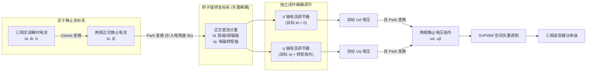
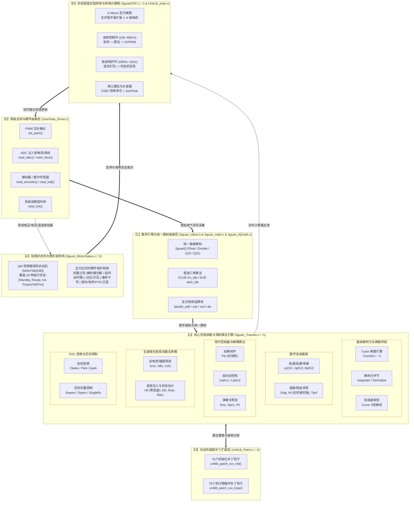
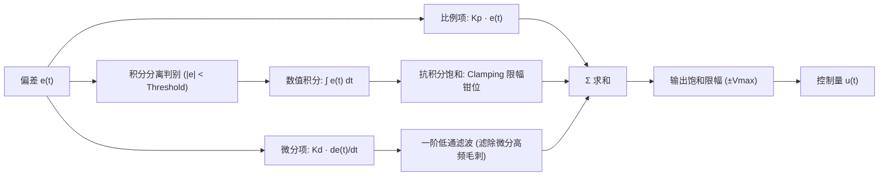
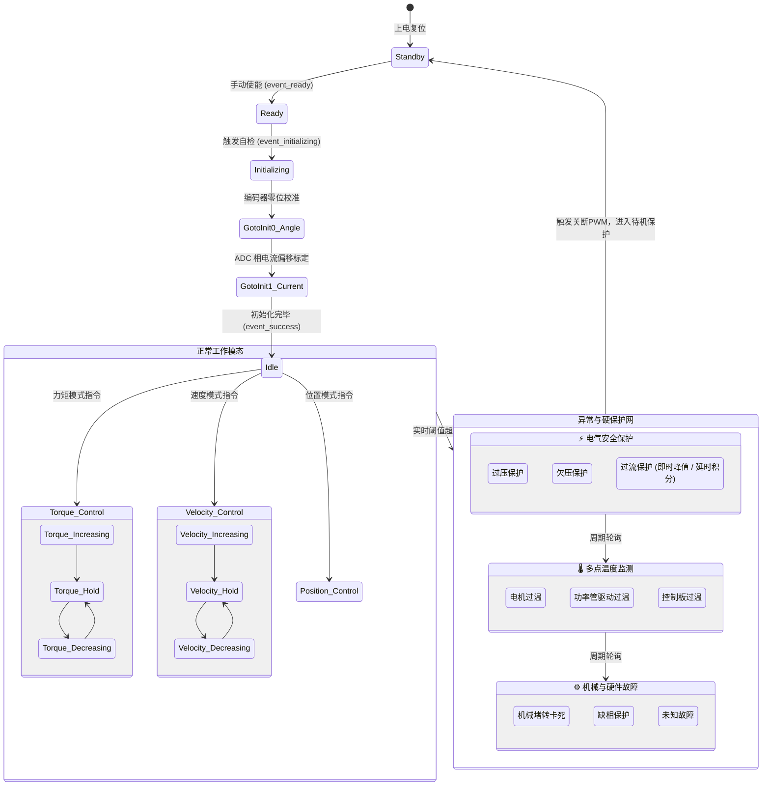

# SguanFOC v4.0.0 架构设计与核心算法全景深度解析 (Architecture & Theory Deep Dive)

> **文档定位**：本指南专为立志深入理解现代无刷直流电机 (BLDC) 与永磁同步电机 (PMSM) 高性能矢量控制 (FOC) 的嵌入式软件工程师、算法研究员与初学者编写。  
> 本文以 **SguanFOC 库 v4.0.0 (高度自由模块化 FOC，终阶)** 源码为蓝本，全面拆解从底层信号链、坐标变换、SVPWM 空间矢量调制，到 $s$ 域到 $z$ 域双线性离散化引擎、现代控制算法 (PID/LADRC/SMC/DPCC/PIR)、全速域无感观测器全家桶 (SMO/NLFO/VCFO/HFI/EKF/ROLO/MARS)、多电机 X-Macro 元编程及 196 项状态机安全保护的完整设计逻辑。

---

## 零、初学者前置导引：电机矢量控制的物理本质

### 1. 为什么需要 FOC (磁场定向控制)？

在传统的方波控制（六步换向）或标量控制（VF 压频比）中，定子产生的旋转磁场与转子永磁体磁场之间的夹角是在 $60^\circ \sim 120^\circ$ 范围内离散跳变的。

* 当两磁场夹角偏离 $90^\circ$ 时，定子电流产生的磁动势中有一部分被浪费在“径向挤压轴承”或“与转子磁场正面对冲（去磁/充磁）”上，导致转矩脉动大、能效低、高速运行啸叫严重。
* **FOC 的物理精髓**：实时检测转子永磁体的磁极位置角度 $\theta_e$（电角度），通过坐标变换，把定子三相交流电流解耦为两个在转子旋转坐标系下的相互正交的直流分量：
  1. **$d$ 轴电流 ($I_d$, 直轴)**：方向正对转子永磁体磁极，仅产生径向磁拉力，不产生任何旋转力矩（在表贴式 PMSM 中通常控制 $I_d = 0$ 以实现最大能效比；在高速弱磁工况下注入负 $I_d < 0$ 以拓宽转速极限）。
  2. **$q$ 轴电流 ($I_q$, 交轴)**：方向超前转子磁极 $90^\circ$ 电角度，百分之百产生切向旋转力矩（即电磁转矩 $T_e \propto I_q$）。

这样，复杂的非线性交流三相电机就被解耦成类似**“一台电刷在旋转的有刷直流电机”**，实现了线性的力矩控制。



### 2. 机械角度与电角度的物理转换

电机的定子旋转一周对应的空间物理角度为**机械角度 $\theta_m$ ($0 \sim 2\pi\text{ rad}$)**。如果电机内部有 $P_n$ 对磁极（例如 7 对极的云台电机或无人机盘式电机），当转子机械旋转一周时，磁场在定子绕组中交变了 $P_n$ 个周期，因此**电气角度 $\theta_e$** 满足：
$$\theta_e = P_n \cdot \theta_m$$
在所有 FOC 变换公式（Clarke、Park、SVPWM）中，涉及三角函数运算的输入角度**必须是电气角度 $\theta_e$**。

---

## 一、SguanFOC v4.0.0 系统架构拓扑全景

SguanFOC v4.0.0 是该架构演进的“终阶”版本。其最大革新在于**高自由度模块化 (High-degree-of-freedom Modularization)** 与 **面向对象半隐藏接口设计**：将所有的底层运算环节封装为标准的传递函数块 (`Transfer1` $\sim$ `Transfer5`)、独立滤波器、控制器与观测器，并提供统一的动态补丁接口 (`UnitLib_Patch`) 与 196 项转移矩阵的状态机保护网。



---

## 二、基础坐标变换与空间矢量调制深度数学推导

### 1. Clarke 变换与等幅值修正

三相定子绕组在空间对称分布，互差 $120^\circ$ 电角度。定子瞬时电流 $i_a(t), i_b(t), i_c(t)$ 产生的合成磁动势矢量在二维静止平面上运动。Clarke 变换的目的是将其投影到互差 $90^\circ$ 的正交静止坐标系 $\alpha-\beta$ 上。

对于星型接法中性点不接地系统，有基尔霍夫电流定律约束：
$$i_a(t) + i_b(t) + i_c(t) = 0$$

#### (1) 等幅值 Clarke 变换公式推导

为了保证变换后的正交电流幅值 $\sqrt{i_\alpha^2 + i_\beta^2}$ 与原始三相相电流峰值 $I_m$ 完全一致，采用变换系数 $m = \frac{2}{3}$：
$$\begin{bmatrix} i_\alpha \\ i_\beta \end{bmatrix} = \frac{2}{3} \begin{bmatrix} 1 & -\frac{1}{2} & -\frac{1}{2} \\ 0 & \frac{\sqrt{3}}{2} & -\frac{\sqrt{3}}{2} \end{bmatrix} \begin{bmatrix} i_a \\ i_b \\ i_c \end{bmatrix}$$

利用 $i_c = -i_a - i_b$ 代入化简，可得计算量最小的经典工业实现：
$$i_\alpha = i_a$$
$$i_\beta = \frac{1}{\sqrt{3}}(i_a + 2 i_b) = \frac{\sqrt{3}}{3} i_a + \frac{2\sqrt{3}}{3} i_b$$

在 SguanFOC 库中，该运算在 [`transfer_clarke_loop`](../SguanFOC库v4.0.0(高度自由模块化foc，终阶)/Sguan_Transfer.c) 中以纯浮点或 Q31 饱和乘加高效完成。

---

### 2. Park 变换与逆变换 (旋转正交投影)

将 $\alpha-\beta$ 静止坐标系上的交流相量逆时针旋转电角度 $\theta_e$，投影到与转子永磁体同步旋转的 $d-q$ 坐标系上。

#### (1) 旋转变换矩阵

$$\begin{bmatrix} i_d \\ i_q \end{bmatrix} = \begin{bmatrix} \cos\theta_e & \sin\theta_e \\ -\sin\theta_e & \cos\theta_e \end{bmatrix} \begin{bmatrix} i_\alpha \\ i_\beta \end{bmatrix}$$
展开形式：
$$i_d = i_\alpha \cos\theta_e + i_\beta \sin\theta_e$$
$$i_q = -i_\alpha \sin\theta_e + i_\beta \cos\theta_e$$

#### (2) 帕克逆变换 (Inverse Park Transform)

控制器输出目标调节电压 $U_d$ 和 $U_q$ 后，需反向旋转回 $\alpha-\beta$ 静止坐标系供调制模块使用：
$$\begin{bmatrix} u_\alpha \\ u_\beta \end{bmatrix} = \begin{bmatrix} \cos\theta_e & -\sin\theta_e \\ \sin\theta_e & \cos\theta_e \end{bmatrix} \begin{bmatrix} u_d \\ u_q \end{bmatrix}$$
展开形式：
$$u_\alpha = u_d \cos\theta_e - u_q \sin\theta_e$$
$$u_\beta = u_d \sin\theta_e + u_q \cos\theta_e$$

> [!TIP]
> 🚀 **算力优化技巧**：在 SguanFOC 中，$\sin\theta_e$ 与 $\cos\theta_e$ 绝不调用标准数学库的 `sin()` 和 `cos()`！而是调用 [`math_sin_cos()`](../SguanFOC库v4.0.0(高度自由模块化foc，终阶)/Sguan_math.c)，单次查表并进行相位偏移，直接同时吐出正弦和余弦值，耗时仅需几个时钟周期！

---

### 3. 七段式 SVPWM 空间矢量调制全流程拆解

SVPWM 的目标是通过三相全桥逆变器的 6 个功率开关管（对应 8 个开关状态，6 个非零基本电压矢量 $V_1 \sim V_6$ 与 2 个零矢量 $V_0, V_7$）的周期性组合切换，合成出一个在定子内圆内平滑旋转的等效圆形旋转电压矢量 $U_{ref}$。

```
          V2(010)        V1(001)
             \          /
              \ 扇区 II/
               \      /
  扇区 III      \    /      扇区 I
V3(011) --------- 0 ---------- V6(101)
                 /    \
  扇区 IV       /      \    扇区 VI
               / 扇区 V \
              /          \
          V4(010)        V5(100)
```

#### 第一步：扇区判断 (Sector Identification)

定义三个中间判别参考量：
$$U_1 = u_\beta$$
$$U_2 = \frac{\sqrt{3}}{2} u_\alpha - \frac{1}{2} u_\beta$$
$$U_3 = -\frac{\sqrt{3}}{2} u_\alpha - \frac{1}{2} u_\beta$$

设置判别标志位：

* 若 $U_1 > 0$，则 $A = 1$，否则 $A = 0$
* 若 $U_2 > 0$，则 $B = 1$，否则 $B = 0$
* 若 $U_3 > 0$，则 $C = 1$，否则 $C = 0$

合成扇区序号变量：
$$N = 4C + 2B + A$$
通过映射表查得实际所在扇区：

* $N=3 \implies \text{扇区 I}$
* $N=1 \implies \text{扇区 II}$
* $N=5 \implies \text{扇区 III}$
* $N=4 \implies \text{扇区 IV}$
* $N=6 \implies \text{扇区 V}$
* $N=2 \implies \text{扇区 VI}$

#### 第二步：相邻基本矢量作用时间计算

设 PWM 载波周期为 $T_{pwm}$，母线电压为 $V_{bus}$。以扇区 I 为例，相邻矢量为 $V_4$ 与 $V_6$：
$$T_4 = \frac{\sqrt{3} T_{pwm}}{V_{bus}} \left( \frac{\sqrt{3}}{2} u_\alpha - \frac{1}{2} u_\beta \right)$$
$$T_6 = \frac{\sqrt{3} T_{pwm}}{V_{bus}} u_\beta$$
零矢量总持续时间：
$$T_0 = T_{pwm} - T_4 - T_6$$

若发生过调制（$T_4 + T_6 > T_{pwm}$），执行饱和按比例收缩：
$$T_4' = T_4 \cdot \frac{T_{pwm}}{T_4 + T_6}, \quad T_6' = T_6 \cdot \frac{T_{pwm}}{T_4 + T_6}, \quad T_0' = 0$$

#### 第三步：七段式对称发波时间分配

为最小化开关损耗并消除开关谐波，七段式发波采用对称结构（例如扇区 I 顺序为：$V_0 \to V_4 \to V_6 \to V_7 \to V_6 \to V_4 \to V_0$）。
三相比较寄存器赋值：
$$T_{a} = \frac{T_0}{4}$$
$$T_{b} = T_a + \frac{T_4}{2}$$
$$T_{c} = T_b + \frac{T_6}{2}$$
这三个时间直接换算为定时器的 PWM 比较值寄存器 CCR1, CCR2, CCR3。

---

## 三、连续域到离散域的桥梁：Tustin 双线性离散化引擎

在经典现代控制理论中，模拟系统往往基于拉普拉斯变换的连续域传函 $G(s)$ 设计。但运行在 MCU 中的软件必须将其离散化为差分方程 $y[k]$。SguanFOC v4.0.0 内部通过 [`Transfer1` $\sim$ `Transfer5`](../SguanFOC库v4.0.0(高度自由模块化foc，终阶)/Sguan_Transfer.c) 实现了**一阶到五阶通用双线性变换差分求解引擎**。

### 1. Tustin 变换代数替换法则

双线性变换采用梯形数值积分逼近，其映射关系为：
$$s = \frac{2}{T_s} \cdot \frac{1 - z^{-1}}{1 + z^{-1}} = \frac{2}{T_s} \cdot \frac{z - 1}{z + 1}$$
其中 $T_s$ 为系统采样周期（在 SguanFOC 中即为 `PMSM_RUN_T = TIM_T = 50μs`，对应 $20\text{kHz}$）。

### 2. 一阶通用传递函数离散化推导实战 (`Transfer1`)

考虑一阶通用传递函数：
$$G(s) = \frac{num_1 s + num_0}{den_1 s + den_0}$$
将 $s = \frac{2}{T_s} \frac{1 - z^{-1}}{1 + z^{-1}}$ 代入：
$$G(z) = \frac{num_1 \left( \frac{2}{T_s} \frac{1 - z^{-1}}{1 + z^{-1}} \right) + num_0}{den_1 \left( \frac{2}{T_s} \frac{1 - z^{-1}}{1 + z^{-1}} \right) + den_0}$$
分子分母同乘以 $T_s (1 + z^{-1})$：
$$G(z) = \frac{2 \cdot num_1 (1 - z^{-1}) + num_0 T_s (1 + z^{-1})}{2 \cdot den_1 (1 - z^{-1}) + den_0 T_s (1 + z^{-1})}$$
合并同类项并整理为 $z^{-1}$ 降幂多项式：
$$G(z) = \frac{(2 \cdot num_1 + num_0 T_s) + (-2 \cdot num_1 + num_0 T_s) z^{-1}}{(2 \cdot den_1 + den_0 T_s) + (-2 \cdot den_1 + den_0 T_s) z^{-1}} = \frac{b_0 + b_1 z^{-1}}{a_0 + a_1 z^{-1}}$$

在时域中，由 $Y(z)(a_0 + a_1 z^{-1}) = U(z)(b_0 + b_1 z^{-1})$，取 $Z$ 逆变换得差分方程：
$$a_0 y[k] + a_1 y[k-1] = b_0 u[k] + b_1 u[k-1]$$
解出当前输出值 $y[k]$：
$$y[k] = \frac{b_0 u[k] + b_1 u[k-1] - a_1 y[k-1]}{a_0}$$

#### 源码对照分析

打开 [`Sguan_Transfer.c#L20-L54`](../SguanFOC库v4.0.0(高度自由模块化foc，终阶)/Sguan_Transfer.c)：
```c
// 系数初始化 / 参数动态重算
transfer->data->data_num[0] = 2.0f*transfer->params.num1 + transfer->params.num0*transfer->params.t;
transfer->data->data_num[1] = -2.0f*transfer->params.num1 + transfer->params.num0*transfer->params.t;

transfer->data->data_den[0] = 2.0f*transfer->params.den1 + transfer->params.den0*transfer->params.t;
transfer->data->data_den[1] = -2.0f*transfer->params.den1 + transfer->params.den0*transfer->params.t;

// 执行期差分递推循环
transfer->out.output = (transfer->in.input * transfer->data->data_num[0] 
                      + transfer->data->i   * transfer->data->data_num[1] 
                      - transfer->data->o   * transfer->data->data_den[1]) 
                      / transfer->data->data_den[0];

// 历史值移位
transfer->data->i = transfer->in.input;
transfer->data->o = transfer->out.output;
```
逻辑与数学推导严格一致！此设计使得用户在定义任意阶传递函数时，**只需输入连续域的微分方程参数分子分母，库内部自动转换为离散差分方程执行**，极大降低了控制算法的工程化门槛。

---

## 四、现代控制算法模块原理与实现

SguanFOC v4.0.0 不局限于传统 PID，还内置了自抗扰、滑模变结构与有限拍预测控制等多种工业先进控制算法。

### 1. 带抗积分饱和与滤波微分的 PID 控制器 (`Pid`)

经典增量/位置式 PID 在电机控制中最大的痛点是**执行机构饱和**（如母线电压受限导致 PWM 占空比打满 100%）。此时如果偏差持续存在，积分项会严重累加“虚高”，导致系统退饱和极其缓慢，产生剧烈超调甚至震荡失步。



SguanFOC 采取两套抗饱和防护：

1. **积分分离 (Integration Separation)**：当转速偏差较大时，切除积分项，仅靠比例作用快速响应；进入稳态精调区间后再投入积分消除静差。
2. **钳位抗饱和 (Clamping Anti-windup)**：一旦输出达到最大输出限幅，且积分动作继续朝加剧饱和的方向累加时，强制停止积分器累加。

---

### 2. 线性自抗扰控制 (LADRC, 一阶与二阶)

PID 本质是“基于误差消除误差”，对系统模型的不确定性（如电机参数随温度变化、母线电压跌落）以及外部扰动（如负载突变、齿槽转矩）响应迟缓。
LADRC 的核心思想是：将系统内部的未建模动态与所有外部扰动归结为一个**“总扰动 $f$”**，通过**扩张状态观测器 (LESO)** 将其在线实时估计出来，并在控制律中前馈抵消，将原本高度非线性的被控对象化简为纯积分器串联型线性积分链对象。

#### 一阶系统 LADRC1 数学模型

考虑一阶转速环系统模型：
$$\dot{y} = -a y + b u + w = b_0 u + f$$
其中 $y$ 为转速，$u$ 为交轴电流指令 $I_q$，$b_0$ 为控制器增益估计值，$f = -a y + (b - b_0) u + w$ 为总扰动。

扩张状态变量：设 $x_1 = y$, $x_2 = f$。状态方程为：
$$\begin{cases} \dot{x}_1 = x_2 + b_0 u \\ \dot{x}_2 = \dot{f} \end{cases}$$

构建线性扩张状态观测器 (LESO)：
$$\begin{cases} e_1 = z_1 - y \\ \dot{z}_1 = z_2 - \beta_1 e_1 + b_0 u \\ \dot{z}_2 = -\beta_2 e_1 \end{cases}$$
其中 $z_1$ 跟踪实际转速 $y$，$z_2$ 估计出总扰动 $f$。根据高志强教授的带宽法，观测器极点配置在 $-\omega_o$：
$$\beta_1 = 2 \omega_o, \quad \beta_2 = \omega_o^2$$

控制律设计：前馈补偿总扰动并实施比例闭环：
$$u_0 = K_p (r - z_1)$$
$$u = \frac{u_0 - z_2}{b_0}$$
闭环后的系统传递函数简化为标准一阶惯性环节 $\frac{Y(s)}{R(s)} = \frac{K_p}{s + K_p}$，完全消除了外界扰动影响！

---

### 3. 指数趋近律滑模控制 (SMC)

滑模变结构控制 (Sliding Mode Control) 对系统参数摄动与外界干扰具有完全的“鲁棒不变性”。

* **滑模面设计**：设转速跟踪误差 $e(t) = \omega_{ref} - \omega$。定义滑模切换面 $s = e$。
* **指数趋近律**：
  $$\dot{s} = -\epsilon \text{sgn}(s) - k s, \quad \epsilon > 0, k > 0$$
  其中 $-ks$ 为指数趋近项，保证远离滑模面时能以极高速度趋近；$-\epsilon \text{sgn}(s)$ 为等速趋近项，保证到达滑模面时的速度不为零。
* **抖振抑制策略**：传统滑模由于符号函数 $\text{sgn}(s)$ 的不连续开关，会导致控制器输出剧烈抖振（高频电磁啸叫和功率器件发热）。在 SguanFOC 的模块中，用连续的饱和函数 $\text{sat}(s / \delta)$ 或 Sigmoid 函数平滑替代 $\text{sgn}(s)$，在边界层 $\delta$ 内实现平滑过渡，消除了抖振。

---

### 4. 无死拍电流预测控制 (DPCC)

无死拍预测控制 (Deadbeat Predictive Current Control) 是一种基于离散状态空间模型的现代高动态电流控制方法。
在转子 $d-q$ 同步坐标系下，PMSM 的电压方程为：
$$u_d = R_s i_d + L_d \frac{di_d}{dt} - \omega_e L_q i_q$$
$$u_q = R_s i_q + L_q \frac{di_q}{dt} + \omega_e L_d i_d + \omega_e \psi_f$$

将微分项用一阶差分离散化：
$$\frac{di}{dt} \approx \frac{i[k+1] - i[k]}{T_s}$$
令期望在下一个采样周期末，实际电流完全跟踪上参考值，即令 $i_d[k+1] = i_d^*$, $i_q[k+1] = i_q^*$。
反解出当前周期需要施加的最优电压控制量：
$$u_d[k] = R_s i_d[k] + L_d \frac{i_d^* - i_d[k]}{T_s} - \omega_e L_q i_q[k]$$
$$u_q[k] = R_s i_q[k] + L_q \frac{i_q^* - i_q[k]}{T_s} + \omega_e L_d i_d[k] + \omega_e \psi_f$$
**控制效果**：理论上在一个 PWM 周期内即可消除电流误差，动态阶跃响应远超传统 PI 调节器。

---

## 五、全速域无感观测器全家桶原理与数学推导

在无物理编码器场景下，电机的转子位置与速度必须从电流和电压信号中实时估计。SguanFOC 提供了全速域无感算法库。

```
   [0 ~ 5% 额定转速]             [5% ~ 15% 切换过渡区]             [15% ~ 100%+ 额定转速]
════════════════════════════════════════════════════════════════════════════════════════════
    HFI 高频正弦波注入               加权过渡融合算法               SMO 滑模观测器 / NLFO 磁链观测器
 (利用转子几何/磁饱和凸极效应)     Angle = α·HFI + (1-α)·SMO      (反电动势足够强，基于反电势/磁链方程)
```

### 1. 滑模观测器 (SMO)

在静止坐标系 $\alpha-\beta$ 下，永磁同步电机电流状态方程为：
$$\frac{di_\alpha}{dt} = -\frac{R_s}{L_s} i_\alpha + \frac{1}{L_s} u_\alpha - \frac{1}{L_s} e_\alpha$$
$$\frac{di_\beta}{dt} = -\frac{R_s}{L_s} i_\beta + \frac{1}{L_s} u_\beta - \frac{1}{L_s} e_\beta$$
其中反电动势分量定义为：
$$e_\alpha = -\omega_e \psi_f \sin\theta_e, \quad e_\beta = \omega_e \psi_f \cos\theta_e$$

构建电流滑模观测器：
$$\frac{d\hat{i}_\alpha}{dt} = -\frac{R_s}{L_s} \hat{i}_\alpha + \frac{1}{L_s} u_\alpha - \frac{1}{L_s} z_\alpha$$
$$\frac{d\hat{i}_\beta}{dt} = -\frac{R_s}{L_s} \hat{i}_\beta + \frac{1}{L_s} u_\beta - \frac{1}{L_s} z_\beta$$
其中滑模控制量为：
$$z_\alpha = k \cdot \text{sgn}(\hat{i}_\alpha - i_\alpha), \quad z_\beta = k \cdot \text{sgn}(\hat{i}_\beta - i_\beta)$$
当系统滑动模态建立时，$\hat{i} - i \to 0$，滑模控制量 $z_\alpha, z_\beta$ 的等效控制分量即等于实际反电势 $e_\alpha, e_\beta$。经过一阶低通滤波提取平滑反电势后，送入锁相环 (PLL) 解算转子电角度 $\theta_e$ 和角速度 $\omega_e$。

---

### 2. 非线性磁链观测器 (NLFO)

SMO 在高速弱磁或参数漂移时容易受纯积分漂移影响。NLFO 直接以定子总磁链矢量为状态变量。
定子磁链状态方程：
$$\dot{\psi}_\alpha = u_\alpha - R_s i_\alpha$$
$$\dot{\psi}_\beta = u_\beta - R_s i_\beta$$
转子永磁体磁链模长恒为 $\psi_f$。定义磁链误差李雅普诺夫能量函数：
$$V = \frac{1}{2} \left( (\hat{\psi}_\alpha - L_s i_\alpha)^2 + (\hat{\psi}_\beta - L_s i_\beta)^2 - \psi_f^2 \right)^2$$
通过构造非线性反馈校正项，强行使观测磁链模长收敛在以 $\psi_f$ 为半径的圆周轨迹上，抗参数不确定性能力极强。

---

### 3. 高频正弦波注入 (HFI, 零低速无感)

在零速和极低速工况下，反电动势 $e \propto \omega_e \approx 0$，任何基于反电势的观测器（SMO、NLFO）彻底失效。HFI 利用转子的**凸极性 (Saliency, $L_d \ne L_q$)** 来提取转子位置。

* 在估计的转子 $d$ 轴上注入高频高压正弦信号：
  $$u_{dh} = V_h \cos(\omega_h t), \quad u_{qh} = 0$$
* 当估计角度 $\hat{\theta}_e$ 与实际角度 $\theta_e$ 存在误差 $\tilde{\theta} = \theta_e - \hat{\theta}_e$ 时，由于高频阻抗不平衡，高频电压会在估计的 $q$ 轴上感应出高频响应电流 $i_{qh}$：
  $$i_{qh} \approx I_{h2} \sin(2\tilde{\theta}) \sin(\omega_h t)$$
* **外差法解调与滤波**：将检测到的相电流经高通滤波滤除基波，再与 $\sin(\omega_h t)$ 相乘解调：
  $$\varepsilon = i_{qh} \cdot \sin(\omega_h t) \propto \sin(2\tilde{\theta})$$
* 误差信号 $\varepsilon$ 送入锁相环 (PLL)，驱使 $\tilde{\theta} \to 0$，即可实现零速悬停与带载起步！
* **极性辨识 (NSD)**：由于电感关于 $d$ 轴前后对称，高频注入只能分辨 $0 \sim 180^\circ$（无法分辨北极 N 还是南极 S）。库中通过注入正负短脉冲，利用定子铁芯的**磁饱和效应**（顺着磁场方向电感饱和下降，电流上升更快），准确识别定子磁极的真实极性。

---

## 六、数字滤波器族设计与数学机理

SguanFOC 内置了丰富的数字滤波器（[`Sguan_Transfer.h`](../SguanFOC库v4.0.0(高度自由模块化foc，终阶)/Sguan_Transfer.h)），全部基于 Tustin 变换解析离散化，免除用户查表配置的烦恼：

| 模块名称 | 物理特性与连续域传函 $G(s)$ | 应用场景与在 FOC 中的实战价值 |
| :---: | :--- | :--- |
| **`Lpf1`** (一阶低通) | $G(s) = \frac{\omega_c}{s + \omega_c}$ | 母线电压/母线电流滤波，转速反馈一阶平滑，计算开销极低（仅2次乘法） |
| **`Lpf2`** (二阶低通) | $G(s) = \frac{\omega_c^2}{s^2 + \sqrt{2}\omega_c s + \omega_c^2}$ (标准巴特沃斯) | SMO 反电势高阶谐波过滤，陡峭截止，相位延迟恒定 |
| **`Hpf1` / `Hpf2`** (高通) | $G(s) = \frac{s}{s + \omega_c}$, $G(s) = \frac{s^2}{s^2 + \sqrt{2}\omega_c s + \omega_c^2}$ | HFI 高频电流提取（阻隔直流大基波），去除电流采样直流漂移 |
| **`Bpf1` / `Bpf2`** (带通) | LPF+HPF 级联 或 $G(s) = \frac{2\zeta\omega_0 s}{s^2 + 2\zeta\omega_0 s + \omega_0^2}$ | 精准提取特定频段信号（如 HFI 注入频率 $1\text{kHz}$） |
| **`Sogi`** (二阶广义积分器) | $D(s) = \frac{k\omega_0 s}{s^2 + k\omega_0 s + \omega_0^2}$, $Q(s) = \frac{k\omega_0^2}{s^2 + k\omega_0 s + \omega_0^2}$ | 单相/正交信号生成 (OSG)，90度精准相移，广泛用于锁相环前置滤波 |
| **`Nf`** (陷波滤波器) | $G(s) = \frac{s^2 + \omega_0^2}{s^2 + 2\zeta\omega_0 s + \omega_0^2}$ | **机械共振消除利器**！精准挖掉减速箱或连杆的特征共振峰（如 $350\text{Hz}$） |
| **`Tpnf`** (三参数陷波) | $G(s) = \frac{s^2 + 2 k_2 \omega_0 s + \omega_0^2}{s^2 + 2 k_1 \omega_0 s + \omega_0^2}$ | 相比普通陷波器，可独立调节陷波深度与宽度，减小对控制通带相位的损伤 |

---

## 七、196项转移矩阵有限状态机 (FSM)

电机的运行与保护必须由高可靠性的有限状态机调度。[`Sguan_MotorStatus.c`](../SguanFOC库v4.0.0(高度自由模块化foc，终阶)/Sguan_MotorStatus.c) 构建了多达 **196 个转移单元的全局状态转移表 `motor_tab[196]`**，覆盖了 29 个子状态 (`HandleStatus`)、7 大系统阶段 (`HandleState`) 与 22 种触发事件 (`HandleEvent`)。



### 即时过流与延时过流双重保护机制

在 [`Sguan_MotorStatus.c#L717-L740`](../SguanFOC库v4.0.0(高度自由模块化foc，终阶)/Sguan_MotorStatus.c) 中，实现了严苛的工业级电流保护：

1. **即时峰值过流保护 ($I_{bus} \ge I_{instant\_max}$)**：一旦母线电流超过硬极限（如硬件相间短路），**零延迟**立刻触发切断 PWM 输出。
2. **延时反时限过流保护 ($I_{bus} \ge I_{stable\_max}$ 且持续时间 $\ge t_{delay}$)**：允许电机在加速瞬间承受短时过载电流，但若持续超过稳定额定上限达到 `ibus_tick_delay`，状态机同样判定为过流，平稳停机，避免功率 MOS 管热击穿。

---

## 八、系统工程级特色设计剖析

### 1. 多电机 X-Macro 元编程 (`SguanFOC.c`)

在多轴机器人（如双足、四足、机械臂）中，经常需要同一套固件同时驱动 1 至 6 台电机。若写 6 套重复的初始化与中断循环代码，会导致代码极度冗余且极难维护。  
SguanFOC 采用了优雅的 **C 语言预处理器 X-Macro** 技术：
```c
#define MAKE_MOTOR_FUNCS(n) \
    static void high_loop_##n(void) { \
        SguanFoc *p = &sguanfoc[n]; \
        sguanfoc_high_loop(p); \
    } \
    static void low_loop_##n(void) { \
        SguanFoc *p = &sguanfoc[n]; \
        sguanfoc_low_loop(p); \
    } \
    static void main_loop_##n(void) { \
        SguanFoc *p = &sguanfoc[n]; \
        sguanfoc_main_loop(p); \
    }

#define X(n) MAKE_MOTOR_FUNCS(n)
MOTOR_LIST
#undef X
```
用户只需在 [`UnitLib_Config.h`](../SguanFOC库v4.0.0(高度自由模块化foc，终阶)/UnitLib_Config.h) 中修改一个宏：
```c
#define UNITLIB_CONFIG_MOTOR  4  // 配置为 4 轴电机
```
预处理器便会自动生成 `high_loop_0` 到 `high_loop_3`，以及 `sguanfoc[4]` 的结构体静态数组分配，没有产生任何运行时虚函数开销或指针寻址损耗！

---

### 2. 串口极速 DJB2 哈希查表解析 (`Sguan_printf.c`)

传统串口调参通常使用 `strcmp` 逐个比较字符串，或者用标准库的 `sscanf`/`atof` 进行浮点数解析，计算开销巨大，甚至会拖慢 $10\text{kHz}$ 的高频中断。  
SguanFOC 实现了工业级的无锁轻量解析：

* **DJB2 32 位字符串哈希算法**：
  $$hash_{i} = (hash_{i-1} \ll 5) + hash_{i-1} + str[i] = hash_{i-1} \times 33 + str[i]$$
  串口指令字典在开机初始化时（`printf_rx_init`）一次性算好哈希值。收到指令时，计算收到的 Key 字符串哈希值，直接以**单条整数比较指令**匹配指令，时间复杂度达 $O(1)$！
* **单遍扫描浮点数提取器 (`get_data_fast`)**：无库函数依赖，纯手写整数累加与权值衰减，并带有粘包异常熔断截断保护，确保系统毫秒级参数热调整不卡死。
