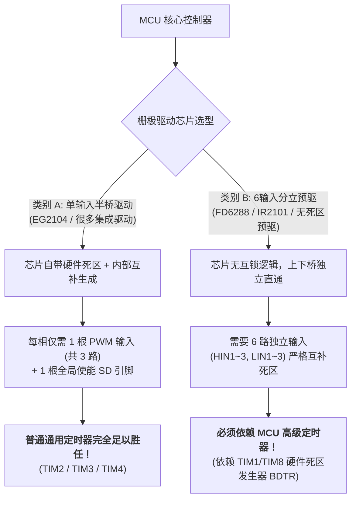

# SguanFOC v4.0.0 从 CH32V305 到 CH32V467 移植与硬件架构全景指南

> **核心摘要**：  
> 1. **架构真相澄清**：在“MCU + 半桥栅极驱动 (如 EG2104) + NMOS”架构中，**MCU 确实不需要高级定时器**！普通通用定时器（TIM2/TIM3/TIM4/TIM5）配合 3 路单端 PWM 完全足以胜任。  
> 2. **硬件映射与移植**：基于原开源硬件 **CH32V305CCT6** 关节板电路，全面给出 **CH32V467**（200MHz 青稞 RISC-V + RVV 向量引擎 + 4MB/8MB 片上 PSRAM）的引脚重分配方案（含原有 PCB 原位兼容方案与全新通用定时器方案）。  
> 3. **v4.0.0 终阶库适配代码**：提供开箱即用的 `UserData_Driver.c` 硬件抽象层、外设初始化驱动（TIM/ADC/SPI/GPIO）以及顶层中断调度代码。

---

## 目录

- [一、核心理论辨析：MCU 是否必须具备高级定时器？](#一核心理论辨析mcu-是否必须具备高级定时器)
  - [1.1 栅极驱动芯片的本质分类决定对 MCU 的需求](#11-栅极驱动芯片的本质分类决定对-mcu-的需求)
  - [1.2 V305 原理图硬件设计实证：为什么只用 3 路 PWM？](#12-v305-原理图硬件设计实证为什么只用-3-路-pwm)
  - [1.3 普通通用定时器胜任 FOC 的三大硬性指标自查](#13-普通通用定时器胜任-foc-的三大硬性指标自查)
  - [1.4 结论与架构对比决策表](#14-结论与架构对比决策表)
- [二、芯片特性对比：CH32V305 vs CH32V467](#二芯片特性对比ch32v305-vs-ch32v467)
- [三、IO 引脚配置与外设复用映射全景](#三io-引脚配置与外设复用映射全景)
  - [3.1 V305 原理图硬件引脚分布回顾](#31-v305-原理图硬件引脚分布回顾)
  - [3.2 方案 A：V467 原位引脚直连方案 (PCB Pin-to-Pin 兼容)](#32-方案-av467-原位引脚直连方案-pcb-pin-to-pin-兼容)
  - [3.3 方案 B：纯通用定时器方案 (TIM2 释放高定资源)](#33-方案-b纯通用定时器方案-tim2-释放高定资源)
- [四、SguanFOC v4.0.0 移植落地代码](#四sguanfoc-v400-移植落地代码)
  - [4.1 配置文件宏定义调整 (`Sguan_Config.h` / `UnitLib_Config.h`)](#41-配置文件宏定义调整-sguan_configh--unitlib_configh)
  - [4.2 底层硬件外设驱动 (`Sguan_TIM.c / .h`)](#42-底层硬件外设驱动-sguan_timc--h)
  - [4.3 底层双通道注入 ADC 采样 (`Sguan_ADC.c / .h`)](#43-底层双通道注入-adc-采样-sguan_adcc--h)
  - [4.4 磁编码器 SPI 驱动 (`KTH7823_Driver.c / .h`)](#44-磁编码器-spi-驱动-kth7823_driverc--h)
  - [4.5 硬件抽象层完整适配 (`UserData_Driver.c`)](#45-硬件抽象层完整适配-userdata_driverc)
  - [4.6 顶层调度与中断服务入口 (`main.c` / `ch32v46x_it.c`)](#46-顶层调度与中断服务入口-mainc--ch32v46x_itc)
- [五、MounRiver Studio 工程配置与避坑指南](#五mounriver-studio-工程配置与避坑指南)

---

## 一、核心理论辨析：MCU 是否必须具备高级定时器？

很多开发者在接触 FOC 算法时常常形成一个固有思维：“做无刷电机控制，MCU 必须要有带互补死区的高级定时器（如 TIM1/TIM8）”。  
**明确结论：在本项目“MCU + 栅极驱动 + NMOS”框架下，这个结论是不成立的！MCU 完全不需要高级定时器，普通通用定时器（TIM2/TIM3/TIM4/TIM5）完全足以胜任！**

### 1.1 栅极驱动芯片的本质分类决定对 MCU 的需求

能否使用普通通用定时器，**唯一决定因素在于逆变桥前的“栅极驱动芯片 (Gate Driver IC)”的工作模式**：



#### 驱动芯片对比矩阵：

| 驱动芯片方案 | 典型芯片 | 输入信号需求 | 内部死区机制 | 对 MCU 定时器的要求 |
| :--- | :--- | :--- | :--- | :--- |
| **单输入半桥驱动 (本项目方案)** | **EG2104**, MP6540, IR2104 | **3 路单端 PWM**<br>(每相 1 根 IN) + 1 根 SD | **芯片硬件内置死区**<br>(EG2104 内部固定死区约 400ns) | **极低**：普通定时器输出 3 路 PWM 即可，完全不需要互补通道和死区发生器 |
| **三相一体化功率芯片** | **DRV8313**, MP6536, L6234 | **3 路单端 PWM**<br>(IN1, IN2, IN3) + EN | **芯片硬件集成死区与保护** | **极低**：通用定时器完全适用 |
| **6 输入分立高低侧驱动** | **FD6288**, IR2101, EG2133 | **6 路输入**<br>(HIN1~3, LIN1~3) | ❌ 无内部互锁死区逻辑 | **极高**：必须依赖 MCU 高级定时器硬件互补死区（BDTR），否则上下管直通炸管 |

---

### 1.2 V305 原理图硬件设计实证：为什么只用 3 路 PWM？

翻开工程开源硬件电路图（`【原理图】SguanFOC_MOTOR.pdf`）：
1. **驱动芯片选型**：板载 3 颗 `U6`, `U11`, `U13`，型号为 **EG2104** 半桥栅极驱动芯片；
2. **EG2104 芯片引脚定义**：
   - `Pin 2 (IN)`：逻辑信号输入端，高电平导通高端 MOS (HO)，低电平导通低端 MOS (LO)；
   - `Pin 3 (SD#)`：关断/使能引脚，低电平进入关断休眠（HO、LO 均为低），高电平正常工作；
   - `Pin 5 (LO)` / `Pin 7 (HO)`：内部自动反相生成高低侧栅极驱动，并**自动插入 400ns 硬件死区**；
3. **MCU 连接关系**：
   - `PA8` 连接 `PWM-A` (U6 的 IN 端)；
   - `PA9` 连接 `PWM-C` (U13 的 IN 端)；
   - `PA10` 连接 `PWM-B` (U11 的 IN 端)；
   - `PA11` 连接 `SD` (U6, U11, U13 的 SD# 集中使能端)。

**硬件实证**：原设计即便是连接在高级定时器 TIM1 的 PA8/PA9/PA10 上，也**仅仅开启了 CH1/CH2/CH3 单端输出**，互补通道（CH1N/CH2N/CH3N）全部悬空禁用，且死区寄存器 BDTR 未配置任何延时。因此，**替换为普通定时器在电气原理上 100% 等效**！

---

### 1.3 普通通用定时器胜任 FOC 的三大硬性指标自查

在放弃高级定时器、改用普通通用定时器（如 TIM2/TIM3/TIM4/TIM5）时，必须确认以下三大特性是否得到满足：

1. **中央对齐计数模式 (Center-Aligned Mode)**：
   - *要求*：SVPWM 要求载波关于中心对称以消除开关谐波，并在波谷进行电流采样；
   - *通用定时器支持度*：CH32V / STM32 的 TIM2~TIM5 全部支持 `TIM_CounterMode_CenterAligned1/2/3` 双向计数，与 TIM1 完全一致。
2. **ADC 硬件触发源联动 (TRGO 输出)**：
   - *要求*：在定时器波谷（下溢）或利用未连接引脚的 CH4 比较匹配瞬时触发双路 ADC 注入转换，杜绝软件中断抖动；
   - *通用定时器支持度*：TIM2~TIM5 均具备 `TIM_SelectOutputTrigger(TIMx, TIM_TRGOSource_Update)` 或 `TIM_TRGOSource_OC4Ref`，支持硬件联动 ADC 注入组。
3. **时钟主频与细分精度**：
   - *要求*：在 10kHz~20kHz 载波下具备足够的占空比调节级数；
   - *主频支持度*：CH32V467 的 APB1/APB2 外设时钟高达 100MHz~200MHz，在 20kHz 中央对齐模式下计数值达 5000~10000 级，分辨率优于 0.02%，控制精度极高。

### 1.4 结论与架构对比决策表

| 特性需求 | 高级定时器 (TIM1/TIM8) | 通用定时器 (TIM2/TIM3/TIM4/TIM5) | 本项目 (EG2104+NMOS) 结论 |
| :--- | :---: | :---: | :---: |
| **3 路单端 PWM 输出** | ✅ 支持 | ✅ 支持 | **两者无任何区别** |
| **中央对齐双向计数** | ✅ 支持 | ✅ 支持 | **两者无任何区别** |
| **TRGO 硬件触发 ADC 注入** | ✅ 支持 | ✅ 支持 | **两者无任何区别** |
| **6 路互补输出 (CHxN)** | ✅ 硬件支持 | ❌ 不支持 (无引脚) | **本项目不需要 (EG2104 自带反相)** |
| **硬件死区时间发生器 (BDTR)** | ✅ 硬件支持 | ❌ 不支持 | **本项目不需要 (EG2104 内置 400ns 死区)** |
| **紧急刹车断开引脚 (BKIN)** | ✅ 纳秒级硬件保护 | ❌ 不支持 | 可由比较器或 EXTI 中断拉低 SD 引脚代替 |

> [!TIP]
> **开发建议**：  
> - 如果继续沿用原 V305 硬件走线（PA8/PA9/PA10），直接使用 V467 的 TIM1（单端模式），代码无缝复用；  
> - 如果重新设计硬件板或需要节省出 TIM1 用于其他外设（如双电机驱动），**大胆采用 TIM2 或 TIM3**，性能没有任何折扣！

---

## 二、芯片特性对比：CH32V305 vs CH32V467

| 硬件规格 | 原方案：CH32V305CCT6 | 新方案：CH32V467 | 移植收益与升级亮点 |
| :--- | :--- | :--- | :--- |
| **内核架构** | 32 位 RISC-V 青稞 **V4F** | 32 位 RISC-V 青稞 **V3V / V4V** | 升级搭载 **RISC-V Vector 向量扩展 (RVV)**，支持单指令矢量并行解算 |
| **最高主频** | 144 MHz | **200 MHz** (零等待运行) | 主频提升 38.9%，在 20kHz FOC 载波中断下 CPU 负载降低至 15% 以下 |
| **硬件浮点 (FPU)** | 单精度硬件 FPU (RV32IMAFC) | 单精度/双精度硬件 FPU + RVV 向量单元 | 原生硬件浮点，与 SguanFOC 终阶库原生 `float` 运算高度吻合 |
| **SRAM / Flash** | 32 KB SRAM / 128 KB Flash | **200 KB SRAM / 512 KB Flash** | 内存暴增 6 倍，可开辟大容量高频调参波形缓冲区，轻松部署复杂算法 |
| **片上 PSRAM** | ❌ 无 | **4 MB / 8 MB 片上伪静态 RAM (PSRAM)** | **核心硬件差异**：无需外部走线即可拥有海量数据缓冲区，支持高阶黑匣子记录 |
| **网络与高速接口** | 双高速 USB (需外部转接) | **片上集成 10/100M 以太网 PHY**<br>+ **双高速 USB 2.0 PHY** | 可单芯片直接做成工业以太网 (Modbus-TCP / Ethernet) 伺服驱动一体板 |
| **模拟外设 (ADC/OPA)** | 2 × 12 位 ADC (16 通道) | 2 × 12 位高速 ADC + 2 × DAC + **内置轨到轨运算放大器 (OPA)** | 内置 OPA 具备可编程增益，未来改版可直接省掉外部运放 INA240，进一步降低 BOM 成本 |

---

## 三、IO 引脚配置与外设复用映射全景

### 3.1 V305 原理图硬件引脚分布回顾

原开源板卡（CH32V305CCT6，LQFP48 封装）引脚连线如下：

```mermaid
graph LR
    subgraph V305_Pins [CH32V305 原版引脚]
        PA8["PA8: TIM1_CH1 -> PWM-A"]
        PA9["PA9: TIM1_CH2 -> PWM-C"]
        PA10["PA10: TIM1_CH3 -> PWM-B"]
        PA11["PA11: GPIO_Out -> SD (驱动使能)"]
        PA12["PA12: GPIO_Out -> LED 指示灯"]
        
        PB0["PB0: ADC1_IN8 -> ADC_B (相电流 B)"]
        PB1["PB1: ADC1_IN9 -> ADC_A (相电流 A)"]
        
        PA3["PA3: GPIO_Out -> SPI1_CS (编码器)"]
        PA5["PA5: SPI1_SCK -> SCK"]
        PA6["PA6: SPI1_MISO -> MISO"]
        PA7["PA7: SPI1_MOSI -> MOSI"]
        
        PB4["PB4: CAN2_RX"]
        PB5["PB5: CAN2_TX"]
        PB6["PB6: USART1_RX (调试串口)"]
        PB7["PB7: UART6_TX (调试串口)"]
        
        PC4["PC4: KEY1 输入"]
        PB15["PB15: KEY2 输入"]
    end
```



> [!CAUTION]
> **相序接线细节防坑**：  
> 请务必注意原图纸的引脚与三相逆变桥对应顺序：  
> - `PA8` 对应逆变相 **A** (`PWM-A`)；  
> - `PA9` 对应逆变相 **C** (`PWM-C`)；  
> - `PA10` 对应逆变相 **B** (`PWM-B`)；  
> 在定时器占空比写入函数中，必须严格按照 `U -> PA8`, `V -> PA10`, `W -> PA9` 分发，否则会导致电机转向反转或开机抖动！

---

### 3.2 方案 A：V467 原位引脚直连方案 (PCB Pin-to-Pin 兼容)

若直接将 CH32V467 焊接在原 V305 硬件板卡或保持 PCB 走线不变，引脚配置映射表如下：

| 功能信号 | 原 V305 引脚 | CH32V467 目标引脚 | 外设复用功能 | GPIO 模式配置 | 备注说明 |
| :--- | :--- | :--- | :--- | :--- | :--- |
| **PWM-A (U 相)** | **PA8** | **PA8** | TIM1_CH1 | 推挽复用输出 (`GPIO_Mode_AF_PP`), 50MHz | 单端 PWM 输出，禁用 CH1N |
| **PWM-C (W 相)** | **PA9** | **PA9** | TIM1_CH2 | 推挽复用输出 (`GPIO_Mode_AF_PP`), 50MHz | 单端 PWM 输出，注意对应 W 相 |
| **PWM-B (V 相)** | **PA10** | **PA10** | TIM1_CH3 | 推挽复用输出 (`GPIO_Mode_AF_PP`), 50MHz | 单端 PWM 输出，注意对应 V 相 |
| **栅极使能 (SD)** | **PA11** | **PA11** | GPIO | 通用推挽输出 (`GPIO_Mode_Out_PP`) | 高电平使能 EG2104，低电平关断 |
| **运行 LED** | **PA12** | **PA12** | GPIO | 通用推挽输出 (`GPIO_Mode_Out_PP`) | 高电平点亮 |
| **相电流 A (Ia)** | **PB1** | **PB1** | ADC1_IN9 | 模拟输入 (`GPIO_Mode_AIN`) | INA240 放大输出采样，注入通道 |
| **相电流 B (Ib)** | **PB0** | **PB0** | ADC1_IN8 | 模拟输入 (`GPIO_Mode_AIN`) | INA240 放大输出采样，注入通道 |
| **编码器 CS** | **PA3** | **PA3** | GPIO | 通用推挽输出 (`GPIO_Mode_Out_PP`) | 软件片选控制，低电平使能 |
| **编码器 SCK** | **PA5** | **PA5** | SPI1_SCK | 推挽复用输出 (`GPIO_Mode_AF_PP`) | KTH7823 时钟 (CPOL=1, CPHA=1) |
| **编码器 MISO**| **PA6** | **PA6** | SPI1_MISO| 浮空输入 (`GPIO_Mode_IN_FLOATING`) | 磁编码器角度数据回传 |
| **编码器 MOSI**| **PA7** | **PA7** | SPI1_MOSI| 推挽复用输出 (`GPIO_Mode_AF_PP`) | 发送寄存器命令 |
| **CAN 通信** | **PB4 / PB5** | **PB4 / PB5** | CAN1/CAN2 | 复用推挽 / 上拉输入 | 关节通信主总线 |
| **用户按键** | **PC4 / PB15** | **PC4 / PB15** | GPIO | 下拉 / 上拉输入 | KEY1 与 KEY2 |

---

### 3.3 方案 B：纯通用定时器方案 (TIM2 释放高定资源)

若针对 V467 重新设计布线，或希望释放 TIM1/TIM8 用于其他轴/高阶任务，可采用 **TIM2 普通定时器** 生成三相 PWM：

| 功能信号 | 推荐 V467 引脚 | 外设复用功能 | 硬件连线目标 | 方案优势 |
| :--- | :--- | :--- | :--- | :--- |
| **PWM-A** | **PA0** | TIM2_CH1 | 连接 U 相 EG2104 的 IN 引脚 | 验证通用定时器完全胜任 FOC |
| **PWM-B** | **PA1** | TIM2_CH2 | 连接 V 相 EG2104 的 IN 引脚 | 走线集中，PA0~PA2 紧邻 |
| **PWM-C** | **PA2** | TIM2_CH3 | 连接 W 相 EG2104 的 IN 引脚 | 释放 TIM1 与 TIM8 全部引脚 |
| **ADC 触发** | 内部联动 | **TIM2 TRGO** | 触发 ADC1/2 注入转换 | 完全相同于高级定时器效果 |

---

## 四、SguanFOC v4.0.0 移植落地代码

### 4.1 配置文件宏定义调整 (`Sguan_Config.h` / `UnitLib_Config.h`)

在 SguanFOC v4.0.0 中，数学核心与实例规模在头文件中解耦。打开并设置如下：

#### `UnitLib_Config.h`
```c
#ifndef __UNITLIB_CONFIG_H
#define __UNITLIB_CONFIG_H

// 1. 设置电机实例数量为 1 (单轴)
#define UNITLIB_CONFIG_MOTOR        1

// 2. 数学运算模式配置:
// 0 -> float (原生单精度浮点)
// 1 -> double (双精度浮点)
// 2 -> Q15 定点
// 3 -> Q31 定点
// CH32V467 搭载硬件单精度 FPU 与 200MHz 青稞 RISC-V 内核，直接选 0 (float) 性能最强！
#define UNITLIB_CONFIG_MATH         0

// 3. 启用常用控制与滤波模块 (根据需要开闭)
#define UNITLIB_CONFIG_PID          1   // 启用位置/速度/电流 PID
#define UNITLIB_CONFIG_LPF1         1   // 启用一阶低通滤波
#define UNITLIB_CONFIG_TRANSFER1    2   // 典型传递函数

#endif // __UNITLIB_CONFIG_H
```

#### `UserData_Config.h`
```c
#ifndef __USERDATA_CONFIG_H
#define __USERDATA_CONFIG_H

// 载波与中断周期配置: 20kHz 对应 50us (5e-5)
#define TIM_T                       5e-5f 

#endif // __USERDATA_CONFIG_H
```

---

### 4.2 底层硬件外设驱动 (`Sguan_TIM.c / .h`)

此处提供针对 CH32V467 的定时器初始化代码。支持**通用定时器 (TIM2) 模式**与**高级定时器 (TIM1) 模式**，两者均配置为**中央对齐计数 + TRGO 触发 ADC 注入采样**。

#### `Sguan_TIM.h`
```c
#ifndef __SGUAN_TIM_H
#define __SGUAN_TIM_H

#include "ch32v46x.h"

// 选择使用的定时器 (默认使用方案 A: TIM1 单端模式，亦可改为 TIM2)
#define USE_GENERAL_TIM2   0  // 置 1 时切换为通用定时器 TIM2 模式

#if USE_GENERAL_TIM2
    #define SGUAN_PWM_TIM           TIM2
    #define SGUAN_PWM_TIM_RCC       RCC_APB1Periph_TIM2
    #define SGUAN_PWM_TIM_IRQn      TIM2_IRQn
    #define SGUAN_PWM_TIM_IRQHandler TIM2_IRQHandler
#else
    #define SGUAN_PWM_TIM           TIM1
    #define SGUAN_PWM_TIM_RCC       RCC_APB2Periph_TIM1
    #define SGUAN_PWM_TIM_IRQn      TIM1_UP_IRQn
    #define SGUAN_PWM_TIM_IRQHandler TIM1_UP_IRQHandler
#endif

// PWM 载波周期计数值 (200MHz / 20kHz / 2 = 5000)
#define SGUAN_PWM_PERIOD        5000 

void Sguan_TIM_Init(void);

#endif // __SGUAN_TIM_H
```

#### `Sguan_TIM.c`
```c
#include "Sguan_TIM.h"

/**
 * @brief  初始化定时器输出 GPIO
 */
static void Sguan_TIM_GPIO_Init(void)
{
    GPIO_InitTypeDef GPIO_InitStructure = {0};

#if USE_GENERAL_TIM2
    // 通用定时器方案: PA0, PA1, PA2
    RCC_APB2PeriphClockCmd(RCC_APB2Periph_GPIOA, ENABLE);
    GPIO_InitStructure.GPIO_Pin = GPIO_Pin_0 | GPIO_Pin_1 | GPIO_Pin_2;
    GPIO_InitStructure.GPIO_Mode = GPIO_Mode_AF_PP;
    GPIO_InitStructure.GPIO_Speed = GPIO_Speed_50MHz;
    GPIO_Init(GPIOA, &GPIO_InitStructure);
#else
    // 原位兼容方案: PA8, PA9, PA10
    RCC_APB2PeriphClockCmd(RCC_APB2Periph_GPIOA, ENABLE);
    GPIO_InitStructure.GPIO_Pin = GPIO_Pin_8 | GPIO_Pin_9 | GPIO_Pin_10;
    GPIO_InitStructure.GPIO_Mode = GPIO_Mode_AF_PP;
    GPIO_InitStructure.GPIO_Speed = GPIO_Speed_50MHz;
    GPIO_Init(GPIOA, &GPIO_InitStructure);
#endif
}

/**
 * @brief  配置中央对齐 20kHz PWM 输出及 TRGO 触发
 */
void Sguan_TIM_Init(void)
{
    TIM_TimeBaseInitTypeDef TIM_TimeBaseInitStructure = {0};
    TIM_OCInitTypeDef TIM_OCInitStructure = {0};
    NVIC_InitTypeDef NVIC_InitStructure = {0};

    Sguan_TIM_GPIO_Init();

#if USE_GENERAL_TIM2
    RCC_APB1PeriphClockCmd(SGUAN_PWM_TIM_RCC, ENABLE);
#else
    RCC_APB2PeriphClockCmd(SGUAN_PWM_TIM_RCC, ENABLE);
#endif

    // 1. 时基单元配置: 中央对齐模式 1 (向上计数时触发比较，波谷/波峰双向运行)
    TIM_TimeBaseInitStructure.TIM_Period = SGUAN_PWM_PERIOD - 1;
    TIM_TimeBaseInitStructure.TIM_Prescaler = 0;              // 0 分频，时钟 200MHz
    TIM_TimeBaseInitStructure.TIM_ClockDivision = TIM_CKD_DIV1;
    TIM_TimeBaseInitStructure.TIM_CounterMode = TIM_CounterMode_CenterAligned1;
    TIM_TimeBaseInitStructure.TIM_RepetitionCounter = 0;
    TIM_TimeBaseInit(SGUAN_PWM_TIM, &TIM_TimeBaseInitStructure);

    // 2. 通道 1~3 PWM 输出模式初始化 (初始占空比 0)
    TIM_OCInitStructure.TIM_OCMode = TIM_OCMode_PWM1;
    TIM_OCInitStructure.TIM_OutputState = TIM_OutputState_Enable;
    TIM_OCInitStructure.TIM_OutputNState = TIM_OutputNState_Disable; // 禁用互补，仅需单端！
    TIM_OCInitStructure.TIM_Pulse = 0;
    TIM_OCInitStructure.TIM_OCPolarity = TIM_OCPolarity_High;
    TIM_OCInitStructure.TIM_OCIdleState = TIM_OCIdleState_Reset;

    TIM_OC1Init(SGUAN_PWM_TIM, &TIM_OCInitStructure);
    TIM_OC2Init(SGUAN_PWM_TIM, &TIM_OCInitStructure);
    TIM_OC3Init(SGUAN_PWM_TIM, &TIM_OCInitStructure);

    // 3. 通道 4 配置为 TRGO 触发源 (在波谷点下溢触发 ADC 采样)
    TIM_OCInitStructure.TIM_OutputState = TIM_OutputState_Disable;
    TIM_OCInitStructure.TIM_Pulse = 1; // 计数达到 1 时产生事件
    TIM_OC4Init(SGUAN_PWM_TIM, &TIM_OCInitStructure);
    TIM_SelectOutputTrigger(SGUAN_PWM_TIM, TIM_TRGOSource_OC4Ref);

    // 4. 预装载使能
    TIM_ARRPreloadConfig(SGUAN_PWM_TIM, ENABLE);
    TIM_OC1PreloadConfig(SGUAN_PWM_TIM, TIM_OCPreload_Enable);
    TIM_OC2PreloadConfig(SGUAN_PWM_TIM, TIM_OCPreload_Enable);
    TIM_OC3PreloadConfig(SGUAN_PWM_TIM, TIM_OCPreload_Enable);
    TIM_OC4PreloadConfig(SGUAN_PWM_TIM, TIM_OCPreload_Enable);

#if !USE_GENERAL_TIM2
    // 若使用 TIM1，需开启 MOE 主输出使能
    TIM_CtrlPWMOutputs(SGUAN_PWM_TIM, ENABLE);
#endif

    // 5. 中断配置: 开启更新中断 (波谷执行 FOC 计算)
    TIM_ClearITPendingBit(SGUAN_PWM_TIM, TIM_IT_Update);
    NVIC_InitStructure.NVIC_IRQChannel = SGUAN_PWM_TIM_IRQn;
    NVIC_InitStructure.NVIC_IRQChannelPreemptionPriority = 1;
    NVIC_InitStructure.NVIC_IRQChannelSubPriority = 0;
    NVIC_InitStructure.NVIC_IRQChannelCmd = ENABLE;
    NVIC_Init(&NVIC_InitStructure);

    TIM_ITConfig(SGUAN_PWM_TIM, TIM_IT_Update, ENABLE);
    TIM_Cmd(SGUAN_PWM_TIM, ENABLE);
}
```

---

### 4.3 底层双通道注入 ADC 采样 (`Sguan_ADC.c / .h`)

#### `Sguan_ADC.c`
```c
#include "ch32v46x.h"

// 保存 ADC 注入采样原始码值
volatile uint16_t adc_raw_ia = 2048;
volatile uint16_t adc_raw_ib = 2048;

void Sguan_ADC_Init(void)
{
    ADC_InitTypeDef ADC_InitStructure = {0};
    GPIO_InitTypeDef GPIO_InitStructure = {0};

    // 1. 开启时钟
    RCC_APB2PeriphClockCmd(RCC_APB2Periph_GPIOB | RCC_APB2Periph_ADC1, ENABLE);
    RCC_ADCCLKConfig(RCC_PCLK2_Div8); // ADC 采样时钟

    // 2. 配置 PB0 (ADC_IN8, 相电流 B), PB1 (ADC_IN9, 相电流 A) 为模拟输入
    GPIO_InitStructure.GPIO_Pin = GPIO_Pin_0 | GPIO_Pin_1;
    GPIO_InitStructure.GPIO_Mode = GPIO_Mode_AIN;
    GPIO_Init(GPIOB, &GPIO_InitStructure);

    // 3. ADC 基础参数
    ADC_InitStructure.ADC_Mode = ADC_Mode_Independent;
    ADC_InitStructure.ADC_ScanConvMode = ENABLE;
    ADC_InitStructure.ADC_ContinuousConvMode = DISABLE;
    ADC_InitStructure.ADC_ExternalTrigConv = ADC_ExternalTrigConv_None;
    ADC_InitStructure.ADC_DataAlign = ADC_DataAlign_Right;
    ADC_InitStructure.ADC_NbrOfChannel = 1;
    ADC_Init(ADC1, &ADC_InitStructure);

    // 4. 配置注入组 2 通道 (由定时器 TRGO 自动触发硬件转换)
    ADC_InjectedSequencerLengthConfig(ADC1, 2);
    // 注入通道 1: PB0 (ADC_B)
    ADC_InjectedChannelConfig(ADC1, ADC_Channel_8, 1, ADC_SampleTime_7Cycles5);
    // 注入通道 2: PB1 (ADC_A)
    ADC_InjectedChannelConfig(ADC1, ADC_Channel_9, 2, ADC_SampleTime_7Cycles5);

#if USE_GENERAL_TIM2
    ADC_ExternalTrigInjectedConvConfig(ADC1, ADC_ExternalTrigInjecConv_T2_TRGO);
#else
    ADC_ExternalTrigInjectedConvConfig(ADC1, ADC_ExternalTrigInjecConv_T1_TRGO);
#endif
    ADC_ExternalTrigInjectedConvCmd(ADC1, ENABLE);

    // 5. 启动校准并使能 ADC
    ADC_Cmd(ADC1, ENABLE);
    ADC_ResetCalibration(ADC1);
    while(ADC_GetResetCalibrationStatus(ADC1));
    ADC_StartCalibration(ADC1);
    while(ADC_GetCalibrationStatus(ADC1));
}

/**
 * @brief  读取当前最新注入转换结果
 */
void Sguan_ADC_Update_Injected(void)
{
    // 获取注入数据寄存器数值 (12 位，范围 0~4095)
    adc_raw_ib = ADC_GetInjectedConversionValue(ADC1, ADC_InjectedChannel_1); // PB0
    adc_raw_ia = ADC_GetInjectedConversionValue(ADC1, ADC_InjectedChannel_2); // PB1
}
```

---

### 4.4 磁编码器 SPI 驱动 (`KTH7823_Driver.c / .h`)

#### `KTH7823_Driver.c`
```c
#include "ch32v46x.h"

#define KTH7823_CS_LOW()   GPIO_ResetBits(GPIOA, GPIO_Pin_3)
#define KTH7823_CS_HIGH()  GPIO_SetBits(GPIOA, GPIO_Pin_3)

void KTH7823_SPI_Init(void)
{
    GPIO_InitTypeDef GPIO_InitStructure = {0};
    SPI_InitTypeDef SPI_InitStructure = {0};

    RCC_APB2PeriphClockCmd(RCC_APB2Periph_GPIOA | RCC_APB2Periph_SPI1, ENABLE);

    // CS 引脚 (PA3)
    GPIO_InitStructure.GPIO_Pin = GPIO_Pin_3;
    GPIO_InitStructure.GPIO_Mode = GPIO_Mode_Out_PP;
    GPIO_InitStructure.GPIO_Speed = GPIO_Speed_50MHz;
    GPIO_Init(GPIOA, &GPIO_InitStructure);
    KTH7823_CS_HIGH();

    // SCK (PA5), MOSI (PA7)
    GPIO_InitStructure.GPIO_Pin = GPIO_Pin_5 | GPIO_Pin_7;
    GPIO_InitStructure.GPIO_Mode = GPIO_Mode_AF_PP;
    GPIO_Init(GPIOA, &GPIO_InitStructure);

    // MISO (PA6)
    GPIO_InitStructure.GPIO_Pin = GPIO_Pin_6;
    GPIO_InitStructure.GPIO_Mode = GPIO_Mode_IN_FLOATING;
    GPIO_Init(GPIOA, &GPIO_InitStructure);

    // SPI 模式 3: CPOL=1, CPHA=1
    SPI_InitStructure.SPI_Direction = SPI_Direction_2Lines_FullDuplex;
    SPI_InitStructure.SPI_Mode = SPI_Mode_Master;
    SPI_InitStructure.SPI_DataSize = SPI_DataSize_16b;
    SPI_InitStructure.SPI_CPOL = SPI_CPOL_High;
    SPI_InitStructure.SPI_CPHA = SPI_CPHA_2Edge;
    SPI_InitStructure.SPI_NSS = SPI_NSS_Soft;
    SPI_InitStructure.SPI_BaudRatePrescaler = SPI_BaudRatePrescaler_16;
    SPI_InitStructure.SPI_FirstBit = SPI_FirstBit_MSB;
    SPI_Init(SPI1, &SPI_InitStructure);

    SPI_Cmd(SPI1, ENABLE);
}

uint16_t KTH7823_ReadRawAngle(void)
{
    uint16_t angle = 0;
    KTH7823_CS_LOW();
    while (SPI_I2S_GetFlagStatus(SPI1, SPI_I2S_FLAG_TXE) == RESET);
    SPI_I2S_SendData(SPI1, 0x0000); // 发送空帧驱动时钟
    while (SPI_I2S_GetFlagStatus(SPI1, SPI_I2S_FLAG_RXNE) == RESET);
    angle = SPI_I2S_ReceiveData(SPI1);
    KTH7823_CS_HIGH();
    return angle & 0x3FFF; // 14 位磁编码器有效角度码值
}
```

---

### 4.5 硬件抽象层完整适配 (`UserData_Driver.c`)

在 SguanFOC v4.0.0 中，所有算法与底层硬件的桥梁均在 [`UserData_Driver.c`](file:///e:/github.Prj/FOC/SguanFOC_Library/SguanFOC库v4.0.0(高度自由模块化foc，终阶)/UserData_Driver.c) 中实现。

```c
#include "UserData_Driver.h"
#include "Sguan_TIM.h"
#include "ch32v46x.h"

extern volatile uint32_t system_tick_ms;
extern volatile uint16_t adc_raw_ia;
extern volatile uint16_t adc_raw_ib;
extern uint16_t KTH7823_ReadRawAngle(void);

/**
 * @brief  读取系统 Tick (用于状态机保护、堵转计时)
 */
uint32_t userdata_driver_read_tick(void){
    return system_tick_ms;
}

/**
 * @brief  读取磁编码器绝对角度
 */
SguanQ userdata_driver_read_encoder(uint8_t motor){
    // 读取 14 位原始码值 (0 ~ 16383) 并线性映射到 [0, 2π]
    uint16_t raw = KTH7823_ReadRawAngle();
    float angle_rad = ((float)raw / 16384.0f) * 6.283185307f;
    return (SguanQ)angle_rad;
}

/**
 * @brief  读取 U、V 相电流 ADC 原始值
 */
uint16_t userdata_driver_read_iabc(uint8_t motor, uint8_t ch){
    if (ch == CURRENT_U) {
        return adc_raw_ia; // PB1
    } else if (ch == CURRENT_V) {
        return adc_raw_ib; // PB0
    }
    return 2048; // W 相由 Ia + Ib + Ic = 0 重构
}

/**
 * @brief  读取母线供电电压
 */
SguanQ userdata_driver_read_vbus(uint8_t motor){
    // 默认返回 12V 动力源 (若有分压电阻可接 ADC 读取换算)
    return (SguanQ)12.0f;
}

/**
 * @brief  写入三相 PWM 比较寄存器 (核心发波接口)
 * @note   重要：严格根据硬件原理图分配相序！
 *         U 相 -> PA8 (CH1)
 *         V 相 -> PA10 (CH3)
 *         W 相 -> PA9 (CH2)
 */
void userdata_driver_set_pwm(uint8_t motor, 
    uint16_t du_0, uint16_t du_1, 
    uint16_t dv_0, uint16_t dv_1, 
    uint16_t dw_0, uint16_t dw_1)
{
#if USE_GENERAL_TIM2
    // 通用定时器方案: CH1=U, CH2=V, CH3=W
    TIM2->CH1CVR = du_0;
    TIM2->CH2CVR = dv_0;
    TIM2->CH3CVR = dw_0;
#else
    // 原位兼容方案: CH1=U(PA8), CH3=V(PA10), CH2=W(PA9)
    TIM1->CH1CVR = du_0; // U 相
    TIM1->CH3CVR = dv_0; // V 相 (PA10 是 TIM1_CH3)
    TIM1->CH2CVR = dw_0; // W 相 (PA9 是 TIM1_CH2)
#endif
}

/**
 * @brief  串口非阻塞数据流发送接口
 */
void userdata_driver_set_uart(uint8_t *ch, uint16_t size){
    // 用户可直接调用 USART1_SendData 或 DMA 发送
}
```

---

### 4.6 顶层调度与中断服务入口 (`main.c` / `ch32v46x_it.c`)

在 v4.0.0 架构中，全局电机对象数组为 `sguanfoc[0]`。

```c
#include "ch32v46x.h"
#include "SguanFOC.h"
#include "Sguan_TIM.h"

volatile uint32_t system_tick_ms = 0;
extern void Sguan_ADC_Update_Injected(void);

/**
 * @brief  PWM 载波下溢高频中断服务函数 (执行频率 20kHz)
 */
void SGUAN_PWM_TIM_IRQHandler(void) __attribute__((interrupt("WCH-Interrupt-fast")));
void SGUAN_PWM_TIM_IRQHandler(void)
{
    if (TIM_GetITStatus(SGUAN_PWM_TIM, TIM_IT_Update) != RESET)
    {
        // 1. 同步刷新 ADC 采样数据
        Sguan_ADC_Update_Injected();

        // 2. 调度 SguanFOC 核心高频矢量控制环 (闭环解算、逆 Park、SVPWM 输出)
        sguanfoc[0].func_high_loop();

        // 3. 清除更新中断标志位
        TIM_ClearITPendingBit(SGUAN_PWM_TIM, TIM_IT_Update);
    }
}

/**
 * @brief  SysTick 1ms 低频节拍中断 (用于有限状态机与故障监控)
 */
void SysTick_Handler(void) __attribute__((interrupt("WCH-Interrupt-fast")));
void SysTick_Handler(void)
{
    system_tick_ms++;
    
    // 调度 SguanFOC 低频保护与状态机流转 (1kHz)
    sguanfoc[0].func_low_loop();
}

/**
 * @brief  主程序入口
 */
int main(void)
{
    // 1. 系统时钟初始化 (200MHz)
    SystemCoreClockUpdate();
    NVIC_PriorityGroupConfig(NVIC_PriorityGroup_2);

    // 2. 板载外设与驱动使能初始化
    Sguan_GPIO_Init();
    // 拉高 SD 引脚，使能 EG2104 栅极驱动
    GPIO_SetBits(GPIOA, GPIO_Pin_11);

    KTH7823_SPI_Init();
    Sguan_ADC_Init();
    Sguan_TIM_Init();

    // 3. 启动 SysTick 1ms 时钟
    SysTick_Config(SystemCoreClock / 1000);

    // 4. 后台非实时大循环
    while (1)
    {
        // 调度后台监控、调参命令行与 LED 状态指示
        sguanfoc[0].func_main_loop();
    }
}
```

---

## 五、MounRiver Studio 工程配置与避坑指南

1. **RVV 向量扩展编译选项开启**：
   - 在 MounRiver Studio 中右键工程 -> **Properties** -> **C/C++ Build** -> **Settings** -> **Tool Settings** -> **Target Processor**；
   - 目标架构选择 `rv32imafc` 或开启 `zve32f` 向量指令加速，优化等级推荐 `-O2`；
2. **片上 PSRAM 配置**：
   - CH32V467 片上内置 4MB/8MB PSRAM，若需开启大容量黑匣子波形录制，在系统初始化脚本 `system_ch32v46x.c` 中调用 `PSRAM_Init()`，即可像操作普通内存一样在 `0x60000000` 地址空间分配大数组；
3. **EG2104 自举电容充电注意**：
   - EG2104 依靠下桥臂导通为自举电容充电。首次进入运行前，先输出一小段 50% 占空比的零矢量或低侧微开脉冲，使自举电容充至 12V，避免高端 MOS 初次开通栅极驱动欠压；
4. **相序极性排查 Checklist**：
   - 若开机自检角度标定时电机出现“剧烈震动、尖叫不转、发热急剧升高”，99% 是由于 PA8/PA9/PA10 与 U/V/W 逆变相对应关系接反，只需调换 `userdata_driver_set_pwm` 中写入通道 2 与通道 3 的数据即可恢复顺畅。
