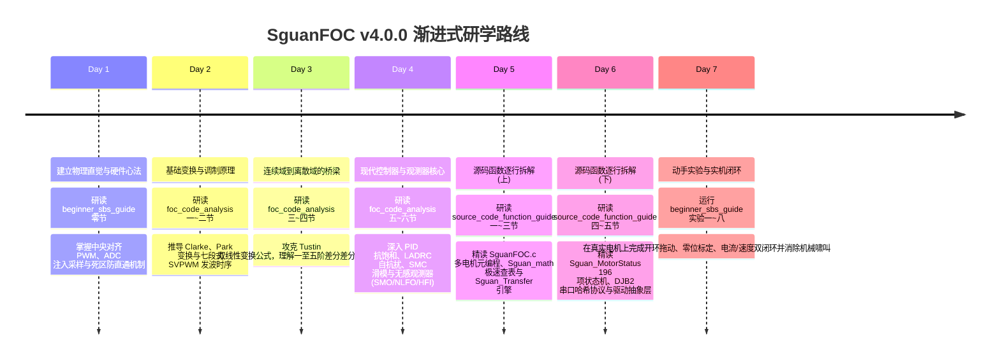

# SguanFOC v4.0.0 教学中心全景索引与学习路线指南 (Master Walkthrough)

> 本文档是 **SguanFOC 库 v4.0.0 (高度自由模块化 FOC，终阶)** 教学中心的全局导航门户与全景总结索引。  
> 旨在帮助不同基础的开发者快速定位所需教学资源，建立从理论推导、架构剖析、逐行源码研读到动手实践的完整技术闭环。

---

## 一、教学文档矩阵架构

教学文档全套放置在项目根目录下的 [`commit/`](.) 文件夹中，分为四大核心篇章：

```
SguanFOC_Library/commit/
├── 📖 foc_code_analysis.md          (系统架构与核心算法全景深度解析)
├── 🔬 source_code_function_guide.md (核心源码函数级逐行深度解析教学指南)
├── 💻 code_walkthrough.html         (源码逐行双屏联动交互剖析工作台)
├── 🎯 dual_motor_gimbal_guide.md    (单 MCU 双电机二维云台实战开发指南)
├── 🛠️ beginner_sbs_guide.md         (初学者手把手实操与源码调试指南)
├── 📝 walkthrough.md                (本篇：教学中心导航与学习路线图)
├── ⚙️ build_docs.bat                (一键 Pandoc HTML 网页构建脚本)
├── 🎨 header.html / navbar.html     (离线网页高颜值样式与导航组件)
└── 🌐                     (纯本地离线交互式 HTML 教学网站输出目录)
```

### 6 大核心教学文件职责定位

| 文档名称 | 核心内容与教学定位 | 适合阅读阶段 | 对应网页版 |
| :--- | :--- | :---: | :---: |
| [**`foc_code_analysis.md`**](foc_code_analysis.md) | **架构与算法全景深度解析**：FOC 物理本质、Clarke/Park 变换推导、SVPWM 七段式空间矢量调制原理、Tustin 双线性离散化引擎公式、PID/LADRC/SMC/DPCC 控制算法、全速域无感观测器全家桶 (SMO/NLFO/VCFO/HFI/EKF)、数字滤波器族及 196 项有限状态机原理。 | **第一阶段：建立全景理论认知** | [📖 网页精读](foc_code_analysis.html) |
| [**`source_code_function_guide.md`**](source_code_function_guide.md) | **核心源码函数级逐行深度解析**：跳过模糊概念，全面覆盖库中**每一个文件、每一个结构体、每一个函数**。详细剖析入参出参、数学实现逻辑、调用链、优化技巧与硬件避坑细节。 | **第二阶段：源码级精雕细琢** | [🔬 网页精读](source_code_function_guide.html) |
| [**`code_walkthrough.html`**](code_walkthrough.html) | **双屏联动源码精读工作台**：左侧原生代码高亮行号、右侧教学提示与数学推导卡片同步联动，支持动态 Bézier 曲线引导、字号缩放、双向跳转与 11 大核心文件矩阵切换。 | **第二阶段：双屏沉浸式研读** | [💻 交互工作台](code_walkthrough.html) |
| [**`dual_motor_gimbal_guide.md`**](dual_motor_gimbal_guide.md) | **单 MCU 双电机二维云台开发指南**：CH32V208、CH32V305 与 CH32V407 硬件特性选型横评、高级定时器与驱动芯片深度澄清、两轴三闭环控制链路、硬件拓扑与 SguanFOC 双电机代码配置落地。 | **第二阶段：多电机与工程实战** | [🎯 网页精读](dual_motor_gimbal_guide.html) |
| [**`beginner_sbs_guide.md`**](beginner_sbs_guide.md) | **初学者手把手实操指南**：嵌入式 C 语言与硬件定时器/ADC 注入触发心法、低侧采样避坑、8 个循序渐进的动手实战实验（从开环强拖、零位标定、电流闭环，到机械共振消除与串口自定义指令添加）以及常见疑难排查 (FAQ)。 | **第三阶段：动手实验与上机调试** | [🛠️ 网页精读](beginner_sbs_guide.html) |
| [**`walkthrough.md`**](walkthrough.md) | **教学中心导航与学习路线**：7 天渐进式学习路线图、模块架构速查表与一键构建指南。 | **全程查阅与规划指导** | [📝 网页精读](walkthrough.html) |

---

## 二、7 天从零到精通渐进式学习规划 (Study Roadmap)

为避免初学者面对复杂的数学公式与庞大代码库感到无从下手，推荐按照以下循序渐进的节奏进行研读：



---

## 三、HTML 教学网站离线一键构建说明

本项目配备了完整的离线网页交互式学习系统：

1. **纯本地离线运行**：所有 KaTeX 数学公式排版引擎、Mermaid 动态矢量图表引擎与 WOFF2 字体均保存在 `commit/assets/` 中，断网环境下直接双击打开毫无阻塞！
2. **一键转换脚本**：
   在终端或文件管理器中双击运行 [`commit/build_docs.bat`](build_docs.bat)：
   ```cmd
   cd commit
   build_docs.bat
   ```
   脚本将自动调用 Pandoc，将全套 Markdown 文档编译为带有顶级导航条、侧边栏自适应目录、代码复制按钮、彩色 GitHub Alert 警示卡片的美观离线 HTML 网页，存放在 `commit/` 目录下。

---

## 四、核心算法与源码速查索引

* **多电机 X-Macro 元编程**：[`SguanFOC.c#L15-L69`](../SguanFOC库v4.0.0(高度自由模块化foc，终阶)/SguanFOC.c)
* **512 点快速正弦与 91 点插值反正切**：[`Sguan_math.c#L7-L214`](../SguanFOC库v4.0.0(高度自由模块化foc，终阶)/Sguan_math.c)
* **Q31 / Q15 跨基准饱和加减乘除**：[`Sguan_IQmath.c#L27-L177`](../SguanFOC库v4.0.0(高度自由模块化foc，终阶)/Sguan_IQmath.c)
* **一至五阶双线性离散化传递函数引擎**：[`Sguan_Transfer.c#L15-L347`](../SguanFOC库v4.0.0(高度自由模块化foc，终阶)/Sguan_Transfer.c)
* **消除机械共振的陷波滤波器 (Nf)**：[`Sguan_Transfer.c#L1187-L1247`](../SguanFOC库v4.0.0(高度自由模块化foc，终阶)/Sguan_Transfer.c)
* **196 项有限状态机转移表与多重故障保护**：[`Sguan_MotorStatus.c#L104-L866`](../SguanFOC库v4.0.0(高度自由模块化foc，终阶)/Sguan_MotorStatus.c)
* **DJB2 极速字符串哈希串口协议**：[`Sguan_printf.c#L27-L126`](../SguanFOC库v4.0.0(高度自由模块化foc，终阶)/Sguan_printf.c)
* **硬件抽象与三相定时器 PWM 写入**：[`UserData_Driver.c#L21-L417`](../SguanFOC库v4.0.0(高度自由模块化foc，终阶)/UserData_Driver.c)
